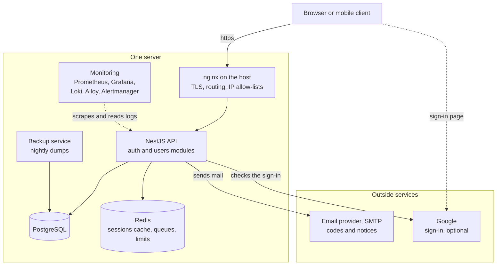
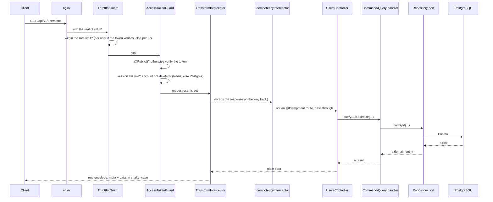
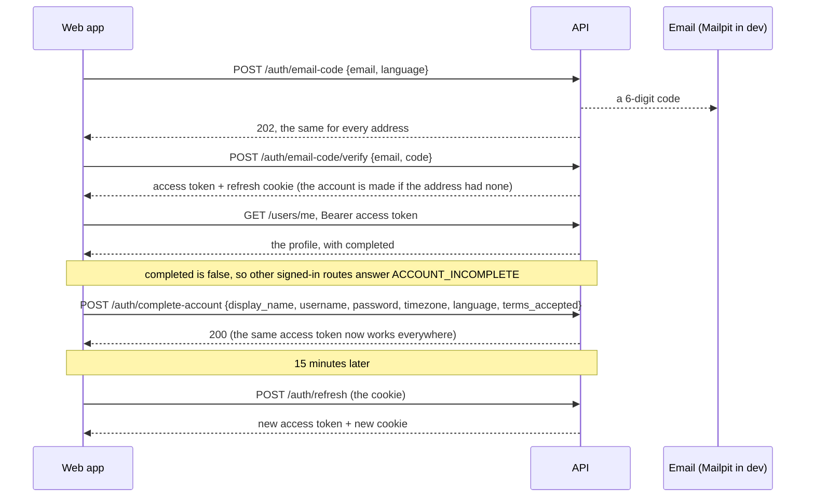
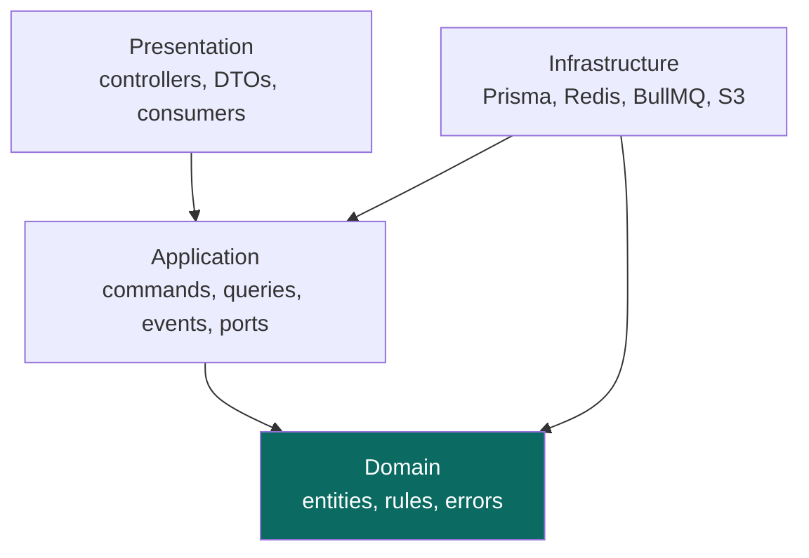
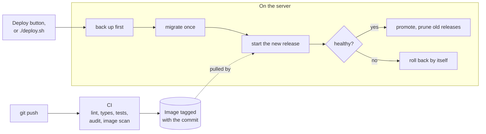

# A tour of the starter

Read this once and you will know what is in this repository, how the pieces
fit, and where to look for anything. It links out rather than repeating: each
section ends with the page that goes deep.

If you are impatient: [GETTING_STARTED.md](./GETTING_STARTED.md) has it
running in about ten minutes, and you can come back.

- [What this is](#what-this-is)
- [Is it the right starting point for you?](#is-it-the-right-starting-point-for-you)
- [What actually runs](#what-actually-runs)
- [The life of one request](#the-life-of-one-request)
- [How signing in works](#how-signing-in-works)
- [How the code is arranged](#how-the-code-is-arranged)
- [What is already handled for you](#what-is-already-handled-for-you)
- [The operational half](#the-operational-half)
- [Where things live](#where-things-live)
- [Doing the usual things](#doing-the-usual-things)
- [The decisions, and why](#the-decisions-and-why)
- [What this is not](#what-this-is-not)
- [A reading order](#a-reading-order)

## What this is

A NestJS API you could put in front of real users this week.

`nest new` gives you a web framework. Everything between that and a service
you would trust on a Friday afternoon (the authentication, the rate limiting,
the database migrations, the health checks, the backups, the alerting, the
deploys that roll themselves back) is the part that takes months, and it is
the part that is already here.

Concretely, what you get on top of Nest:

| | |
| --- | --- |
| **Sign-in you own** | Emailed codes (one flow for sign-up and sign-in) and passwords, sessions with a refresh cookie, Google sign-in, rate limits. No identity server to run |
| **An architecture that survives growth** | Hexagonal layers and CQRS, with two worked modules: `users`, and the larger `auth` |
| **The safety net** | Rate limiting, idempotency, request timeouts, graceful shutdown, a two-layer cache |
| **The boring necessities** | Postgres and Prisma, Redis, background jobs, file uploads with image processing, email |
| **Eyes on it** | Metrics, logs, dashboards, alerts to Discord, optional error tracking |
| **A way to ship it** | CI, a published image, one-command deploys with automatic rollback, tested backups |

The paired [React starter](https://github.com/StoriuSs/React-Starter-No-Keycloak) is the
other half: every sign-in screen, settings, and the profile pages. Either runs
without the other.

## Is it the right starting point for you?

**Yes, if** you are building a JSON API for a web or mobile client, you want
users to sign in, you expect it to be maintained for years, and you would
rather spend your first month on your product than on plumbing.

**Probably not, if:**

- **You want to render HTML on the server.** This returns JSON. Next.js or
  Nest with a view engine is a better fit.
- **You want serverless.** This assumes a long-running process with a
  connection pool, an in-process cache and background workers. None of that
  suits a function that starts and stops per request.
- **You need SAML, LDAP, many social logins, or an admin console for support
  staff.** Sign-in here is an emailed code, a password and Google, written into the
  app ([docs/auth/](./docs/auth/README.md)). Use the
  [Keycloak starter](https://github.com/StoriuSs/nest-starter-hexagonal), the
  same stack with an identity server beside it.
- **It is a weekend project you will not deploy.** Half of what is here is for
  running the thing in production. That half will just be in your way.

## What actually runs

On a server, `docker-compose.prod.yaml` runs this, with nginx installed on the
host in front of it:



Twelve containers in production, which sounds like a lot until you count what
they are: **four are the application and its data** (the API, Postgres, Redis,
backups) and the other **eight exist only to watch those four**.

If that ratio bothers you, it is one setting. Grafana Cloud takes the metrics
and logs instead, leaving only Alloy to ship them, and eight containers total:

```bash
MONITORING=grafana-cloud
# plus the endpoints and token Grafana Cloud gives you; compose refuses
# to start without them rather than starting blind
```

Only one outside service is required: **an email provider**, because signing
up, signing in by code and password reset all email a code. Google sign-in is
off until you set its keys; S3 storage, Sentry and Grafana Cloud are optional
too.
[docs/setup/README.md](./docs/setup/README.md) lists every one, with the steps
to get its keys.

**In development**, `pnpm docker:dev` runs the same app, database, Redis and
monitoring on your machine, without nginx and the backup service, and adds
**Mailpit**: an inbox that catches every email the app sends, so the sign-in
codes land there and nothing is delivered for real. The tests add **RustFS**
(S3 without an AWS account). So the email and S3 paths can be built and tested
with nothing to sign up for.

→ [docker.md](./docs/docker.md) for what each file does ·
[monitoring.md](./docs/monitoring.md) for the two modes

## The life of one request

This is the diagram worth understanding. Everything else is detail.



Four things in that picture explain most of the design:

1. **The throttler runs before authentication.** The other way round, the auth
   guard throws on a missing token and anonymous traffic is never rate-limited
   at all, which is the traffic a rate limiter exists for.
2. **The guard checks the session, not just the token.** A signature proves
   the token was issued; one Redis read proves the session behind it has not
   ended since. That is why signing out, changing a password, or deleting an
   account takes effect on the very next request.
3. **The controller does no work.** It hands a command or query to a handler.
4. **Nothing builds the response envelope by hand.** Every success goes through
   one interceptor and every failure through one filter, so the shape cannot
   drift between routes.

→ [auth/sessions-and-tokens.md](./docs/auth/sessions-and-tokens.md) ·
[rate-limit.md](./docs/rate-limit.md) ·
[BACKEND_RESPONSE_HANDLING.md](./docs/BACKEND_RESPONSE_HANDLING.md)

## How signing in works

Two tokens do the work. The **access token** is a short-lived signed note
(15 minutes) that the client sends as `Authorization: Bearer` on every request.
The **refresh token** is a long-lived secret in an `httpOnly` cookie, a cookie
that page scripts cannot read, so a script injected into the web app cannot
steal it. When the access token expires, the web app swaps the cookie for a new
pair.



The rest builds on that: Google sign-in ends in the same two tokens, and every
sign-in route has its own rate limits.
[docs/auth/flows.md](./docs/auth/flows.md) has each flow step by step;
[docs/auth/concepts.md](./docs/auth/concepts.md) explains the terms if they
are new.

## How the code is arranged

Two ideas, and they are simpler than their names.

### Hexagonal architecture: the database is a detail

Business rules sit in the middle and know nothing about Postgres, Redis,
S3 or HTTP. They talk to **ports** (interfaces) and the outside world
plugs **adapters** into them.



Every arrow is "depends on", and they all point **inwards**. The domain
depends on nothing. That one rule is what makes the business logic testable
without a database and swappable without a rewrite.

### CQRS: one file per thing the app can do

Instead of a `UsersService` that grows to a thousand lines, each operation is
its own small handler:

```
application/commands/update-profile/update-profile.handler.ts
application/commands/upload-avatar/upload-avatar.handler.ts
application/queries/check-username/check-username.handler.ts
```

**Commands** change data, **queries** read it, and **events** are how one
thing that happened causes others without the first one knowing. Deleting an
account publishes `AccountDeletedEvent`; a handler in the users module queues
the avatar clean-up, and one in the auth module ends every session. The delete
handler knows about neither.

### The two modules

`src/modules/users/` is the small worked example. Every layer, filled in:

```
users/
├── domain/                     # Knows nothing about anything
│   ├── entities/user.entity.ts
│   ├── errors/                 # UsernameTakenError, and friends
│   ├── ports/user.repository.port.ts
│   ├── username.rules.ts       # The pattern and why it is that narrow
│   ├── profile-text.rules.ts   # Display name and bio, counted in characters, not UTF-16 units
│   └── user-settings.rules.ts  # Theme, language, switches; the time zone once every 24 hours
├── application/                # What the app can do
│   ├── commands/               # One folder per operation
│   ├── queries/
│   ├── events/                 # Published, plus the handlers that listen
│   └── ports/                  # storage, background jobs, user directory
├── infrastructure/             # The outside world, plugged in
│   ├── persistence/prisma-user.repository.ts
│   ├── adapters/               # uploads, BullMQ, the user directory for auth
│   └── mappers/user.mapper.ts  # Database row ⇄ domain entity
├── presentation/               # The edge
│   ├── http/                   # Controller and DTOs, one class per file
│   └── consumers/              # Queue workers
├── index.ts                    # What other modules may import
└── users.module.ts             # Which adapter fills which port
```

`src/modules/auth/` is the same shape at a larger scale, and the example to
read when your module talks to several outside systems:

```
auth/
├── domain/                     # Errors, repository ports, the password policy, reading a user agent, masking an IP
├── application/
│   ├── commands/               # send-email-code, verify-email-code, complete-account, login, refresh, revoke-session, revoke-other-sessions, delete-own-account, finish-oauth, ...
│   ├── queries/                # sign-in methods, sign-in options, list sessions
│   ├── events/handlers/        # Reacting to the users module's events
│   ├── services/               # Shared steps: issue a session, check a code, the limits
│   ├── ports/                  # Hasher, tokens, OIDC, mailer, rate limits, ...
│   └── rate-limits.ts          # Every sign-in limit, in one table
├── infrastructure/
│   ├── adapters/               # Argon2, jose (JWT), openid-client, Redis, BullMQ, Prometheus
│   └── persistence/            # The Prisma repositories
├── presentation/
│   ├── http/                   # The /auth routes in five controllers, by topic; DTOs
│   ├── guards/                 # AccessTokenGuard, global
│   └── consumers/              # Sends the emails, runs the hourly clean-up
└── auth.module.ts
```

The auth module imports only what the users module publishes in its
`index.ts` — the `USER_DIRECTORY` port, the events it reacts to, the
deletion command: the way two modules talk without importing each other's
insides, and an ESLint rule keeps it that way. [docs/auth/in-the-code.md](./docs/auth/in-the-code.md) maps
it file by file.

Copy that shape for your own modules. There is a step-by-step in
[adding-a-module.md](./docs/adding-a-module.md).

→ [hexagonal-architecture.md](./docs/hexagonal-architecture.md) ·
[cqrs-guide.md](./docs/cqrs-guide.md)

## What is already handled for you

The cross-cutting things, mostly in `src/shared/`, and authentication in its
own module. You inherit these without writing anything.

| | What it does for you | Where |
| --- | --- | --- |
| **Authentication** | Sign-up and sign-in by an emailed code (one flow), a "complete your account" step (username, password, time zone, language, Terms) that gates every other signed-in route (`ACCOUNT_INCOMPLETE`, `@AllowIncomplete()`), sign-in with a password, password reset and change. Short access tokens, a rotating refresh cookie that notices when it was stolen, revocation on the next request. Google sign-in, account deletion with the password (`POST /auth/account/delete`). Emails in Vietnamese or English. `@Public()`, `@Roles()`, `@CurrentUser()`. CLI: `pnpm user:promote` | `src/modules/auth/` · [docs/auth/](./docs/auth/README.md) |
| **Rate limiting** | A per-route limit on every route, per user when the request has a valid access token and per IP otherwise (D-135), counted in Redis so the limit is the limit across every instance. On top, the sign-in routes count per address, per IP and per account (`rl:*` keys) | [rate-limit.md](./docs/rate-limit.md) · [auth/rate-limits.md](./docs/auth/rate-limits.md) |
| **Idempotency** | A retried payment or a double-tapped button does the work once. `@Idempotent('1h')` on the route | [idempotency.md](./docs/idempotency.md) |
| **Caching** | Two layers, memory in front of Redis, with a clear rule about which state may use which | [cache.md](./docs/cache.md) |
| **Responses** | One envelope for every success and every error, `camelCase` in the code and `snake_case` on the wire | [BACKEND_RESPONSE_HANDLING.md](./docs/BACKEND_RESPONSE_HANDLING.md) |
| **Validation** | Unknown fields rejected, failures returned as a 422 naming every bad field, nested ones included | [common-utilities.md](./docs/common-utilities.md#pipes) |
| **File uploads** | Size and type enforced while streaming, images converted to WebP with metadata stripped, a concurrency cap so uploads cannot exhaust memory | [upload-module.md](./docs/upload-module.md) |
| **Background jobs** | BullMQ, with retry policies chosen rather than defaulted, and schedules held in Redis so they fire once across instances | [BULLMQ-GUIDE.md](./docs/BULLMQ-GUIDE.md) |
| **Database** | Prisma with migrations, soft delete, a pool that closes properly on shutdown | [prisma-module.md](./docs/prisma-module.md) |
| **Email** | Handlebars templates over plain SMTP, sent from a queue. No provider is named anywhere, so any of them works | [core-infrastructure.md](./docs/core-infrastructure.md#email) |
| **Logging** | Structured JSON, one line per request, a `request_id` tying everything together, secrets and codes redacted | [logging.md](./docs/logging.md) |
| **Metrics** | Prometheus, recorded on the matched route so one series does not become a million; sign-in events counted too | [monitoring.md](./docs/monitoring.md) |
| **Health** | Three probes for three different askers: Docker, a load balancer, a human | [core-infrastructure.md](./docs/core-infrastructure.md#health-checks) |
| **Shutdown** | In-flight requests finish, connections close in the right order, the process exits on its own | [graceful-shutdown.md](./docs/graceful-shutdown.md) |
| **API contract** | OpenAPI generated from the code and committed, so a changed response shape shows up in a diff | [openapi.md](./docs/openapi.md) |

Most of these entries exist because the naive version was wrong in a way that
only shows up in production. The pages say which way.

## The operational half

Roughly half of this repository is about running the thing rather than writing
it.



| | | |
| --- | --- | --- |
| **CI** | Lint, types, unit, e2e and integration tests, a dependency audit, a container scan, and an image tagged with the commit | [ci.md](./docs/ci.md) |
| **Deploys** | One image per commit. Migrations run once, health is checked, and a release that does not come up healthy is rolled back without you | [deploy.md](./docs/deploy.md) |
| **Backups** | Nightly dumps, read back to prove they are readable, copied off the server, with a restore script that has a `verify` mode | [backups.md](./docs/backups.md) |
| **Alerts** | About thirty rules, to Discord, Slack or Teams. Tested with `promtool`, so the rules themselves have tests | [alerts.md](./docs/alerts.md) |
| **Dashboards** | Six of them, self-hosted or Grafana Cloud, switched with one variable | [monitoring.md](./docs/monitoring.md) |
| **Error tracking** | Sentry, off unless you set a key, with the request body scrubbed | [error-tracking.md](./docs/error-tracking.md) |
| **Load testing** | k6 scripts to find the ceiling before your users do | [load-testing.md](./docs/load-testing.md) |
| **Dependencies** | Renovate, grouped weekly, majors held behind your approval | [renovate.md](./docs/renovate.md) |
| **The server itself** | Security updates, fail2ban, swap, the firewall, nginx and TLS | [server.md](./docs/server.md) |

When one box is no longer enough: [scaling.md](./docs/scaling.md) covers moving
Postgres, uploads, Redis and monitoring off it, in the order that pays.

## Where things live

```
├── src/
│   ├── main.ts                 # Bootstrap: pipes, filters, versioning, Swagger
│   ├── app.module.ts           # Global guards and interceptors, in order
│   ├── config/                 # One file per area + the Joi schema
│   ├── health/                 # The three probes
│   ├── modules/auth/           # Sign-in, sessions, Google, account deletion
│   ├── modules/users/          # Profiles, usernames, avatars, settings, deletion
│   ├── shared/                 # Everything cross-cutting
│   └── bootstrap/              # Scripts: env check, OpenAPI export, user roles, cloud sync
├── prisma/                     # Schema (models/auth.prisma, models/users.prisma) and migrations
├── test/                       # e2e and integration suites
├── k6/                         # Load-test scripts
├── monitoring/                 # Prometheus, Loki, Alloy, Grafana, Alertmanager
├── backup/                     # The backup service and restore.sh
├── nginx/                      # Host nginx template and its bootstrap script
├── deploy.sh                   # Releases, rollback, history
└── docker-compose.{dev,prod}.yaml
```

Where to go for a given change:

| You want to change | Look in |
| --- | --- |
| A setting, or add one | `src/config/`: the `*.config.ts` that reads it **and** `validation.ts` |
| What the database holds | `prisma/models/`, then `pnpm prisma:migrate` |
| Who can reach a route | The decorators on it: `@Public()`, `@Roles()` |
| How sign-in behaves | `src/modules/auth/`, and the settings in `src/config/auth.config.ts` |
| What happens on a request, everywhere | `src/app.module.ts` |
| Rate limits, timeouts, upload limits | `.env.example` documents every one; the sign-in limits are in `src/modules/auth/application/rate-limits.ts` |
| An email's text | The module's `infrastructure/email/templates/`; auth keeps its words in `src/modules/auth/infrastructure/email/email-copy.ts` (per language) and one layout in `templates/email.hbs` |
| A job that runs on a schedule | `src/maintenance/maintenance-tasks.ts` |
| An alert rule or a dashboard | `monitoring/` |

## Doing the usual things

| I want to… | Start here |
| --- | --- |
| Add an endpoint to an existing module | A DTO, a controller method, a handler: [adding-a-module.md](./docs/adding-a-module.md#adding-one-operation) |
| Add a whole feature | [adding-a-module.md](./docs/adding-a-module.md) |
| Add a configuration setting | [environment.md](./docs/environment.md#adding-a-variable): two files, and a test fails if you miss one |
| Turn on Google sign-in | [setup/google-sign-in.md](./docs/setup/google-sign-in.md) |
| Make someone an administrator | `pnpm user:promote <email>`: [auth/accounts.md](./docs/auth/accounts.md) |
| Change the database | [prisma-module.md](./docs/prisma-module.md) |
| Run something in the background | [BULLMQ-GUIDE.md](./docs/BULLMQ-GUIDE.md) |
| Send an email | [core-infrastructure.md](./docs/core-infrastructure.md#email): Mailpit catches it in development |
| Store a file | [file-uploads-and-s3.md](./docs/file-uploads-and-s3.md) |
| Make a route safe to retry | [idempotency.md](./docs/idempotency.md) |
| Write a test | [testing.md](./docs/testing.md) |
| Put it on the internet | [setup/prepare-for-production.md](./docs/setup/prepare-for-production.md), then [deployment-guide.md](./docs/deployment-guide.md) |
| Find out why production is slow | [monitoring.md](./docs/monitoring.md), then [logging.md](./docs/logging.md) |

## The decisions, and why

A starter is a pile of decisions. These are the ones you would otherwise have
to reverse-engineer.

**Authentication the application owns, rather than an identity server.** This
starter is the sibling of the Keycloak one, for projects that would rather not
run a second server with its own database, admin console and upgrade cycle. The
cost is real: password hashing, reset flows, emailed codes, Google
sign-in and session management are code in this repository,
and the CVEs become yours. It is the right trade when you want one deployable
and a sign-in page you control, and the wrong one when you need SAML, LDAP or
an admin console for support staff. See
[docs/auth/security.md](./docs/auth/security.md) for what it defends against,
and what it does not.

**Hexagonal and CQRS, for a starter with two modules.** It looks like a lot of
folders for two features, and it is. The point is that the third, fifth and
twentieth feature go in the same shape, and by then a `UsersService` would have
been a thousand lines nobody wants to open. Learn it on the modules that are
already here.

**`snake_case` on the wire, `camelCase` in the code.** Both conventions are
defensible; having two of them inside one system is not. Conversion happens at
the edge, in one place, and the OpenAPI document is generated from the real
thing so the two cannot drift.

**One envelope for every response.** A client writes the unwrapping once.
Errors carry a machine-readable `type` rather than a sentence, which is what
lets the frontend translate them.

**503 is never sent to error tracking.** It means "a dependency is down or I am
at capacity", something the alerts already tell you, in one message rather
than ten thousand events.

**The session check skips the memory layer.** One instance cannot invalidate
another's memory, so a signed-out session would keep working elsewhere.
Anything that must be the same on every instance lives in Redis only.

**No in-process cron.** A schedule in the process fires on every instance; a
BullMQ job scheduler lives in Redis and fires once. The starter runs one
instance today and will not need rewriting when it runs three.

**Committed OpenAPI.** Generated, not written, and checked in CI. A changed
response shape appears in a pull request diff like any other change.

→ [LESSONS.md](./docs/LESSONS.md) is the longer version: things that went wrong and
what was changed as a result.

## What this is not

Deliberately absent, with a page explaining what each would take:

- Audit logging, feature flags, distributed tracing, circuit breakers, a
  transactional outbox, websockets → [extensions.md](./docs/extensions.md)
- Passkeys (WebAuthn), a device list, more social providers → the auth module
  is built to take them; [docs/auth/in-the-code.md](./docs/auth/in-the-code.md)
  says where
- Multi-tenancy, GraphQL, a microservice split: out of scope, and each would
  change the shape of everything above.
- Horizontal scaling **today**: the design is ready for it and
  [scaling.md](./docs/scaling.md) is the path, but the compose files run one
  instance.

## A reading order

**If you just want it running:** [GETTING_STARTED.md](./GETTING_STARTED.md),
then come back. For the full setup with every optional service,
[setup/prepare-for-development.md](./docs/setup/prepare-for-development.md).

**Once it runs and you are starting a real project:**
[making-it-yours.md](./docs/making-it-yours.md), the renaming pass, worth
doing before Docker has created volumes named after this starter.

**If you are new to this stack**, in this order:

1. [hexagonal-architecture.md](./docs/hexagonal-architecture.md): why the folders
2. [cqrs-guide.md](./docs/cqrs-guide.md): commands, queries, events
3. [auth/concepts.md](./docs/auth/concepts.md) and
   [auth/README.md](./docs/auth/README.md): how a request becomes a user
4. [BACKEND_RESPONSE_HANDLING.md](./docs/BACKEND_RESPONSE_HANDLING.md): the envelope
5. [prisma-module.md](./docs/prisma-module.md): the database
6. [adding-a-module.md](./docs/adding-a-module.md): now build something

**If you are experienced and just want the map:** this page, then
[common-utilities.md](./docs/common-utilities.md) for what is already in the shared
layer, then read `src/modules/users/` end to end. It is about 1,700 lines
without its tests, and it shows every pattern the repository uses.
`src/modules/auth/` is the same patterns at full size.

**Before you deploy anything:**
[setup/prepare-for-production.md](./docs/setup/prepare-for-production.md),
[deployment-guide.md](./docs/deployment-guide.md) and [server.md](./docs/server.md).

**When you are on call:** [monitoring.md](./docs/monitoring.md),
[logging.md](./docs/logging.md), [alerts.md](./docs/alerts.md),
[backups.md](./docs/backups.md), [auth/operations.md](./docs/auth/operations.md).
