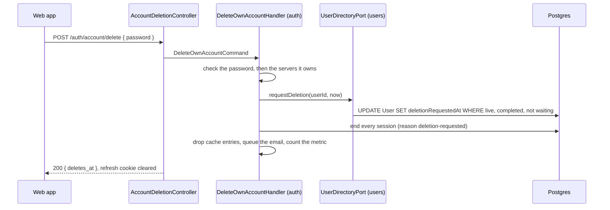

# Account deletion

How "delete my account" works, step by step: what the person must prove, how
the 14-day wait works, how the account is restored, what is removed and when,
and what happens if a step fails. Read it before you add tables that point to
users, when someone asks "what do you keep after I delete my account?", or when
you change the deletion or restore dialogs in the web app.

**NezFocus differs from the starter here, on purpose** (D-141, REQ-AUTH-09).
The starter deletes the account at once and erases its personal data 30 days
later (`DELETED_ACCOUNT_RETENTION_DAYS`). NezFocus waits 14 days on a live
account, so that signing in again finds the same account and can restore it,
and erases everything at the moment of deletion. The variable is gone.

For where deletion fits in an account's life (sign-up, completion, sign-in
methods, roles), start with [auth/accounts.md](auth/accounts.md). This page is
the deep one.

- [In short](#in-short)
- [Proving it is the owner](#proving-it-is-the-owner)
- [Asking to delete: what runs, in order](#asking-to-delete-what-runs-in-order)
- [While the account waits](#while-the-account-waits)
- [Restoring the account](#restoring-the-account)
- [The deletion sweep](#the-deletion-sweep)
- [What is removed, and when](#what-is-removed-and-when)
- [Why the row is kept](#why-the-row-is-kept)
- [The clean-up safety net](#the-clean-up-safety-net)
- [Errors](#errors)
- [Limits](#limits)
- [The web app's side](#the-web-apps-side)
- [Edge cases](#edge-cases)
- [What happens to the username](#what-happens-to-the-username)
- [The files involved](#the-files-involved)

## In short

1. The signed-in person calls `POST /api/v1/auth/account/delete` with their
   password. An Owner of servers with other members hands them over first.
2. Nothing is deleted yet. `User.deletionRequestedAt` is set, every session
   ends (this device's too, and its refresh cookie is cleared), and the owner
   is emailed the date the account goes. The answer carries that date,
   `deletes_at`, 14 days later.
3. For 14 days the account stays live: its email, username, password and
   Google link are all kept. Signing in again (password, code or Google) finds
   it. It can then read its profile and call `POST /api/v1/auth/account/restore`,
   and nothing else, until it is restored.
4. Once the 14 days are over, the 15-minute sweep deletes it: marks the row
   deleted and erases its email, username, display name, bio, avatar key and
   settings in the same statement, then ends its sessions and removes its
   password, Google links and avatar file.
5. The row itself stays, empty, so that anything pointing to it keeps working.

The same sweep also deletes accounts left incomplete 14 days after they were
made (REQ-AUTH-01): sign-ups that never did "complete your account".

## Proving it is the owner

A signed-in session alone is not enough: anyone at an unlocked computer could
otherwise delete the account. The API asks for the current password, and
nothing else:

| Body field | Required | What it is |
|---|---|---|
| `password` | yes, in practice | the current password |
| `language` | no | `vi` or `en`, the page's language, for the email (D-132) |

```json
{ "password": "correct horse battery staple", "language": "vi" }
```

If the password is missing, or the account has none, the answer is
400 `AUTH_CONFIRMATION_REQUIRED` with `{ "needs": ["password"] }`.

**An account that is not completed** cannot ask: like every signed-in route
but three, this one answers 403 `ACCOUNT_INCOMPLETE` until "complete your
account" is done ([auth/accounts.md](./auth/accounts.md#completing-the-account)).
It does not need to: the sweep deletes it after 14 days anyway. Every account
sets a password when it is completed (D-61, D-130).

**A completed account without a password** (only one marked completed by
migration `20261106000000_codes_by_email`, before the step existed) has no
proof to give. It chooses a password first with "forgot password"
(`POST /auth/forgot-password`, then `POST /auth/reset-password`), then
deletes with it. `GET /auth/sign-in-methods` tells the page which case it is
(`password: false`).

**An Owner of servers with other members** is refused with 409
`OWNERSHIP_TRANSFER_REQUIRED` until they hand those servers over (D-76).
`data.servers` lists them, `[{ "id", "name", "member_count" }]`, for the dialog
that says so. Servers arrive in M1; until then the `ServerOwnershipPort`
adapter (`NoServersYet`) answers an empty list, so nothing is blocked.

## Asking to delete: what runs, in order

The request stays inside the auth module. It writes to the user only through
the users module's `UserDirectoryPort`, and publishes no event: nothing is
deleted yet.



1. **`AccountDeletionController.delete`** passes the password and the
   `language` to `DeleteOwnAccountCommand`.
2. **`DeleteOwnAccountHandler`** (auth) refuses a deleted account, asks for
   the password if none was sent or the account has none, and checks it,
   counting wrong answers against the [limits](#limits).
3. It asks **`ServerOwnershipPort.serversBlockingDeletion`** for servers the
   account owns that have other members. Any at all: 409
   `OWNERSHIP_TRANSFER_REQUIRED`, and nothing has changed.
4. **`UserDirectoryPort.requestDeletion`** records the time. It is one
   conditional statement: it matches only a live, completed account that is
   not already waiting. Of two requests at once, one records it; the other
   gets 403 `AUTH_ACCOUNT_DISABLED` (its session is being ended anyway).
5. The wrong-password counter is reset, and **every session ends** with the
   revoke reason `deletion-requested`. Then the cached sessions and the cached
   user are dropped, and the email is queued: job `account-deletion-scheduled`,
   "Your {app} account will be deleted on dd/mm/yyyy", the date written in the
   account's time zone, with a button to `FRONTEND_URL/login` where restoring
   starts. `auth_events_total{event="account_deleted"}` is counted now, at the
   request.
6. The controller clears the refresh cookie and answers 200, "Account will be
   deleted", with `data: { "deletes_at": "<ISO date>" }` (the request time plus
   14 days, `DELETION_WAIT_MS`).

The access token this device still holds stops working on its next request:
401 `AUTH_TOKEN_REVOKED`, reason `account_deleted`.

## While the account waits

The account is live (`deletedAt` is null), so everything that finds an
account by address or username keeps finding it:

- **Signing in** with the password, an emailed code or Google reaches the same
  account, never a new one. The password and the Google link were kept for
  exactly this.
- **The email and the username stay taken.** Nobody else can sign up with the
  address or pick the name.
- **The guard holds the account back.** `AccessTokenGuard` reads the user on
  every request anyway. If `deletionRequestedAt` is set, every signed-in route
  answers 403 `ACCOUNT_PENDING_DELETION` (403101, `data.deletes_at`), except
  the two marked `@AllowPendingDeletion()`:
  - `GET /api/v1/users/me`, which now carries `deletes_at` (null when the
    account is not waiting), so the client knows to offer the restore;
  - `POST /api/v1/auth/account/restore`.

  Public routes (refresh, logout, forgot password) work as usual. It is a 403,
  not a 401, because the session is fine and clients sign out on any 401.
- **Devices signed out by the request** find out why. Their refresh answers 401
  `AUTH_REFRESH_FAILED` with `data: { "reason": "account_deleted",
  "deletes_at": "..." }`, so the page can say "your account will be deleted on
  ...", and someone who did not ask can sign in and restore it in time. A
  signed-in route answers 401 `AUTH_TOKEN_REVOKED` with reason
  `account_deleted` (without the date).

## Restoring the account

`POST /api/v1/auth/account/restore`, signed in, no body. Signing in was the
proof: the dialog that offers it only shows to someone who just signed in.

**`RestoreAccountHandler`** calls `UserDirectoryPort.cancelDeletion`, a
conditional write that clears `deletionRequestedAt` only on a live account
that is waiting. Then it drops the cached user, so the next request passes the
guard, and counts `auth_events_total{event="account_restored"}`. The answer is
200, "Account restored", `data: null`.

- Restoring an account that is not waiting (another tab restored it a moment
  ago) is not an error: same answer, nothing counted.
- Restoring an account the sweep deleted first is: 403 `AUTH_ACCOUNT_DISABLED`.
  The sweep and the restore are both conditional writes on the same row, so
  only one can win.
- The sessions the request ended stay ended. Their refresh now answers
  reason `revoked` rather than `account_deleted`: nothing is being deleted any
  more, so the page should not say it is.
- No email is sent: restoring needs signing in, so the owner already knows.

## The deletion sweep

`SweepDeletedAccountsHandler` (users module) runs every 15 minutes, the
`deleted-accounts-sweep` entry in
[maintenance-tasks.ts](../src/maintenance/maintenance-tasks.ts), on the
`maintenance` queue. The schedule lives in Redis, so with several app
instances each run still happens once.

It deletes two kinds of account, worked out by `dueForDeletion(now)` in
[account-deletion.rules.ts](../src/modules/users/domain/account-deletion.rules.ts):

| Account | Due when | `deletedBy` | Email |
|---|---|---|---|
| Its owner asked to delete it | `deletionRequestedAt` is 14 days old (`DELETION_WAIT_MS`) | the user's own id | none (the one at the request said when) |
| Never completed | `createdAt` is 14 days old and `completedAt` still null (`INCOMPLETE_ACCOUNT_MS`) | null | none |

An abandoned sign-up holds only an address (and a name from Google). Coming
back with a code makes a new account, so nothing is lost.

`UserRepositoryPort.deleteDue` does the work in one transaction:

1. One `UPDATE "User"` whose `FROM` is a subquery selecting the due rows with
   `FOR UPDATE`, at most 200 a run (the next run takes the rest). It sets
   `deletedAt` and `deletedBy`, and sets `email`, `username`, `displayName`,
   `bio` and `avatarUrl` to null, in the same statement. It returns each id
   with the avatar key the row held.
2. It deletes those accounts' `UserSettings` rows (time zone and language are
   personal too).

The row lock is what settles the races. If a restore or a completion holds the
row, the sweep waits for it, reads the row again and skips it if it no longer
matches. If the sweep wins, the restore or completion finds the row deleted and
answers 403 `AUTH_ACCOUNT_DISABLED`. Running the sweep twice at once is also
safe: an account is deleted once, by the statement that locks it.

Then, for each account deleted, it publishes **`AccountDeletedEvent`**. The
handlers, run by the event bus in the same process right after:

- **`EndSessionsOfDeletedAccountHandler`** (auth): drops the cached copy of the
  user, ends every session still open (those made by signing in during the
  wait) with the reason `account-deleted` and drops their cache entries, then
  deletes the password (`Credential`) and the Google links (`OAuthAccount`).
- **`CleanupAccountAvatarHandler`** (users): queues the avatar file's removal on
  the `file-cleanup` queue. Without it, a deleted person's photo would stay
  publicly fetchable at a stable URL (local storage is served without auth).

It is an event, rather than one big transaction, so that the users module does
not depend on the auth module. If a handler fails, nothing is exposed: the
per-request check reads the user on every request and refuses a deleted one,
refresh does too, and [the safety net](#the-clean-up-safety-net) finishes the
work within the hour.

If you add tables holding personal data about a user (addresses, messages,
uploads), erase them in `deleteDue`, or in an `AccountDeletedEvent` handler of
your own.

## What is removed, and when

| When | What | By |
|---|---|---|
| In the request | `User.deletionRequestedAt` set; every session ended (reason `deletion-requested`) and dropped from the cache; the refresh cookie cleared in this browser; the email queued | `DeleteOwnAccountHandler`, `AccountDeletionController` |
| While waiting | Nothing. Email, username, password, Google links, avatar, settings all kept | |
| On restore | `deletionRequestedAt` cleared; sessions stay ended | `RestoreAccountHandler` |
| 14 days after the request, at the next 15-minute sweep | `deletedAt` and `deletedBy` set; `email`, `username`, `displayName`, `bio`, `avatarUrl` set to null; `UserSettings` deleted | `SweepDeletedAccountsHandler` |
| Moments after the sweep | Open sessions ended (reason `account-deleted`); password and Google links deleted | `EndSessionsOfDeletedAccountHandler` |
| Moments after the sweep | Avatar file queued for deletion | `CleanupAccountAvatarHandler` |
| Within the hour, only if the step above failed | The same session, password and link clean-up, with a warning in the log | hourly auth clean-up |
| A day after they stop working | Emailed codes (`VerificationCode` rows, keyed by address, not by account) | hourly auth clean-up |
| 7 days after the session ended | `Session` rows and all their refresh tokens | hourly auth clean-up |
| Never | The `User` row itself (id, roles, flags, dates, `deletedAt`, `deletedBy`), and rows in your own tables that point to it | |

Ended sessions are kept a week on purpose: a stolen refresh token presented in
that week is still recognised for what it is.

**Outside the database.** Backups made before the deletion still hold the
account until they age out (by default the last 7 daily and 4 weekly dumps; see
[backups.md](backups.md)), and so does any copy in your off-site bucket under its
own lifecycle rule. Logs hold user ids, not addresses. Say so in your privacy
policy.

Once the sweep has run, there is no undo: the data support would need to look
the account up is gone (the trade-off D-141 accepts). The 14 days are the
undo.

## Why the row is kept

Because your business data probably points to it. If a user posted a hundred
messages, deleting their row breaks the foreign keys, and you usually want
those messages to survive, attributed to an account that no longer has a person
behind it.

So the row stays and is marked deleted:

- `prisma/models/users.prisma` carries `deletedAt`, `deletedBy` and
  `deletionRequestedAt` (indexed, for the sweep).
- `PrismaUserRepository` filters `deletedAt: null` in every read **and** in
  `update`, so a deleted row is invisible to the rest of the application and
  cannot be changed by a caller holding a stale id.
- The auth module reads users through `UserDirectoryPort`, which also ignores
  deleted rows when looking up an address. Since the sweep erases the address
  anyway, it can register again at once afterwards. Coming back makes a
  **new** account (a new id), never the old one revived, whether by code or by
  Google (the Google link went with the old account). The old password no
  longer signs in: it was deleted. Within the 14 days, the same steps reach the
  old account instead. `test/integration/account-deletion.integration-spec.ts`
  shows both, against the real database.

There is no generic `SoftDeletableRepository` base class: the filtering is
explicit in `PrismaUserRepository`, where you can see it.

## The clean-up safety net

The event handlers run in memory. If the process dies between the sweep's
commit and handling the event (a deploy, a crash), the event is lost. The
account is still refused everywhere, but sessions made during the wait, the
password and the Google links would linger.

So the auth module's hourly clean-up (`CleanUpAuthHandler`, the `auth-clean-up`
schedule on the `maintenance` queue) also looks for leftovers of deleted accounts: it
ends their open sessions and deletes their passwords and Google links. When it
finds any, it logs a warning:

```
Ended 2 session(s), removed 1 password(s) and 0 provider link(s) of deleted accounts: an account deletion's event was not handled
```

That line means a deletion was interrupted; nothing was exposed meanwhile. The
avatar file has no such net: the row's key is already erased, so a lost event
leaves the file behind ([file-uploads-and-s3.md](file-uploads-and-s3.md)). The
same job removes sessions ended more than 7 days ago and codes that stopped
working more than a day ago, for every account.

## Errors

From `POST /api/v1/auth/account/delete`:

| Status | `meta.type` | Code | When | `data` |
|---|---|---|---|---|
| 400 | `AUTH_CONFIRMATION_REQUIRED` | 400108 | No password sent, or the account has none | `needs`: `["password"]` |
| 400 | `AUTH_CURRENT_PASSWORD_INVALID` | 400104 | Wrong password (400, not 401: clients treat any 401 as "signed out") | |
| 429 | `RATE_LIMIT_EXCEEDED` | 429001 | The limit below is used up | `reason`, and the `Retry-After` header |
| 409 | `OWNERSHIP_TRANSFER_REQUIRED` | 409101 | The account owns servers with other members (D-76) | `servers`: `[{ id, name, member_count }]` |
| 403 | `AUTH_ACCOUNT_DISABLED` | 403003 | Already deleted, or another request recorded the deletion a moment earlier | |
| 403 | `ACCOUNT_PENDING_DELETION` | 403101 | Already waiting to be deleted (signed in again, not restored) | `deletes_at` |
| 403 | `ACCOUNT_INCOMPLETE` | 403100 | The account is not completed | |
| 422 | `VALIDATION_ERROR` | 422000 | `language` not `vi` or `en`, an unknown field | per-field list |

From `POST /api/v1/auth/account/restore`:

| Status | `meta.type` | Code | When | `data` |
|---|---|---|---|---|
| 403 | `AUTH_ACCOUNT_DISABLED` | 403003 | The sweep deleted the account first | |
| 403 | `ACCOUNT_INCOMPLETE` | 403100 | The account is not completed (it cannot be waiting) | |

From every other signed-in route, while the account waits: 403
`ACCOUNT_PENDING_DELETION` (403101) with `deletes_at`.

Plus the usual signed-in errors (missing or expired access token) and
the global throttler. Every auth error: [auth/api-reference.md](auth/api-reference.md).

## Limits

The password counts against the same limit as when changing it, so the
deletion form is not a back door for guessing:

| Proof | Limit | `reason` on 429 |
|---|---|---|
| Password | `change-pw-fail`: 5 wrong per 15 minutes, per user (shared with change-password) | `wrong_password` |

The restore route has no limit of its own beyond the global throttler: it
needs a fresh sign-in, which is limited already. Details:
[auth/rate-limits.md](auth/rate-limits.md).

## The web app's side

NezFocus-Frontend builds all of it (M0, L14). Its
`docs/auth/account-settings.md` (section "Delete the account") and
`docs/auth/session.md` (section "An account waiting to be deleted") explain
each part; in short:

- **Asking.** The Account settings page (`/settings/account`) has a "Delete
  account" group. Its dialog
  (`src/features/auth/components/DeleteAccountDialog.tsx`) names the day the
  account goes and asks for the password, sent with the page's `language`
  (`deleteAccount` in `src/features/auth/api/auth.api.ts`, `withCredentials`,
  so the cookie-clearing `Set-Cookie` is applied). A wrong password shows
  under the field, a 429 is waited out, and "Forgot password?" emails a reset
  code and opens the change-password dialog on it. Once asked, the app signs
  out and the sign-in page's banner gives the day from `deletes_at`. The
  `OWNERSHIP_TRANSFER_REQUIRED` dialog waits for servers (M1).
- **Other devices.** A refused refresh with reason `account_deleted` and a
  `deletes_at` signs out to the same dated banner. Without `deletes_at` the
  account is gone, and a toast says so.
- **Signing in again.** A `deletes_at` in `GET /users/me`, or a 403
  `ACCOUNT_PENDING_DELETION` from any request, keeps the person on the
  sign-in page under a restore dialog
  (`src/features/auth/components/PendingDeletionDialog.tsx`). "Restore
  account" calls `POST /auth/account/restore` and goes on into the app; "Not
  now" calls `POST /auth/logout` and leaves the account waiting.
  `src/lib/api.ts` signs out on a 401, and on a 403 `AUTH_ACCOUNT_DISABLED`;
  `ACCOUNT_PENDING_DELETION` is not a sign-out.

## Edge cases

**Other devices.** The request ends every session at once, so the next request
from any other device is refused (401 `AUTH_TOKEN_REVOKED`, reason
`account_deleted`) and its refresh says until when the account can be
restored. A device that signs in again during the wait gets a new, working
session that can only restore. After a restore, the old devices stay signed
out, and their refresh reads reason `revoked`.

**A deleted account with a token still in a browser.** An access token stays
cryptographically valid until it expires, so the account must be refused on its
**next request**, not when the token runs out. The per-request check reads the
session and the user every time (from Redis, falling back to Postgres), so any
signed-in route answers 403 `AUTH_ACCOUNT_DISABLED` as soon as the event
handler has dropped the cached copy of the user. If that step failed, the
cached copy expires within 5 minutes anyway. A refresh answers 401
`AUTH_REFRESH_FAILED` with `data.reason: "account_deleted"` (no `deletes_at`:
it is gone). See [auth/sessions-and-tokens.md](auth/sessions-and-tokens.md).

**Restore against the sweep.** Both are conditional writes on the same row, and
the sweep locks it: exactly one wins. Restore second gets 403
`AUTH_ACCOUNT_DISABLED`; sweep second skips the row.

**Completion against the sweep.** An abandoned sign-up that completes in the
very minute the sweep takes it: the same lock decides. If the sweep wins,
"complete your account" answers 403 `AUTH_ACCOUNT_DISABLED` (not 409
`ACCOUNT_ALREADY_COMPLETE`, which would send the page into an account that is
gone).

**Two requests at once.** One records the time; the other gets 403
`AUTH_ACCOUNT_DISABLED`, and both devices are signed out by the first.

**Signing in with Google.** During the wait the Google link still exists, so
Google signs in to the waiting account. After the sweep the link is gone, so
the same Google person gets a new, empty account. See
[auth/google-sign-in.md](auth/google-sign-in.md).

**An upload in flight.** The avatar routes are closed while the account waits.
`replaceAvatar` matches only live rows, so an upload that lands after the
sweep changes nothing and removes its own file; the sweep returns the key the
row held under its lock, so that file is the one queued for deletion.

`test/integration/account-deletion.integration-spec.ts` covers the routes end to
end (the wait, other devices, signing in by password, code and Google, restore,
the username, after 14 days). The "deleting an account, 14 days later" block of
`test/integration/account-lifecycle.integration-spec.ts` covers the repository
and the races.

## What happens to the username

There are two defensible answers to "can someone else take a deleted user's
name?", and NezFocus picks a mix:

- **While the account waits, the name is held.** The account is live, so the
  name is taken, and a restore gets it back unchanged. Nobody can grab it in
  the 14 days (Kiểm 2 review, B8).
- **At deletion, the name is released.** The sweep erases the username in the
  same statement that marks the row deleted, so the name is not merely hidden
  but gone, and free for anyone at once.

Holding every name anyone ever registered is a poor deal for everyone else, and
the 14 days already protect the owner who changes their mind. If your
application needs names held forever (a forum where posts stay attributed by
name, say), leave the username out of `deleteDue`'s erase list and drop the
`deletedAt: null` filter from `findByUsername`.

## The files involved

| File | Role |
|---|---|
| [account-deletion.controller.ts](../src/modules/auth/presentation/http/account-deletion.controller.ts) | `POST /auth/account/delete` (clears the cookie) and `POST /auth/account/restore` |
| [delete-own-account.handler.ts](../src/modules/auth/application/commands/delete-own-account/delete-own-account.handler.ts) | The proof, the limits, the servers check, the request, ending the sessions, the email and the metric |
| [restore-account.handler.ts](../src/modules/auth/application/commands/restore-account/restore-account.handler.ts) | Taking the request back |
| [server-ownership.port.ts](../src/modules/auth/application/ports/server-ownership.port.ts) | The servers that block a deletion; `NoServersYet` until M1 |
| [access-token.guard.ts](../src/modules/auth/presentation/guards/access-token.guard.ts) | `ACCOUNT_PENDING_DELETION` on routes not marked `@AllowPendingDeletion()` |
| [account-deletion.rules.ts](../src/modules/users/domain/account-deletion.rules.ts) | The 14 days: `DELETION_WAIT_MS`, `INCOMPLETE_ACCOUNT_MS`, `deletesAt`, `dueForDeletion` |
| [sweep-deleted-accounts.handler.ts](../src/modules/users/application/commands/sweep-deleted-accounts/sweep-deleted-accounts.handler.ts) | Deleting the accounts whose time has come; publishes `AccountDeletedEvent` |
| [end-sessions-of-deleted-account.handler.ts](../src/modules/auth/application/events/handlers/end-sessions-of-deleted-account.handler.ts) | `EndSessionsOfDeletedAccountHandler` |
| [cleanup-account-avatar.handler.ts](../src/modules/users/application/events/handlers/cleanup-account-avatar.handler.ts) | Queues the avatar's removal |
| [clean-up-auth.handler.ts](../src/modules/auth/application/commands/clean-up-auth/clean-up-auth.handler.ts) | The hourly safety net and housekeeping |
| [maintenance-tasks.ts](../src/maintenance/maintenance-tasks.ts) | Runs the sweep every 15 minutes, and the clean-up every hour |
| [prisma-user.repository.ts](../src/modules/users/infrastructure/persistence/prisma-user.repository.ts) | The soft-delete filtering, `requestDeletion`, `cancelDeletion`, `deleteDue` |
| [prisma-session.repository.ts](../src/modules/auth/infrastructure/persistence/prisma-session.repository.ts) | How an ended session reads: `deletion-requested`, with `deletes_at`, or `revoked` after a restore |
| [auth-emails.ts](../src/modules/auth/infrastructure/email/auth-emails.ts) | The "will be deleted on" email |

Related: [auth/accounts.md](auth/accounts.md) (the account's whole life),
[auth/security.md](auth/security.md), [BULLMQ-GUIDE.md](BULLMQ-GUIDE.md) (the
queues), [environment.md](environment.md) (`SUPPORT_EMAIL`).
