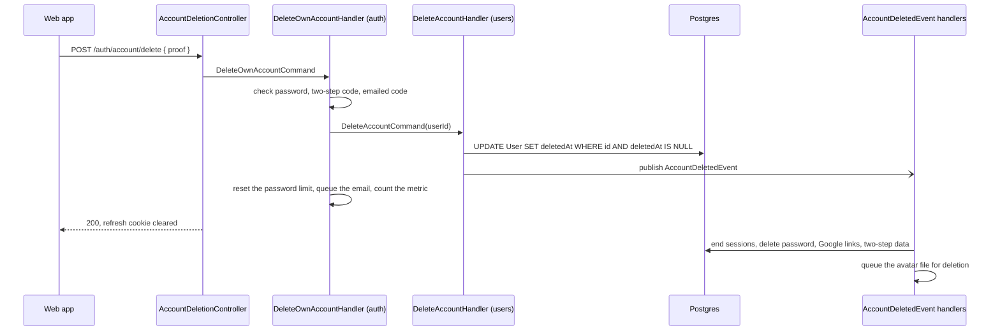

# Account deletion

How "delete my account" works in this starter, step by step: what the person
must prove, which code runs, what is removed at once and what later, and what
happens if a step fails. Read it before you add tables that point to users, when
someone asks "what do you keep after I delete my account?", or when you change
the deletion dialog in the web app.

For where deletion fits in an account's life (sign-up, confirmation, sign-in
methods, roles), start with [auth/accounts.md](auth/accounts.md). This page is
the deep one.

- [In short](#in-short)
- [Proving it is the owner](#proving-it-is-the-owner)
- [What runs, in order](#what-runs-in-order)
- [What is removed, and when](#what-is-removed-and-when)
- [Why the row is kept](#why-the-row-is-kept)
- [The retention sweep](#the-retention-sweep)
- [The clean-up safety net](#the-clean-up-safety-net)
- [Errors](#errors)
- [Limits](#limits)
- [The web app's side](#the-web-apps-side)
- [Edge cases](#edge-cases)
- [What happens to the username](#what-happens-to-the-username)
- [The files involved](#the-files-involved)

## In short

1. The signed-in person calls `POST /api/v1/auth/account/delete` with proof: their
   password, or an emailed code if the account has no password, plus a two-step
   code if that is on.
2. The account is marked deleted (not removed), and the refresh cookie is
   cleared.
3. Moments later, in the same process, every session ends and the sign-in data
   goes: password, Google link, two-step secret, recovery codes. The avatar file
   is queued for deletion.
4. The owner is emailed.
5. After `DELETED_ACCOUNT_RETENTION_DAYS` (30 by default) the personal fields
   on the row are erased. The row itself stays, empty, so that anything pointing
   to it keeps working.

## Proving it is the owner

A signed-in session alone is not enough: anyone at an unlocked computer could
otherwise delete the account. What the API asks for depends on the account:

| The account | Body field | What it is |
|---|---|---|
| has a password | `password` | the current password |
| has no password (made with Google) | `code` | 6 digits from `POST /api/v1/auth/account/delete-code`, sent to the account's address |
| has two-step sign-in on | `two_factor_code`, in addition | a code from the authenticator app, or a recovery code |

Examples:

```json
{ "password": "correct horse battery staple" }
{ "password": "correct horse battery staple", "two_factor_code": "492039" }
{ "code": "731905", "two_factor_code": "K7Q2M-X9HDP" }
```

If something the account needs is missing, the answer is
400 `AUTH_CONFIRMATION_REQUIRED` with `data.needs` listing it, for example
`{ "needs": ["password", "two_factor_code"] }`. A page that does not know the
account yet can send `{}` and read `needs`; the React starter asks
`GET /auth/sign-in-methods` and `GET /auth/2fa` instead.

**Getting the emailed code.** `POST /api/v1/auth/account/delete-code`, signed in,
no body. It answers 200 and emails "Your code to delete your {app} account"
(6 digits, valid 10 minutes, 5 tries, only the newest works). An account that
has a password gets 409 `AUTH_USE_PASSWORD` instead: the password is the proof.

**The order of checks** is password, then two-step code, then emailed code. The
password cannot be used up, so it goes first: a wrong password does not spend
the two-step code or the emailed code. One consequence: a right two-step code
followed by a wrong emailed code is spent (each app code works once), so the
next try needs the app's next code.

## What runs, in order

The deletion crosses two modules. The auth module checks the proof; the users
module owns the account and deletes it; the auth module then removes its own
data in reaction to an event. The users module never needs to know the auth
module exists.



1. **`AccountDeletionController.delete`** passes the proof and the client IP to
   `DeleteOwnAccountCommand`.
2. **`DeleteOwnAccountHandler`** (auth) refuses a deleted account, works out what
   proof is needed, and checks it in the order above, counting wrong answers
   against the [limits](#limits).
3. It sends the users module's **`DeleteAccountCommand(userId, userId)`** (the
   second id is who deleted it, stored as `deletedBy`).
4. **`DeleteAccountHandler`** (users) calls `softDelete`: one conditional
   statement, `UPDATE ... WHERE id = ? AND "deletedAt" IS NULL ... RETURNING`.
   It matches only a live row and returns the row as it was deleted. Two
   deletion requests racing each other therefore publish the follow-up work
   **once** (the loser gets 404 `USER_NOT_FOUND`), and the avatar key comes
   from the row at the instant of deletion, not from an earlier read that an
   upload could have overtaken.
5. It publishes **`AccountDeletedEvent`** with the user id and the avatar key.
6. Back in `DeleteOwnAccountHandler`: the wrong-password counter is reset, the
   "Your {app} account was deleted" email is queued, and
   `auth_events_total{event="account_deleted"}` is counted.
7. The controller clears the refresh cookie and answers 200, "Account deleted
   successfully", `data: null`.

The event handlers, run by the event bus in the same process right after:

- **`EndSessionsOfDeletedAccountHandler`** (auth): drops the cached copy of the
  user, ends every session with the reason `account-deleted` and drops their
  cache entries, then deletes the password (`Credential`), the Google links
  (`OAuthAccount`), and the two-step secret and recovery codes (`TwoFactor`,
  `RecoveryCode`). They are personal data with no further use: a deleted account
  can never sign in.
- **`CleanupAccountAvatarHandler`** (users): queues the avatar file's removal on
  the `file-cleanup` queue. Without it, a deleted person's photo would stay
  publicly fetchable at a stable URL (local storage is served without auth).

It is an event, rather than one big transaction, so that the users module does
not depend on the auth module. If a handler fails, nothing is left open: the
per-request check reads the user on every request and refuses a deleted one,
refresh does too, and [the safety net](#the-clean-up-safety-net) finishes the
work within the hour. (The Keycloak edition of this starter needed queued
jobs, retries and a reconciliation sweep for this step; here it is a few writes
in the same database.)

## What is removed, and when

| When | What | By |
|---|---|---|
| In the request | `User.deletedAt` and `deletedBy` set; the refresh cookie cleared in this browser | `DeleteAccountHandler`, `AccountDeletionController` |
| Moments later | Every session ended (reason `account-deleted`), cache entries dropped; password, Google links, two-step secret and recovery codes deleted | `EndSessionsOfDeletedAccountHandler` |
| Moments later | Avatar file queued for deletion | `CleanupAccountAvatarHandler` |
| Moments later | "Your account was deleted" email queued | `DeleteOwnAccountHandler` |
| Within the hour, only if the step above failed | The same session, password, link and two-step clean-up, with a warning in the log | hourly auth clean-up |
| A day after they stop working | Emailed codes (`VerificationCode` rows), the used deletion code included | hourly auth clean-up |
| 7 days after the session ended | `Session` rows and all their refresh tokens | hourly auth clean-up |
| After `DELETED_ACCOUNT_RETENTION_DAYS` (30), at the next 15-minute sweep | `email`, `username`, `displayName`, `bio`, `avatarUrl` set to null | `SweepDeletedAccountsHandler` |
| Never | The `User` row itself (id, roles, flags, dates, `deletedAt`, `deletedBy`), and rows in your own tables that point to it | — |

Ended sessions are kept a week on purpose: a stolen refresh token presented in
that week is still recognised for what it is.

**Outside the database.** Backups made before the deletion still hold the
account until they age out (by default the last 7 daily and 4 weekly dumps; see
[backups.md](backups.md)), and so does any copy in your off-site bucket under its
own lifecycle rule. Logs hold user ids, not addresses. Say so in your privacy
policy.

The account-deleted email states the retention period, and names
`SUPPORT_EMAIL` when it is set. There is no "undelete" route. The 30 days exist
so that support can still answer "that wasn't me" with the account's details at
hand. Restoring an account would be a manual database change, and the person
would have to set up their password, Google link and two-step sign-in again,
because those are deleted at once.

## Why the row is kept

Because your business data probably points to it. If a user placed ten orders,
deleting their row breaks the `Order` table's foreign keys, and you usually want
those orders to survive, attributed to an account that no longer has a person
behind it.

So the row stays and is marked deleted:

- `prisma/models/users.prisma` carries `deletedAt` and `deletedBy`.
- `PrismaUserRepository` filters `deletedAt: null` in every read **and** in
  `update`, so a deleted row is invisible to the rest of the application and
  cannot be changed by a caller holding a stale id. The one exception is the
  soft-delete write itself, which has to match the row it marks.
- The auth module reads users through `UserDirectoryPort`, which also ignores
  deleted rows when looking up an address. A deleted account's address can
  therefore register again at once: uniqueness of addresses applies to live
  accounts only. Coming back makes a **new** account (a new id), never the old
  one revived, whether by password or by Google (the Google link went with the
  old account). The old password no longer signs in: it was deleted. The
  per-address limits still count, so a second sign-up email within the minute
  is refused as for any address. `test/integration/account-reuse.integration-spec.ts`
  shows both ways back against the real database.

There is no generic `SoftDeletableRepository` base class: the filtering is
explicit in `PrismaUserRepository`, where you can see it.

A row that merely stops being read is not deletion in any sense a person would
recognise, nor one a regulator would accept. So the row is also emptied, later.

## The retention sweep

`SweepDeletedAccountsHandler` runs every 15 minutes (the `deleted-accounts-sweep`
entry in [maintenance-tasks.ts](../src/maintenance/maintenance-tasks.ts), on the
`maintenance` queue; the schedule lives in Redis, so with several app
instances each run still happens once). It
does two things, both safe to repeat:

1. **Erases** the personal fields (email, username, display name, bio, avatar
   key) of accounts deleted more than `DELETED_ACCOUNT_RETENTION_DAYS` ago
   (default 30, `0` for "at the next sweep"). The row stays, so foreign keys
   hold and the account is still recognised and refused.
2. **Removes** sign-ups that were never confirmed and are older than
   `UNVERIFIED_ACCOUNT_RETENTION_DAYS` (default 7). Nobody ever signed in to
   them, so they are deleted outright, with their password and codes, which
   frees the address for its real owner. Only accounts with a password here
   count as sign-ups, so users brought over from the Keycloak starter (no
   password yet, "unconfirmed" because the column is new) are never removed
   ([auth/accounts.md](auth/accounts.md#unconfirmed-accounts-are-removed-after-a-week)).

If you add tables holding personal data about a user (addresses, messages,
uploads), add them to the erase step, or to an `AccountDeletedEvent` handler of
your own if they should go at once.

## The clean-up safety net

The event handlers run in memory. If the process dies between saving the
deletion and handling the event (a deploy, a crash), the event is lost. The
account is still refused everywhere, but its sessions, password and so on would
linger.

So the auth module's hourly clean-up (`CleanUpAuthHandler`, the `auth-clean-up`
schedule on the `maintenance` queue) also looks for leftovers of deleted accounts: it
ends their open sessions and deletes their passwords, Google links, two-step
secrets and recovery codes. When it finds any, it logs a warning:

```
Ended 2 session(s), removed 1 password(s), 0 provider link(s) and 0 two-step setup(s) of deleted accounts: an account deletion's event was not handled
```

That line means a deletion was interrupted; nothing was exposed meanwhile. The
same job removes sessions ended more than 7 days ago and codes that stopped
working more than a day ago, for every account.

## Errors

From `POST /api/v1/auth/account/delete`:

| Status | `meta.type` | Code | When | `data` |
|---|---|---|---|---|
| 400 | `AUTH_CONFIRMATION_REQUIRED` | 400108 | Proof missing | `needs`: `password`, `code`, `two_factor_code` |
| 400 | `AUTH_CURRENT_PASSWORD_INVALID` | 400104 | Wrong password (400, not 401: clients treat any 401 as "signed out") | — |
| 400 | `AUTH_TWO_FACTOR_CODE_INVALID` | 400105 | Wrong or already used two-step code | `attempts_left` |
| 400 | `AUTH_CODE_INVALID` | 400102 | Wrong emailed code, or not the newest | — |
| 400 | `AUTH_CODE_EXPIRED` | 400103 | Emailed code older than 10 minutes, or out of tries: ask for a new one | — |
| 429 | `RATE_LIMIT_EXCEEDED` | 429001 | A limit below is used up | `reason`, and the `Retry-After` header |
| 503 | `AUTH_TWO_FACTOR_UNAVAILABLE` | 503003 | The two-step secret cannot be read (encryption key changed or lost) | — |
| 403 | `AUTH_ACCOUNT_DISABLED` | 403003 | Already deleted | — |
| 404 | `USER_NOT_FOUND` | 404001 | Lost a race with another deletion of the same account | — |
| 422 | `VALIDATION_ERROR` | 422000 | `code` not 6 digits, `two_factor_code` not 6–32 characters, an unknown field | per-field list |

From `POST /api/v1/auth/account/delete-code`:

| Status | `meta.type` | Code | When |
|---|---|---|---|
| 409 | `AUTH_USE_PASSWORD` | 409005 | The account has a password: confirm with it instead |
| 429 | `RATE_LIMIT_EXCEEDED` | 429001 | 1 code email per minute or 5 per hour to this address (`reason: "emails"`) |
| 403 | `AUTH_ACCOUNT_DISABLED` | 403003 | Already deleted |

Plus, on both, the usual signed-in errors (missing or expired access token) and
the global throttler. Every auth error: [auth/api-reference.md](auth/api-reference.md).

## Limits

Each kind of proof counts against the same limit it does elsewhere, so the
deletion form is not a back door for guessing:

| Proof | Limit | `reason` on 429 |
|---|---|---|
| Password | `change-pw-fail`: 5 wrong per 15 minutes, per user (shared with change-password) | `wrong_password` |
| Two-step code | `2fa-fail`: 5 wrong per 15 minutes, per user (shared with sign-in and settings) | `wrong_codes` |
| Emailed code | `code-try-ip`: 20 wrong per hour, per IP; and 5 tries per code | `network` |
| Sending the code | `code-email-min` and `code-email-hour`: 1 a minute, 5 an hour, per address | `emails` |

Details: [auth/rate-limits.md](auth/rate-limits.md).

## The web app's side

In the React starter (`React-Starter-No-Keycloak`):

- **`src/features/auth/components/DeleteAccountDialog.tsx`**, shown on the profile
  page (`src/features/users/pages/Profile.tsx`) as the "Delete account" button.
  When opened it reads `GET /auth/sign-in-methods` and `GET /auth/2fa` to decide
  which fields to show: the password, or a "Send code" button (with a 60-second
  wait, or the API's `Retry-After`) and a code field; plus a two-step field that
  takes an app code or a recovery code. The delete button stays disabled until
  the needed fields are filled.
- Errors land on the right field: `AUTH_CURRENT_PASSWORD_INVALID` on the
  password, `AUTH_CODE_INVALID` and `AUTH_CODE_EXPIRED` on the code,
  `AUTH_TWO_FACTOR_CODE_INVALID` on the two-step code. `AUTH_CONFIRMATION_REQUIRED`
  or `AUTH_USE_PASSWORD` mean the account changed in another tab (a password
  was added, two-step sign-in turned on), so it reads the account again.
- **`src/features/auth/api/auth.api.ts`**: `sendAccountDeletionCode()` and
  `deleteAccount({ password?, code?, twoFactorCode? })`. The delete request is
  sent `withCredentials`, so the response's cookie-clearing `Set-Cookie` is
  applied by the browser.
- On success the dialog signs out locally with the reason `account-deleted`.
  Other open tabs find out on their next request: `src/lib/api.ts` signs out on
  a 401, and on a 403 whose `meta.type` is `AUTH_ACCOUNT_DISABLED`. Any other 403
  means "you may not do this" and is left to the page.

## Edge cases

**A deleted account with a token still in a browser.** An access token stays
cryptographically valid until it expires, so the account must be refused on its
**next request**, not when the token runs out. The per-request check reads the
session and the user every time (from Redis, falling back to Postgres), so any
signed-in route answers 403 `AUTH_ACCOUNT_DISABLED` as soon as the event handler
has dropped the cached copy of the user, a few milliseconds after the deletion is
saved. If that step failed, the cached copy expires within 5 minutes anyway. A
refresh answers 401 `AUTH_REFRESH_FAILED` with `data.reason: "account_deleted"`.
See [auth/sessions-and-tokens.md](auth/sessions-and-tokens.md).

**A sign-in halfway through.** A two-step challenge issued before the deletion
is refused at the second step with 403 `AUTH_ACCOUNT_DISABLED`.

**Signing in with Google afterwards.** The Google link was deleted with the
account, so the same Google person signing in later gets a new, empty account.
See [auth/google-sign-in.md](auth/google-sign-in.md).

**An upload in flight.** `replaceAvatar` matches only live rows, so an upload
that lands after the deletion changes nothing and removes its own file. One
that lands just before is included in the row `softDelete` returns, so its file
is the one queued for deletion. `test/integration/account-lifecycle.integration-spec.ts`
covers these races; `test/integration/auth-http.integration-spec.ts` covers the
route end to end.

## What happens to the username

A deleted account keeps its row, so its username is still in the table until
the sweep. There are two defensible answers and this starter deliberately picks
the second:

- **Hold the name forever**, so nobody can take a departed user's handle and be
  mistaken for them.
- **Release it**, because holding every name anyone ever registered is a poor
  deal for everyone else, and a name that can never be reused can never be
  corrected either.

`findByUsername` excludes deleted rows, so a deleted account does not make its
handle look taken. The impersonation risk is handled at the other end: the sweep
erases personal data after `DELETED_ACCOUNT_RETENTION_DAYS`, username included,
so the name is not merely hidden but gone.

If your application needs the first answer (a forum where posts stay attributed
by name, say), drop the `deletedAt: null` filter from `findByUsername` and leave
the username out of the sweep's erase list.

## The files involved

| File | Role |
|---|---|
| [account-deletion.controller.ts](../src/modules/auth/presentation/http/account-deletion.controller.ts) | `POST /auth/account/delete-code` and `/auth/account/delete`; clears the cookie |
| [delete-own-account.handler.ts](../src/modules/auth/application/commands/delete-own-account/delete-own-account.handler.ts) | The proof, the limits, the email and the metric |
| [delete-account.handler.ts](../src/modules/users/application/commands/delete-account/delete-account.handler.ts) | The soft delete; publishes `AccountDeletedEvent` |
| [end-sessions-of-deleted-account.handler.ts](../src/modules/auth/application/events/handlers/end-sessions-of-deleted-account.handler.ts) | `EndSessionsOfDeletedAccountHandler` |
| [cleanup-account-avatar.handler.ts](../src/modules/users/application/events/handlers/cleanup-account-avatar.handler.ts) | Queues the avatar's removal |
| [clean-up-auth.handler.ts](../src/modules/auth/application/commands/clean-up-auth/clean-up-auth.handler.ts) | The hourly safety net and housekeeping |
| [sweep-deleted-accounts.handler.ts](../src/modules/users/application/commands/sweep-deleted-accounts/sweep-deleted-accounts.handler.ts) | Erasing personal data; removing unconfirmed accounts |
| [maintenance-tasks.ts](../src/maintenance/maintenance-tasks.ts) | Runs the sweep every 15 minutes, and the clean-up every hour |
| [prisma-user.repository.ts](../src/modules/users/infrastructure/persistence/prisma-user.repository.ts) | The soft-delete filtering, `softDelete`, the erase query |

Related: [auth/accounts.md](auth/accounts.md) (the account's whole life),
[auth/security.md](auth/security.md), [BULLMQ-GUIDE.md](BULLMQ-GUIDE.md) (the
queues), [environment.md](environment.md) (`DELETED_ACCOUNT_RETENTION_DAYS`,
`UNVERIFIED_ACCOUNT_RETENTION_DAYS`, `SUPPORT_EMAIL`).
