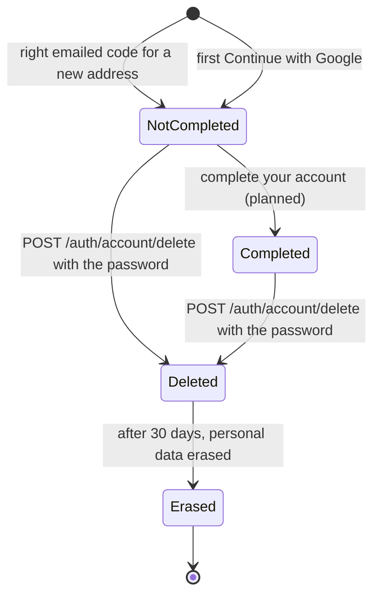

# Accounts: from sign-up to deletion

This page follows one account through its life: how it is created by a code
or by Google, completed, signed in to (with a code, a password, Google, or
more than one), given roles, and deleted. It is the overview; each step links
to the page with the exact rules.

Read it to understand what states an account can be in and what moves it
between them, to give someone admin rights, or to protect a route by role.

- [The states of an account](#the-states-of-an-account)
- [Creating an account](#creating-an-account)
- [Completing the account](#completing-the-account)
- [Ways to sign in: code, password, Google](#ways-to-sign-in-code-password-google)
- [What the profile says about the account](#what-the-profile-says-about-the-account)
- [Deleting an account](#deleting-an-account)
- [Roles](#roles)
- [Settings](#settings)

## The states of an account



| State | Can sign in? | Stored | Ends when |
|---|---|---|---|
| **Not completed** | Yes, with a code or Google (and a password, if one was added by reset) | `User` row with `completedAt` empty; no username; usually no password | the owner completes it, or deletes it |
| **Completed** | Yes | `User` row with `completedAt` set, plus a password and/or a Google link, sessions | the owner deletes it |
| **Deleted** | No: 403 `AUTH_ACCOUNT_DISABLED` | `User` row with `deletedAt` set; sign-in data already removed | after `DELETED_ACCOUNT_RETENTION_DAYS` (30) its personal data is erased |
| **Erased** | No | the `User` row without personal data: id, roles, flags and dates | never: the row stays so that other data pointing to it keeps working |

There is no "unconfirmed" state (D-133). An account is only made once its
owner has proved they read the inbox: the code sent to the address was right,
or Google verified the address. So every account's address is confirmed, and
nothing has to sweep away sign-ups that never confirmed.

Addresses are stored lower-case and are unique among live accounts, ignoring
case. A deleted account's address is free again at once: the same person can
sign up afresh.

## Creating an account

There are two ways in:

- **A code by email** (D-59, D-60). `POST /api/v1/auth/email-code` with
  `{ email, language? }` emails a 6-digit code to any address, then
  `POST /api/v1/auth/email-code/verify` with `{ email, code }` signs in. If
  the address has no account, the right code creates one at that moment: no
  password, no username, not completed. The first request answers 202 "Check
  your email for the code." whatever the address; only the email's wording
  says which ("your sign-in code" or "your code to create an account"), and
  only the inbox's owner reads it. So this cannot be used to find out who has
  an account. The answer to the second says
  `account: { created, completed }`.
- **"Continue with Google"** for an address with no account: the account is
  created with no password, not completed, and the display name from Google
  (D-130). See [google-sign-in.md](google-sign-in.md).

- The code is 6 digits, valid 10 minutes, 5 tries; only the newest one works.
- Asking again is the same call (at most one a minute and five an hour per
  address, shared with reset codes).
- Wrong codes are also limited per address: 10 an hour across its codes
  (D-134).

Every step, with diagrams: [flows.md](flows.md). Codes and their rules:
[passwords-and-codes.md](passwords-and-codes.md).

## Completing the account

`completedAt` on the `User` row marks the "complete your account" step done
(D-61). A new account, by code or by Google, starts with it empty, and the
sign-in answer says `completed: false` so the web app opens the step.

The step itself (`POST /auth/complete-account`: a username and a password)
and the gate that refuses an account that has not done it come in a later
slice. Until then an account that is not completed can use the API like any
other.

Accounts that existed before migration `20261106000000_codes_by_email` and
had already chosen a username (`hasSetUsername`) were marked completed, with
`completedAt` set to their `createdAt`.

## Ways to sign in: code, password, Google

Every account can sign in with an **emailed code**. It can also have a
**password** (a row in `Credential`), a **Google link** (a row in
`OAuthAccount`), or both. All work at any time; none is primary.

`GET /api/v1/auth/sign-in-methods` tells the settings page what this account
has: `{ "password": true, "providers": ["google"] }`.

| To | How | Sessions |
|---|---|---|
| Add Google to an account | Sign in with Google once. An account with the same address is linked, and its owner emailed "Google sign-in was added". | kept |
| Add a password to an account without one | "Forgot password": `POST /auth/forgot-password` (the email offers to *choose* a password), then `POST /auth/reset-password`. The owner is emailed "A password was added". (Completing the account, planned, will also set one.) | **all** sessions end; this one starts fresh |
| Change the password | `POST /auth/change-password` with `{ current_password, new_password }` | every **other** session ends |
| Reset a forgotten password | `POST /auth/forgot-password`, then `POST /auth/reset-password` with `{ email, code, password }` | **all** sessions end; this one starts fresh |
| Remove Google, or change the address | Not supported: there are no routes for these | — |

Adding a first password needs an emailed code, not just a session: someone at
a borrowed computer where the owner is signed in could otherwise add a
password they know and keep access.

Details: [passwords-and-codes.md](passwords-and-codes.md),
[sessions-and-tokens.md](sessions-and-tokens.md).

## What the profile says about the account

`GET /api/v1/users/me` returns the signed-in user's profile, including
`roles`, for example `["user"]` or `["user", "admin"]` ([below](#roles)).

It comes from the per-request session check, so a change (a new role, a
deletion) shows on the next request.

## Deleting an account

People delete their own account from the web app's profile page. A session
alone is not enough: the API wants proof it is the owner, so that someone at an
unlocked computer cannot do it.

`POST /api/v1/auth/account/delete` with `password` (and an optional
`language` for the email). The password is the only proof. An account without
one (not completed, or made with Google) chooses one with "Forgot password"
first.

If the password is missing, or the account has none, the answer is 400
`AUTH_CONFIRMATION_REQUIRED` with `data.needs: ["password"]`. Wrong passwords
count against the same limit as when changing the password.

On success (200):

1. The account is marked deleted at once and the refresh cookie is cleared.
2. Within moments, every session ends and the password and the Google link
   are deleted.
3. The owner is emailed "Your {app} account was deleted", saying when their
   details will be erased and, if `SUPPORT_EMAIL` is set, who to contact.
4. After `DELETED_ACCOUNT_RETENTION_DAYS` (30) the email, username, display
   name, bio and avatar are erased from the row.

There is no "undelete" route. The full mechanics (the proof, every
error, what is removed when, the safety net if a step fails, and the web app's
dialog) are on [../account-deletion.md](../account-deletion.md).

## Roles

Every account has a `roles` list, `["user"]` by default. Routes can require a
role with `@Roles()`.

### Giving someone a role

Roles are changed only from the command line, never by a setting that promotes
"whoever signs up first", and never through the API:

```bash
pnpm user:promote you@example.com                   # add "admin"
pnpm user:promote you@example.com --role editor     # add another role
pnpm user:promote you@example.com --remove          # take "admin" away
pnpm user:promote you@example.com --role editor --remove
```

On the server, in the app's container:

```bash
docker compose --env-file .env.production -f docker-compose.prod.yaml exec app \
  node dist/src/bootstrap/user-roles.js you@example.com
```

- The account must exist and not be deleted ("No account uses ..." otherwise).
- Role names are lower-case letters, digits, `-` and `_`, starting with a
  letter, at most 32 characters.
- `user` cannot be removed.
- The change applies on the user's **next request**: the script drops the cached
  copy of the user. If it cannot reach Redis it says so, and the change applies
  within five minutes, when that copy expires. No sign-out is needed: roles are
  not inside the access token, they are read on every request.

The script is [user-roles.ts](../../src/bootstrap/user-roles.ts).

### Protecting a route

```ts
import { Roles } from '@/shared/presentation/decorators'

@Roles('admin')
@Get('reports')
listReports() { ... }
```

- The global `RolesGuard` ([roles.guard.ts](../../src/shared/presentation/guards/roles.guard.ts))
  lets the request through if the user has **any** of the listed roles.
- Otherwise it answers 403 `AUTH_FORBIDDEN` (403004). The web app should show
  "not allowed", not sign the person out.
- `@Roles()` on a controller class applies to all its routes; on a method it
  overrides the class.
- It runs after authentication, so a `@Public()` route has no user and a
  `@Roles()` on it always refuses.

The React starter hides admin-only pages with its `RequireRole` component, but
the API's check is the one that counts.

## Settings

| Variable | Default | Meaning |
|---|---|---|
| `DELETED_ACCOUNT_RETENTION_DAYS` | 30 (0 or more) | Deleted accounts' personal data is erased after this; also stated in the account-deleted email |
| `SUPPORT_EMAIL` | empty | Named in the account-deleted email |
| `APP_NAME` | `Test App` in code, `YourAppName` in `.env.example` | In every email subject |

All environment variables: [../environment.md](../environment.md).
