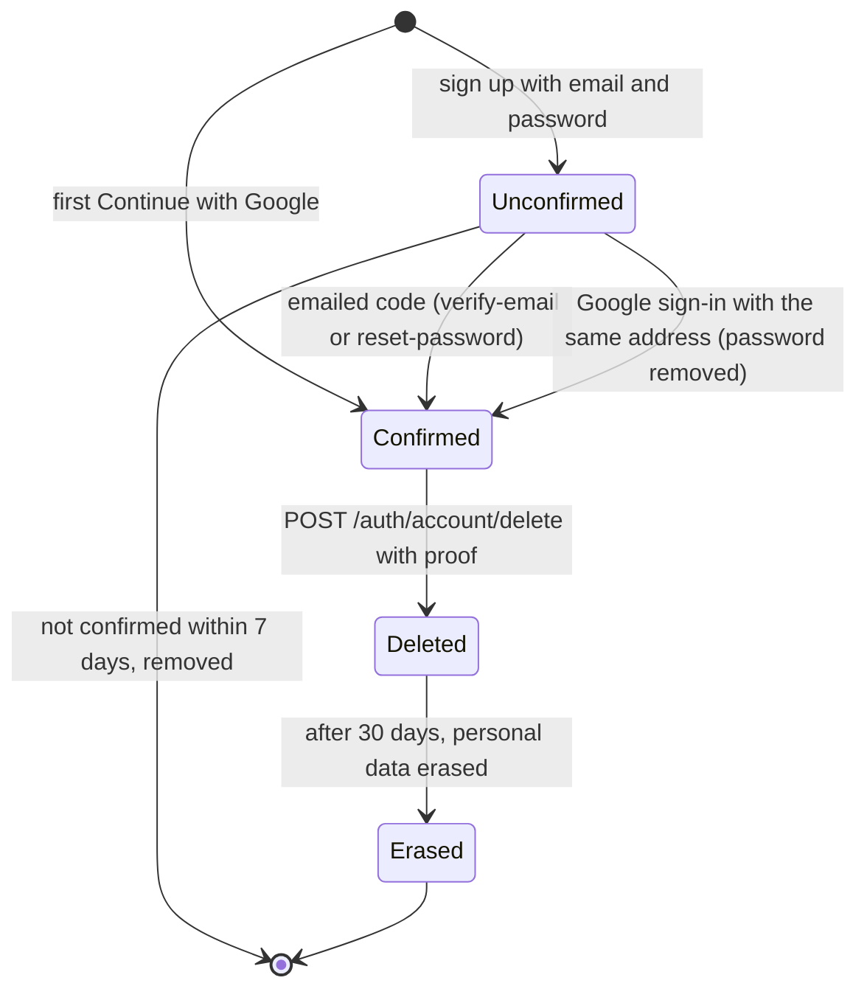

# Accounts: from sign-up to deletion

This page follows one account through its life: how it is created, confirmed,
signed in to (with a password, Google, or both), given roles, and deleted. It is
the overview; each step links to the page with the exact rules.

Read it to understand what states an account can be in and what moves it
between them, to give someone admin rights, or to protect a route by role.

- [The states of an account](#the-states-of-an-account)
- [Creating an account](#creating-an-account)
- [Confirming the address](#confirming-the-address)
- [Unconfirmed accounts are removed after a week](#unconfirmed-accounts-are-removed-after-a-week)
- [Ways to sign in: password, Google, or both](#ways-to-sign-in-password-google-or-both)
- [What the profile says about the account](#what-the-profile-says-about-the-account)
- [Deleting an account](#deleting-an-account)
- [Roles](#roles)
- [Settings](#settings)

## The states of an account



| State | Can sign in? | Stored | Ends when |
|---|---|---|---|
| **Unconfirmed** | No: the right password gets 403 `AUTH_EMAIL_NOT_VERIFIED` | `User` row with `emailVerified = false`, the password hash, a pending code | the address is confirmed, or after `UNVERIFIED_ACCOUNT_RETENTION_DAYS` (7) it is removed completely |
| **Confirmed** | Yes | `User` row, plus a password and/or a Google link, sessions, maybe two-step sign-in | the owner deletes it |
| **Deleted** | No: 403 `AUTH_ACCOUNT_DISABLED` | `User` row with `deletedAt` set; sign-in data already removed | after `DELETED_ACCOUNT_RETENTION_DAYS` (30) its personal data is erased |
| **Erased** | No | the `User` row without personal data: id, roles, flags and dates | never: the row stays so that other data pointing to it keeps working |

Addresses are stored lower-case and are unique among live accounts, ignoring
case. A deleted account's address is free again at once: the same person can
sign up afresh.

## Creating an account

There are two ways in:

- **Sign up**, `POST /api/v1/auth/register` with `{ email, password }` (and a
  `turnstile_token` when [Turnstile](turnstile.md) is on). The password must
  pass the [policy](passwords-and-codes.md). The account is created
  **unconfirmed**, and a 6-digit code is emailed. The answer is always 202 "Check
  your email to continue", whatever the address:
  - a new address: a new account and a code;
  - an address with an unconfirmed account: its password is replaced with the
    new one and a new code is sent (whoever set the old one never proved they own
    the inbox). This is why confirming asks for the password as well as the
    code: see below;
  - an address with a confirmed account: nothing changes, and the owner is
    emailed "You already have a {app} account", saying how they sign in.

  Answering the same in every case means sign-up cannot be used to find out who
  has an account.
- **"Continue with Google"** for an address with no account: the account is
  created **confirmed** (Google verified the address), with no password, and the
  display name from Google. See [google-sign-in.md](google-sign-in.md).

Every step, with diagrams: [flows.md](flows.md).

## Confirming the address

`POST /api/v1/auth/verify-email` with `{ email, code, password }` confirms the
address **and signs in** (the access token and the refresh cookie). The
password is the one chosen at sign-up; the web app still has it from the
sign-up form, so the person only types the code (after a reload of the page,
they type the password again).

Why the password: signing up again with an unconfirmed address replaces its
password (above). With the code alone, someone who knew your address could
sign it up again with their own password in the minutes before you confirmed.
The code would still come to you, and by typing it you would confirm an account
whose password they hold. With the password asked for, your confirmation fails
instead ("That code, or the password, is not right"), and signing up again puts
your password back.

A wrong password is the same answer as a wrong code, so the route cannot be
used to test passwords or find accounts, and it does not use up one of the
code's five tries.

- The code is 6 digits, valid 10 minutes, 5 tries; only the newest one works.
- `POST /api/v1/auth/resend-verification` with `{ email }` sends a new one (at
  most one a minute and five an hour per address).
- "Forgot password" also works for an unconfirmed account: resetting the
  password with the emailed code confirms the address too, since the code
  proved the person reads the inbox.
- Signing in to an unconfirmed account with the right password answers
  403 `AUTH_EMAIL_NOT_VERIFIED`, so the page can offer to resend the code. A
  wrong password answers the ordinary 401: the "not confirmed" answer is given
  only to someone who knows the password.

Codes and their rules: [passwords-and-codes.md](passwords-and-codes.md).

## Unconfirmed accounts are removed after a week

Every 15 minutes, a sweep deletes accounts that were never confirmed and are
older than `UNVERIFIED_ACCOUNT_RETENTION_DAYS` (default 7, at least 1). They are
removed completely, with their password and codes, not just marked: nobody ever
signed in to them.

Only sign-ups are removed: accounts with a password here, which signing up
always sets. An unconfirmed account without one did not come from sign-up. The
case that matters is a database upgraded from the Keycloak starter, where every
existing user starts out "unconfirmed" (the column is new) and is older than a
week. The sweep leaves those alone
([prisma-module.md](../prisma-module.md#upgrading-from-the-keycloak-starter)).

Why: otherwise anyone could sign up with an address they do not own and hold
it forever. The real owner can always sign up again (which replaces the
squatter's password) or use Google, but removing them keeps the table clean.

The sweep is `SweepDeletedAccountsHandler`
([sweep-deleted-accounts.handler.ts](../../src/modules/users/application/commands/sweep-deleted-accounts/sweep-deleted-accounts.handler.ts)),
run by the `maintenance` queue's `deleted-accounts-sweep` schedule
([maintenance-tasks.ts](../../src/maintenance/maintenance-tasks.ts)). The
schedule lives in Redis, so with several app instances each run still happens
once.

## Ways to sign in: password, Google, or both

An account can have a **password** (a row in `Credential`), a **Google link**
(a row in `OAuthAccount`), or both. Both work at any time; neither is primary.

`GET /api/v1/auth/sign-in-methods` tells the settings page what this account
has: `{ "password": true, "providers": ["google"] }`.

| To | How | Sessions |
|---|---|---|
| Add Google to a password account | Sign in with Google once. A confirmed account with the same address is linked, and its owner emailed "Google sign-in was added". | kept |
| Add a password to a Google account | Signed in: `POST /auth/password/code` emails a code, then `POST /auth/password` with `{ code, new_password }`. Signed out: "Forgot password" (the email offers to *choose* a password). The owner is emailed "A password was added". | kept |
| Change the password | `POST /auth/change-password` with `{ current_password, new_password }` | every **other** session ends |
| Reset a forgotten password | `POST /auth/forgot-password`, then `POST /auth/reset-password` with `{ email, code, password }` | **all** sessions end; this one starts fresh |
| Add two-step sign-in | [two-step-sign-in.md](two-step-sign-in.md); it applies to every way of signing in, Google included | kept |
| Remove Google, or change the address | Not supported: there are no routes for these | — |

Setting a first password needs an emailed code, not just a session: someone at
a borrowed computer where the owner is signed in with Google could otherwise add
a password they know and keep access.

Details: [passwords-and-codes.md](passwords-and-codes.md),
[sessions-and-tokens.md](sessions-and-tokens.md).

## What the profile says about the account

`GET /api/v1/users/me` returns the signed-in user's profile, including two
fields the auth module maintains:

- `email_verified`: always `true` for someone who can call it, since unconfirmed
  accounts cannot sign in;
- `roles`: for example `["user"]` or `["user", "admin"]` ([below](#roles)).

These come from the per-request session check, so a change (a new role, a
deletion) shows on the next request.

## Deleting an account

People delete their own account from the web app's profile page. A session
alone is not enough: the API wants proof it is the owner, so that someone at an
unlocked computer cannot do it.

`POST /api/v1/auth/account/delete` with:

| The account has | Send |
|---|---|
| a password | `password` |
| no password (made with Google) | `code`, emailed by `POST /api/v1/auth/account/delete-code` first |
| two-step sign-in on | also `two_factor_code`: an app code or a recovery code |

If something is missing the answer is 400 `AUTH_CONFIRMATION_REQUIRED` with
`data.needs`, for example `["password", "two_factor_code"]`, so the page knows
which fields to show. Wrong answers count against the same limits as at sign-in.

On success (200):

1. The account is marked deleted at once and the refresh cookie is cleared.
2. Within moments, every session ends and the password, the Google link, the
   two-step secret and the recovery codes are deleted.
3. The owner is emailed "Your {app} account was deleted", saying when their
   details will be erased and, if `SUPPORT_EMAIL` is set, who to contact.
4. After `DELETED_ACCOUNT_RETENTION_DAYS` (30) the email, username, display
   name, bio and avatar are erased from the row.

There is no "undelete" route. The full mechanics (the order of checks, every
error, what is removed when, the safety net if a step fails, and the web app's
dialog) are on [../account-deletion.md](../account-deletion.md).

## Roles

Every account has a `roles` list, `["user"]` by default. Routes can require a
role with `@Roles()`.

### Giving someone a role

Roles are changed only from the command line, never by a setting that promotes
"whoever signs up first", and never through the API:

```bash
pnpm user:promote you@example.com                   # add "admin"
pnpm user:promote you@example.com --role editor     # add another role
pnpm user:promote you@example.com --remove          # take "admin" away
pnpm user:promote you@example.com --role editor --remove
```

On the server, in the app's container:

```bash
docker compose --env-file .env.production -f docker-compose.prod.yaml exec app \
  node dist/src/bootstrap/user-roles.js you@example.com
```

- The account must exist and not be deleted ("No account uses ..." otherwise).
- Role names are lower-case letters, digits, `-` and `_`, starting with a
  letter, at most 32 characters.
- `user` cannot be removed.
- The change applies on the user's **next request**: the script drops the cached
  copy of the user. If it cannot reach Redis it says so, and the change applies
  within five minutes, when that copy expires. No sign-out is needed: roles are
  not inside the access token, they are read on every request.

The script is [user-roles.ts](../../src/bootstrap/user-roles.ts).

### Protecting a route

```ts
import { Roles } from '@/shared/presentation/decorators'

@Roles('admin')
@Get('reports')
listReports() { ... }
```

- The global `RolesGuard` ([roles.guard.ts](../../src/shared/presentation/guards/roles.guard.ts))
  lets the request through if the user has **any** of the listed roles.
- Otherwise it answers 403 `AUTH_FORBIDDEN` (403004). The web app should show
  "not allowed", not sign the person out.
- `@Roles()` on a controller class applies to all its routes; on a method it
  overrides the class.
- It runs after authentication, so a `@Public()` route has no user and a
  `@Roles()` on it always refuses.

The React starter hides admin-only pages with its `RequireRole` component, but
the API's check is the one that counts.

## Settings

| Variable | Default | Meaning |
|---|---|---|
| `UNVERIFIED_ACCOUNT_RETENTION_DAYS` | 7 (at least 1) | Unconfirmed accounts older than this are removed |
| `DELETED_ACCOUNT_RETENTION_DAYS` | 30 (0 or more) | Deleted accounts' personal data is erased after this; also stated in the account-deleted email |
| `SUPPORT_EMAIL` | empty | Named in the account-deleted and two-step emails |
| `APP_NAME` | `Test App` in code, `YourAppName` in `.env.example` | In every email subject |

All environment variables: [../environment.md](../environment.md).
