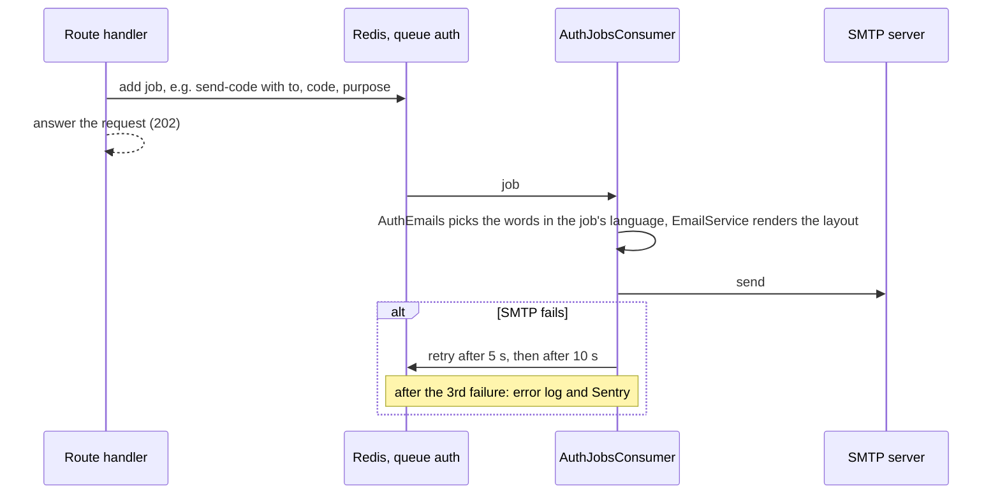

# Emails

Every email the auth module sends: when, what it says, in which language,
and how it is laid out. Then how sending works (a queue), what you need for it
in development and production, how to edit the words and the layout, and why
the queue dashboard must stay private.

Read this if you are setting up email, changing the wording, adding an
email, or chasing a code that never arrived. Choosing and configuring a
provider (Brevo, Resend, Amazon SES) is in
[../setup/email.md](../setup/email.md).

- [What you need](#what-you-need)
- [Every email](#every-email)
- [Languages](#languages)
- [The emails one by one](#the-emails-one-by-one)
- [How an email is sent](#how-an-email-is-sent)
- [When Redis or SMTP is down](#when-redis-or-smtp-is-down)
- [Codes in the queue](#codes-in-the-queue)
- [Editing the words and the layout](#editing-the-words-and-the-layout)
- [Adding an email](#adding-an-email)
- [Settings](#settings)
- [Troubleshooting](#troubleshooting)
- [Where it is in the code](#where-it-is-in-the-code)

## What you need

Email is not optional here: creating an account and signing in without a
password both take an emailed code, so without working email nobody can sign
up, sign in by code or reset a password.

- **Development:** nothing to set up. `pnpm docker:dev` starts **Mailpit**, a
  mail catcher: every email the app sends lands there, whatever `EMAIL_*`
  says (the dev compose file points the app at it), and nothing is delivered
  for real. Read them at `http://localhost:8025`. Running the app on your
  machine instead (`pnpm dev`), the `.env.example` values
  (`EMAIL_HOST=localhost`, `EMAIL_PORT=1025`) reach the same Mailpit.
- **Production:** a real SMTP provider. The app refuses to start in
  production without `EMAIL_HOST`. Set `EMAIL_FROM_ADDRESS` to an address on
  a domain you have authenticated with the provider (SPF, DKIM, DMARC), or
  the codes land in spam. Step by step: [../setup/email.md](../setup/email.md).
- **Redis**, in both: emails go through a queue that lives there.

## Every email

All eight are queued on the BullMQ queue `auth`. They share one layout,
[templates/email.hbs](../../src/modules/auth/infrastructure/email/templates/email.hbs),
and their words are in
[email-copy.ts](../../src/modules/auth/infrastructure/email/email-copy.ts),
once per language (D-132). `{app}` in a subject is `APP_NAME`. The subjects
below are the English ones.

| Email (job) | Sent when | Subject |
|---|---|---|
| Sign-in code (`send-code`, `sign-in`) | `POST /auth/email-code` for an address with an account | Your {app} sign-in code |
| Create-account code (`send-code`, `sign-in`) | `POST /auth/email-code` for an address with no account | Your code to create a {app} account |
| Reset code (`send-code`, `password-reset`) | "Forgot password" for an account with a password | Reset your {app} password |
| Choose-a-password code (`send-code`, `password-reset`) | "Forgot password" for an account with no password yet | Choose a password for your {app} account |
| Password changed (`password-changed`) | Change password; reset password on an account that had one | Your {app} password was changed |
| Password added (`password-added`) | A reset on an account that had no password | Your {app} account now has a password |
| Sign-in method added (`sign-in-method-added`) | Google linked to an existing account | Google sign-in was added to your {app} account |
| Deletion scheduled (`account-deletion-scheduled`) | `POST /auth/account/delete` (the account waits 14 days, D-141) | Your {app} account will be deleted on dd/mm/yyyy |

The code emails are the ones a person waits for. The rest are **security
notices**: each is the one email the owner needs if it was not them, and each
says what to do in that case.

What is deliberately **not** emailed: a sign-in from a new device, a failed
sign-in, a session ending. There is no "new sign-in" email. And "forgot
password" for an address with no account stores a code but sends nothing
(D-121).

## Languages

Every email is written in Vietnamese (`vi`) or English (`en`), D-132.

- **An email someone just asked for from a page** is in that page's language.
  Every route that sends one takes an optional `language` field in its body
  (`vi` or `en`, default `en`): `email-code`, `forgot-password`,
  `reset-password`, `change-password` and `account/delete`. It is a body
  field, not a header, so it follows the language switch on the page and not
  only the browser's setting.
- **An email nobody asked for from a page** (Google sign-in added) is in
  the account's language: `UserSettings.language`, chosen when the account
  was completed (`accountEmailLanguage` in auth-mailer.port.ts). An account
  with no settings row (not completed yet, or completed before settings
  existed) gets English.
- Each queued job carries its `language`. A job without one, queued before
  emails had a language, is sent in English.

`EmailCopy` in email-copy.ts has one entry per language, and its type makes
each carry every email: a missing one is a type error, not an English email
in a Vietnamese inbox. Vietnamese follows the web app's voice ("mình" for
NezFocus, "mã OTP" for the six digits).

## The emails one by one

Every email has the same parts, filled from email-copy.ts: a heading, a few
paragraphs, the code (code emails), a button (some notices), and a footer.
The layout shows them under the NezFocus tile and the app's name. The tile is
an image, `FRONTEND_URL/email-logo-64.png` (served from the web app's
`public/`; 64px shown at 32, sharp on dense screens), in a brand-blue cell
whose alt text is a white "N": with images blocked the reader still sees the
tile. Mailpit in development loads it only while the web app is running.

Links in emails are built from `FRONTEND_URL` and point at `/forgot-password`,
which the web app must have, and at the logo above.

### Sign-in code

- **Says:** "Hi Ada," (or "Hi," without a display name), "Enter this
  code on the sign-in page to get into your {app} account", the code, how
  long it lasts ("The code works for 10 minutes, once. If you asked more than
  once, only the newest code works."), and "Didn't ask for it? Ignore this
  email: nobody gets into your account without the code."
- **Rate:** counts against the per-address limits (1 a minute, 5 an hour),
  shared with reset codes.

### Create-account code

Sent by the same request as the sign-in code when the address has no account.
Only the inbox's owner sees which of the two was sent, so the API can answer
the same for every address (D-59, D-60).

- **Says:** "Enter this code to confirm your email and create your {app}
  account", the code and its lifetime, and "Didn't ask for it? Ignore this
  email: no account will be created."
- **Rate:** as the sign-in code.

### Reset code

- **Says:** "Enter this code with your new password to reset your {app}
  password", the code and its lifetime, that every signed-in device is signed
  out once it is reset, and "Didn't ask for it? Ignore this email: your
  password stays as it is."
- For an account with no password yet (not completed, or made with Google)
  it is the **choose-a-password code** instead: "Your account has no password
  yet. Enter this code with the password you choose."
- **Not sent** for an address with no account; a code is stored all the same.
  The API answers the same `202` either way.

### Password changed

- **Says:** the password of the account was just changed and other devices
  were signed out. If it was not them: a **Reset your password** button
  (`/forgot-password`).

### Password added

- **Says:** a password was just set on the account, which can now sign in
  with it or with an OTP code. If not them: **Reset your password**.
- **Not sent** when the password is chosen in "complete your account".

### Sign-in method added

- **Says:** "The {app} account with this email can now sign in with Google."
  If not them: **Reset your password**.
- **Not sent** when the account was created by this Google sign-in.
- In the account's language, English if it has none yet (D-132).

### Deletion scheduled

- **Says:** a request to delete the account was received and every session has
  ended; it is deleted for good on a date, written dd/mm/yyyy in the account's
  time zone (UTC if it has none). Until then, signing in and choosing "Restore
  account" keeps it. If not them: sign in, restore the account and change the
  password, or contact `SUPPORT_EMAIL` when it is set.
- **Button:** "Sign in", to `FRONTEND_URL/login`, where restoring starts.
- The only deletion email (D-141): nothing is sent when the account is
  restored (that needs signing in), when the sweep deletes it 14 days later,
  or when it deletes an account left incomplete.
- In the request's `language`.

## How an email is sent

A request never talks to the mail server. It puts a job on the `auth` queue
in Redis and answers; a worker in the same app sends the email moments later.

**Why a queue.** Two reasons:

- **The answer must not depend on the mail server.** "Forgot password" says
  the same thing for an address with an account and one without. If it sent
  the email during the request, a slow or broken mail server would make the
  two answers take different times, or one of them fail, and reveal which
  addresses exist ([auth-mailer.port.ts](../../src/modules/auth/application/ports/auth-mailer.port.ts)).
- **The person does not wait** for a slow SMTP handshake.

**The job options** (`EMAIL_JOB_OPTIONS` in
[auth-email-jobs.ts](../../src/modules/auth/infrastructure/email/auth-email-jobs.ts))
replace the queue's slower defaults, because a code expires in minutes:

| Option | Value | Meaning |
|---|---|---|
| `attempts` | 3 | Tried three times in all |
| `backoff` | exponential from 5 s | The 2nd try 5 seconds after the 1st fails, the 3rd 10 seconds after the 2nd |
| `removeOnComplete` | `true` | A sent job is deleted at once: it holds the code |
| `removeOnFail` | 24 hours | A job that failed all three tries is kept a day, to inspect |

Each send also has its own timeouts: 10 seconds to connect, 10 for the
server's greeting, 30 of socket silence
([email.module.ts](../../src/shared/infrastructure/email/email.module.ts)).
So a dead mail server fails a job within about a minute, not ten.

A job that fails all three tries is logged at error level ("Job send-code of
auth failed after 3 attempt(s): …") and sent to Sentry, tagged with the queue
and job name and without the job's data
([queue-failure-reporter.ts](../../src/shared/infrastructure/queue/queue-failure-reporter.ts)).
The queue holds nothing but emails: auth's hourly clean-up runs on the
`maintenance` queue, so a backlog of emails never delays it.

## When Redis or SMTP is down

| What is down | What happens |
|---|---|
| **SMTP** | Requests still answer normally (the job is queued). Each email is tried 3 times over about 15 seconds, then given up, logged and reported. The person never gets the code; they ask for a new one once the mail server is back |
| **Redis** | The job cannot be queued. A request that would send an email waits for Redis, and fails with a timeout after `REQUEST_TIMEOUT_MS` (30 seconds) if it does not come back. Where the request had already stored a code, that code exists but was never sent; asking again makes a new one. Routes that send a code count an auth limit first, and with Redis down those answer `503` at once (D-137). A queueing failure is not always answered: "forgot password" logs it and answers 202, as for an address with no account; the notice after a reset or "complete your account" is logged, and the request succeeds |

Routes that do not send email ("forgot password" for an unknown address,
sign-in) are unaffected by SMTP. With Redis down, those that count an auth
limit (sign-in, codes) answer `503`. More on Redis outages:
[sessions-and-tokens.md](./sessions-and-tokens.md#when-redis-is-down).

## Codes in the queue

A `send-code` job holds the code itself, in clear, with the address it goes
to: the worker needs it to write the email. That means:

- **while a job waits or retries**, the code is readable in Redis and in the
  queue dashboard;
- **a job that failed all its tries** stays readable for **24 hours**;
- **a sent job** is deleted at once.

Anyone who can open the queue dashboard while a reset code is waiting can
reset that person's password. So:

- `/admin/queues` (the BullMQ dashboard) is always behind basic auth
  (`BULL_BOARD_USER`, `BULL_BOARD_PASSWORD`). In production the app refuses
  to start when the password is shorter than 12 characters, a well-known
  default such as `admin`, or a placeholder from the env template.
- The production nginx config also refuses `/admin/queues` from anywhere but
  local and private networks (`nginx/app.conf.template`). Reach it through an
  SSH tunnel or a VPN; do not open it to the internet.
- Redis itself must not be reachable from outside, and needs
  `REDIS_PASSWORD` in production.

The codes never appear in the logs: the request body field `code` is
redacted from logs and error reports, and the email queue's failure reports
leave the job's data out.

## Editing the words and the layout

**The words** of every email, subjects included, are in
[email-copy.ts](../../src/modules/auth/infrastructure/email/email-copy.ts):
one `EmailCopy` per language, each email a function that returns its subject,
preheader (the line a mail app shows next to the subject), heading,
paragraphs, code, button and footer. Change a sentence there, in both
languages.

**The layout** is one Handlebars file,
[templates/email.hbs](../../src/modules/auth/infrastructure/email/templates/email.hbs),
shared by every email: the NezFocus tile and name, then the parts above. Its
colours are DESIGN.md's light theme.

Rules that keep them working:

- **Strict mode is on** ([email.module.ts](../../src/shared/infrastructure/email/email.module.ts)):
  a placeholder the code does not pass, say `{{userName}}`, makes the send
  **fail** instead of printing an empty gap. The layout is given `lang`,
  `appName` and the parts of `EmailContent`. A value only tested by a helper,
  as in `{{#if code}}`, may be missing.
- **Keep both languages complete.** The type checker refuses an `EmailCopy`
  that lacks an email.
- **Keep the "Wasn't you?" part** of the security notices: it is the reason
  they exist.
- **Keep the styles inline**, in `style=` attributes, and the layout in
  tables. Many mail apps ignore `<style>` blocks, external stylesheets and
  flexbox.
- **Images** must be absolute `https://` URLs; there are none today (the tile
  is drawn in HTML).

To preview a change: run the app in development, trigger the email (ask for
a code on the sign-in page, or "forgot password"), and open Mailpit at
`http://localhost:8025`, which also shows the HTML source and an HTML
compatibility check. The build copies the layout into `dist/`
(`nest-cli.json`, also in watch mode), but the mailer keeps it compiled in
memory after its first use: **restart the app** to see an edit to the layout.
An edit to email-copy.ts is picked up like any other code change.

## Adding an email

For example, a "new sign-in" notice:

1. **Words**: a method on `EmailCopy`
   ([email-copy.ts](../../src/modules/auth/infrastructure/email/email-copy.ts)),
   written for `vi` and for `en`. No new template: the layout fits every
   email.
2. **Sender**: a method on `AuthEmails`
   ([auth-emails.ts](../../src/modules/auth/infrastructure/email/auth-emails.ts))
   that takes a `language` and sends the words in the layout, as
   `sendPasswordChanged` does.
3. **Port**: a method on `AuthMailerPort`
   ([auth-mailer.port.ts](../../src/modules/auth/application/ports/auth-mailer.port.ts)),
   so handlers can ask for it without knowing about queues.
4. **Job**: a name in `AUTH_JOBS` and a job-data interface with `language`
   ([auth-email-jobs.ts](../../src/modules/auth/infrastructure/email/auth-email-jobs.ts)), and a method on `BullMqAuthMailer`
   ([bullmq-auth-mailer.adapter.ts](../../src/modules/auth/infrastructure/adapters/bullmq-auth-mailer.adapter.ts)) that adds it with
   `EMAIL_JOB_OPTIONS`.
5. **Worker**: a `case` in `AuthJobsConsumer.process`
   ([auth-jobs.consumer.ts](../../src/modules/auth/presentation/consumers/auth-jobs.consumer.ts))
   that calls the new `AuthEmails` method. An unknown job name is only
   warned about and dropped, so do not skip this step.
6. **Call it** from the handler, and add the method to the in-memory mailer
   in [auth-test-world.shared-spec.ts](../../src/modules/auth/application/commands/auth-test-world.shared-spec.ts).

Deploy the worker change before, or with, the code that queues the new job.

## Settings

| Variable | Default | Meaning |
|---|---|---|
| `EMAIL_HOST` | `localhost` | The SMTP server. **Required in production** |
| `EMAIL_PORT` | `587` (`.env.example`: `1025`, Mailpit) | `587` with STARTTLS, `465` with implicit TLS |
| `EMAIL_SECURE` | `false` | `true` for implicit TLS (port 465); `false` for 587 and for Mailpit |
| `EMAIL_USER`, `EMAIL_PASSWORD` | empty | Leave both empty for a server that takes mail without a login (Mailpit, a private relay) |
| `EMAIL_FROM_NAME` | `Test App` | The sender's name |
| `EMAIL_FROM_ADDRESS` | `noreply@testapp.com` | The sender's address. Use your authenticated domain |
| `APP_NAME` | `Test App` | In every subject and email body |
| `FRONTEND_URL` | `http://localhost:3001` | The web app; the base of every link. **Required in production** |
| `SUPPORT_EMAIL` | empty | Named in the deletion-scheduled email ("or contact ..."). Empty: that part is left out. Set it in production |
| `BULL_BOARD_USER`, `BULL_BOARD_PASSWORD` | `admin` / `admin` | The queue dashboard's login. Production refuses the defaults |

In development the dev compose file overrides `EMAIL_HOST`, `EMAIL_PORT` and
`EMAIL_SECURE` to point at Mailpit; remove those three lines from
`docker-compose.dev.yaml` to send real mail from the dev container. Every
setting: [environment.md](../environment.md).

## Troubleshooting

| Symptom | Look at | Likely cause |
|---|---|---|
| No code arrives (development) | Mailpit, `http://localhost:8025` | It is there: development never delivers real mail |
| No code arrives (production) | The error logs for "Job send-code of auth failed", and failed jobs in `/admin/queues` | Wrong `EMAIL_*`; the provider refusing the sender address; port 25/465/587 blocked by the server's host |
| `Missing credentials for "PLAIN"` | `EMAIL_USER`, `EMAIL_PASSWORD` | A user without a password. Set both, or leave both empty |
| Codes land in spam | The provider's domain settings | SPF, DKIM and DMARC not set for the `EMAIL_FROM_ADDRESS` domain ([../setup/email.md](../setup/email.md)) |
| "Forgot password" says the email is on its way, nothing comes | Is there an account for that address? | No account: nothing is sent, by design |
| Someone expected "your code to create an account" and got "your sign-in code" | Is there an account for that address? | The address already has an account: the code signs in to it, by design |
| A send fails with a Handlebars error | The layout you just edited | A placeholder the code does not pass (strict mode) |
| Links in emails go to localhost | `FRONTEND_URL` | Not set for production |
| `429`, `data.reason: "emails"` | | 1 code email a minute, 5 an hour per address. Wait the `Retry-After` |

More: [operations.md](./operations.md).

## Where it is in the code

| File | What |
|---|---|
| [auth-mailer.port.ts](../../src/modules/auth/application/ports/auth-mailer.port.ts) | What handlers can ask for, and why it is queued |
| [auth-email-jobs.ts](../../src/modules/auth/infrastructure/email/auth-email-jobs.ts) | Job names, job data, `EMAIL_JOB_OPTIONS`: what the adapter adds and the consumer reads |
| [bullmq-auth-mailer.adapter.ts](../../src/modules/auth/infrastructure/adapters/bullmq-auth-mailer.adapter.ts) | Adds the jobs: `AuthMailerPort` on BullMQ |
| [auth-jobs.consumer.ts](../../src/modules/auth/presentation/consumers/auth-jobs.consumer.ts) | The worker: sends each job's email |
| [auth-emails.ts](../../src/modules/auth/infrastructure/email/auth-emails.ts) | Picks each email's words in the language asked for and sends them in the layout |
| [email-copy.ts](../../src/modules/auth/infrastructure/email/email-copy.ts) | The words of every email, subjects included, per language (D-132) |
| [templates/email.hbs](../../src/modules/auth/infrastructure/email/templates/email.hbs) | The one layout |
| [email.service.ts](../../src/shared/infrastructure/email/email.service.ts) | Shared: delivers a template, knows nothing of auth |
| [email.module.ts](../../src/shared/infrastructure/email/email.module.ts) | Shared: SMTP transport, timeouts, Handlebars strict mode |
| [email.config.ts](../../src/config/email.config.ts) | `EMAIL_*` |
| [queues.ts](../../src/shared/infrastructure/queue/queues.ts) | The `auth` queue and its defaults |
| [queue-failure-reporter.ts](../../src/shared/infrastructure/queue/queue-failure-reporter.ts) | Error log and Sentry when a job gives up |

## Related

- [../setup/email.md](../setup/email.md): picking a provider and getting the SMTP settings
- [flows.md](./flows.md): which flow sends which email
- [passwords-and-codes.md](./passwords-and-codes.md#emailed-codes): the code rules
- [BULLMQ-GUIDE.md](../BULLMQ-GUIDE.md): queues in general
- [error-tracking.md](../error-tracking.md): where failed sends are reported
