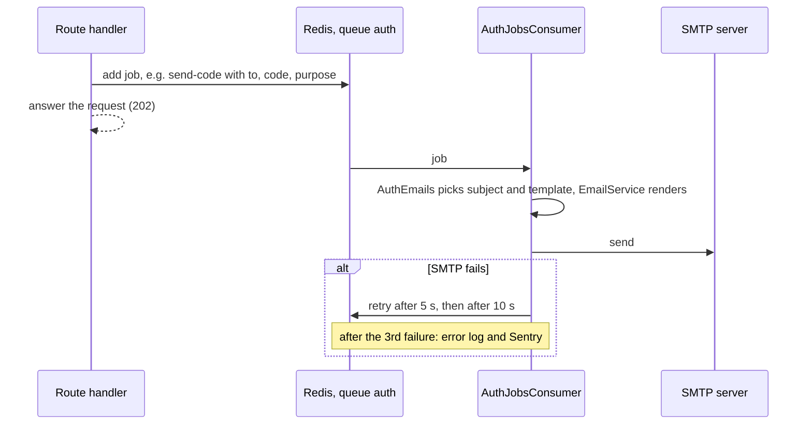

# Emails

Every email the auth module sends: when, what it says, which template, and
what it is given to fill in. Then how sending works (a queue), what you need
for it in development and production, how to edit the templates, and why the
queue dashboard must stay private.

Read this if you are setting up email, changing the wording, adding an
email, or chasing a code that never arrived. Choosing and configuring a
provider (Brevo, Resend, Amazon SES) is in
[../setup/email.md](../setup/email.md).

- [What you need](#what-you-need)
- [Every email](#every-email)
- [The emails one by one](#the-emails-one-by-one)
- [How an email is sent](#how-an-email-is-sent)
- [When Redis or SMTP is down](#when-redis-or-smtp-is-down)
- [Codes in the queue](#codes-in-the-queue)
- [Editing the templates](#editing-the-templates)
- [Adding an email](#adding-an-email)
- [Settings](#settings)
- [Troubleshooting](#troubleshooting)
- [Where it is in the code](#where-it-is-in-the-code)

## What you need

Email is not optional here: signing up is confirmed with an emailed code, so
without working email nobody can finish signing up or reset a password.

- **Development:** nothing to set up. `pnpm docker:dev` starts **Mailpit**, a
  mail catcher: every email the app sends lands there, whatever `EMAIL_*`
  says (the dev compose file points the app at it), and nothing is delivered
  for real. Read them at `http://localhost:8025`. Running the app on your
  machine instead (`pnpm dev`), the `.env.example` values
  (`EMAIL_HOST=localhost`, `EMAIL_PORT=1025`) reach the same Mailpit.
- **Production:** a real SMTP provider. The app refuses to start in
  production without `EMAIL_HOST`. Set `EMAIL_FROM_ADDRESS` to an address on
  a domain you have authenticated with the provider (SPF, DKIM, DMARC), or
  the codes land in spam. Step by step: [../setup/email.md](../setup/email.md).
- **Redis**, in both: emails go through a queue that lives there.

## Every email

All twelve are queued on the BullMQ queue `auth` and rendered from the
Handlebars templates in
[src/modules/auth/infrastructure/email/templates/](../../src/modules/auth/infrastructure/email/templates/).
`{app}` in a subject is `APP_NAME`.

| Email (job) | Sent when | Template | Subject |
|---|---|---|---|
| Sign-up code (`send-code`, `email-verify`) | Sign-up with a new or never-confirmed address; "send a new code" for an unconfirmed address | `verification-code.hbs` | Verify your {app} account |
| Reset code (`send-code`, `password-reset`) | "Forgot password" for an address with an account | `password-reset-code.hbs` | Reset your {app} password, or Choose a password for your {app} account (no password yet) |
| Set-password code (`send-code`, `password-set`) | `POST /auth/password/code` | `password-set-code.hbs` | Your code to set a {app} password |
| Delete code (`send-code`, `account-delete`) | `POST /auth/account/delete-code` | `account-delete-code.hbs` | Your code to delete your {app} account |
| Account exists (`account-exists`) | Sign-up, or "send a new code", for an address that is already confirmed | `account-exists.hbs` | You already have a {app} account |
| Password changed (`password-changed`) | Change password; reset password on an account that had one | `password-changed.hbs` | Your {app} password was changed |
| Password added (`password-added`) | A first password set (`POST /auth/password`), or a reset on an account that had none | `password-added.hbs` | A password was added to your {app} account |
| Sign-in method added (`sign-in-method-added`) | Google linked to an existing, confirmed account | `sign-in-method-added.hbs` | Google sign-in was added to your {app} account |
| Two-step changed (`two-factor-changed`) | Two-step sign-in turned on, or off (by the person, or by an operator with `pnpm auth:two-factor:off`) | `two-factor-changed.hbs` | Two-step verification was turned on (or off) for your {app} account |
| Recovery code used (`recovery-code-used`) | A recovery code used to **sign in** (not to turn two-step off or delete the account) | `recovery-code-used.hbs` | A recovery code was used to sign in to {app} |
| New recovery codes (`recovery-codes-replaced`) | `POST /auth/2fa/recovery-codes` | `recovery-codes-replaced.hbs` | New recovery codes were made for your {app} account |
| Account deleted (`account-deleted`) | `POST /auth/account/delete` | `account-deleted.hbs` | Your {app} account was deleted |

The code emails are the ones a person waits for. The rest are **security
notices**: each is the one email the owner needs if it was not them, and each
says what to do in that case.

What is deliberately **not** emailed: a sign-in from a new device, a failed
sign-in, a session ending. There is no "new sign-in" email.

## The emails one by one

Links in emails are built from `FRONTEND_URL` and point at three pages the web
app must have: `/sign-in`, `/forgot-password` and `/settings` (the React
starter has all three).

### Sign-up code

- **Says:** "Thank you for registering…", the code, "This code will expire in
  10 minutes", and "If you didn't request this code, please ignore this
  email. Never share this code with anyone."
- **Context:** `code`, `appName`, `expiresIn` (minutes), `fullName` (the
  account's display name, so "Hello, Ada." — or "Hello." without one; a new
  sign-up has none yet). The four code emails all greet this way; the reset,
  set-a-password and delete-account codes use the name when the account has
  one (for example from Google).
- **Rate:** counts against the per-address limits (1 a minute, 5 an hour).

### Reset code

- **Says:** "We received a request to reset your password…", the code and
  its lifetime. For an account with no password yet (made with Google) it
  says instead "You asked to choose a password… once you choose one, your
  email address and the password sign in too."
- **Context:** as the sign-up code, plus `firstPassword` (true when the
  account has no password).
- **Not sent** for an address with no account. The API answers the same
  `202` either way.

### Set-password code

- **Says:** "You asked to set a password for your account… Enter this code in
  Settings", and that no password is set without the code.
- **Context:** as the sign-up code.

### Delete code

- **Says:** "You asked to delete your {app} account. Enter this code on the
  page to confirm. Deleting cannot be undone." If it was not them, someone
  may be signed in: sign out everywhere from Settings.
- **Context:** as the sign-up code.

### Account exists

Sent instead of a code when someone signs up with an address that already has
a confirmed account, so sign-up can answer the same for every address while
the real owner still learns what to do.

- **Says:** "Someone, probably you, just tried to create a {app} account with
  this email address. You already have one", then how they sign in, in one
  of three wordings:
  - **Google only** (no password): "You created it with Google, so it has no
    password: choose Continue with Google", with buttons **Sign in** and
    **Set a password** (to `/forgot-password`);
  - **password and Google**: "Sign in with your password or with Google";
  - **password only**: "Sign in with your password, or choose a new one".
  The last two show **Sign in** and **Reset your password**.
- **Context:** `appName`, `providerOnly`, `passwordAndProvider`, `providers`
  (display names joined with " or "), `signInUrl` (`/sign-in`), `resetUrl`
  (`/forgot-password`).
- **Rate:** counts against the same per-address limits as a code, so it
  cannot be used to flood an inbox.

### Password changed

- **Says:** "Your {app} password was just changed… Every other device signed
  in to your account has been signed out." If it was not them: reset it with
  "Forgot password" and change the email account's password.
- **Context:** `appName`.

### Password added

- **Says:** "A password was just added to your {app} account… you can now
  sign in with your email address and this password, as well as the way you
  did before." If not them: choose a new password, sign out everywhere,
  secure the email account.
- **Context:** `appName`.

### Sign-in method added

- **Says:** "You just signed in to {app} with Google for the first time, so
  Google is now a way into your account, alongside your password." If not
  them: secure that Google account, then choose a new password, which signs
  out every device. Button: **Choose a new password**.
- **Context:** `appName`, `providerName` ("Google"), `resetUrl`.
- **Not sent** when the account was created by this Google sign-in, or when
  linking removed the password of a never-confirmed account.

### Two-step changed

- **On:** "Two-step verification is now on… Keep your recovery codes
  somewhere safe." If not them: choose a new password, then contact support
  to have it turned off, "a new password alone will not get you past it".
- **Off:** "Two-step verification is now off… Signing in needs only your
  password (or Google) again." If not them: choose a new password, then turn
  it back on.
- **Context:** `appName`, `enabled`, `resetUrl`, `supportEmail`. With
  `SUPPORT_EMAIL` set, the email names that address as a `mailto:` link;
  without it, it says "contact {app} support".

### Recovery code used

- **Says:** "A recovery code was just used to sign in… you have N left." With
  3 or fewer left, it adds "That is not many… choose New recovery codes in
  Settings". If not them: someone has the password and a recovery code;
  choose a new password now. Buttons: **Choose a new password**,
  **Settings**.
- **Context:** `appName`, `remaining`, `runningLow` (remaining is 3 or
  fewer), `settingsUrl` (`/settings`), `resetUrl`.

### New recovery codes

- **Says:** "New recovery codes were just made… The earlier ones no longer
  work." If not them: someone has the password and the authenticator app;
  choose a new password now.
- **Context:** `appName`, `resetUrl`.

### Account deleted

- **Says:** "Your {app} account was deleted, and you were signed out on
  every device. Your personal details (email address, names, bio and profile
  picture) are erased within N days." If not them: contact support now (by
  `SUPPORT_EMAIL` when set) and change the email account's password.
- **Context:** `appName`, `retentionDays` (`DELETED_ACCOUNT_RETENTION_DAYS`,
  default 30), `supportEmail`.

## How an email is sent

A request never talks to the mail server. It puts a job on the `auth` queue
in Redis and answers; a worker in the same app sends the email moments later.

**Why a queue.** Two reasons:

- **The answer must not depend on the mail server.** "Forgot password" says
  the same thing for an address with an account and one without. If it sent
  the email during the request, a slow or broken mail server would make the
  two answers take different times, or one of them fail, and reveal which
  addresses exist ([auth-mailer.port.ts](../../src/modules/auth/application/ports/auth-mailer.port.ts)).
- **The person does not wait** for a slow SMTP handshake.

**The job options** (`EMAIL_JOB_OPTIONS` in
[auth-email-jobs.ts](../../src/modules/auth/infrastructure/email/auth-email-jobs.ts))
replace the queue's slower defaults, because a code expires in minutes:

| Option | Value | Meaning |
|---|---|---|
| `attempts` | 3 | Tried three times in all |
| `backoff` | exponential from 5 s | The 2nd try 5 seconds after the 1st fails, the 3rd 10 seconds after the 2nd |
| `removeOnComplete` | `true` | A sent job is deleted at once: it holds the code |
| `removeOnFail` | 24 hours | A job that failed all three tries is kept a day, to inspect |

Each send also has its own timeouts: 10 seconds to connect, 10 for the
server's greeting, 30 of socket silence
([email.module.ts](../../src/shared/infrastructure/email/email.module.ts)).
So a dead mail server fails a job within about a minute, not ten.

A job that fails all three tries is logged at error level ("Job send-code of
auth failed after 3 attempt(s): …") and sent to Sentry, tagged with the queue
and job name and without the job's data
([queue-failure-reporter.ts](../../src/shared/infrastructure/queue/queue-failure-reporter.ts)).
The queue holds nothing but emails: auth's hourly clean-up runs on the
`maintenance` queue, so a backlog of emails never delays it.

## When Redis or SMTP is down

| What is down | What happens |
|---|---|
| **SMTP** | Requests still answer normally (the job is queued). Each email is tried 3 times over about 15 seconds, then given up, logged and reported. The person never gets the code; they ask for a new one once the mail server is back |
| **Redis** | The job cannot be queued. A request that would send an email waits for Redis, and fails with a timeout after `REQUEST_TIMEOUT_MS` (30 seconds) if it does not come back. Where the request had already stored a code, that code exists but was never sent; asking again makes a new one |

Routes that do not send email ("forgot password" for an unknown address,
sign-in) are unaffected by either. More on Redis outages:
[sessions-and-tokens.md](./sessions-and-tokens.md#when-redis-is-down).

## Codes in the queue

A `send-code` job holds the code itself, in clear, with the address it goes
to: the worker needs it to write the email. That means:

- **while a job waits or retries**, the code is readable in Redis and in the
  queue dashboard;
- **a job that failed all its tries** stays readable for **24 hours**;
- **a sent job** is deleted at once.

Anyone who can open the queue dashboard while a reset code is waiting can
reset that person's password. So:

- `/admin/queues` (the BullMQ dashboard) is always behind basic auth
  (`BULL_BOARD_USER`, `BULL_BOARD_PASSWORD`). In production the app refuses
  to start when the password is shorter than 12 characters, a well-known
  default such as `admin`, or a placeholder from the env template.
- The production nginx config also refuses `/admin/queues` from anywhere but
  local and private networks (`nginx/app.conf.template`). Reach it through an
  SSH tunnel or a VPN; do not open it to the internet.
- Redis itself must not be reachable from outside, and needs
  `REDIS_PASSWORD` in production.

The codes never appear in the logs: the request body field `code` is
redacted from logs and error reports, and the email queue's failure reports
leave the job's data out.

## Editing the templates

The templates are plain HTML with Handlebars placeholders, one file per email,
in [src/modules/auth/infrastructure/email/templates/](../../src/modules/auth/infrastructure/email/templates/).
Change the wording, the colours or the layout freely.

Rules that keep them working:

- **Strict mode is on** ([email.module.ts](../../src/shared/infrastructure/email/email.module.ts)):
  a placeholder the code does not pass, say `{{userName}}`, makes the send
  **fail** instead of printing an empty gap. Use only the variables listed
  for that email [above](#the-emails-one-by-one). A value only tested by a
  helper, as in `{{#if fullName}}`, may be missing.
- **Subjects are in the code**, not the templates:
  [auth-emails.ts](../../src/modules/auth/infrastructure/email/auth-emails.ts).
  Change them there.
- **Keep the "Wasn't you?" part** of the security notices: it is the reason
  they exist.
- **Keep the CSS inside the template**, in the existing `<style>` block or
  in `style=` attributes. Mail apps strip external stylesheets and scripts.
- **Images** must be absolute `https://` URLs; there are none today.

To preview a change: run the app in development, trigger the email (sign up
with a new address, or "forgot password"), and open Mailpit at
`http://localhost:8025`, which also shows the HTML source and an HTML
compatibility check. The build copies the templates into `dist/`
(`nest-cli.json`, also in watch mode), but the mailer keeps each template
compiled in memory after its first use: **restart the app** to see an edit to
a template that was already sent once.

Check an edited template by sending it: in development every email lands in
Mailpit (http://localhost:8025).

## Adding an email

For example, a "new sign-in" notice:

1. **Template**: `src/modules/auth/infrastructure/email/templates/new-sign-in.hbs`,
   copying the layout of an existing notice.
2. **Sender**: a method on `AuthEmails`
   ([auth-emails.ts](../../src/modules/auth/infrastructure/email/auth-emails.ts))
   with the subject and the context, as `sendPasswordChanged` does.
3. **Port**: a method on `AuthMailerPort`
   ([auth-mailer.port.ts](../../src/modules/auth/application/ports/auth-mailer.port.ts)),
   so handlers can ask for it without knowing about queues.
4. **Job**: a name in `AUTH_JOBS` and a job-data interface
   ([auth-email-jobs.ts](../../src/modules/auth/infrastructure/email/auth-email-jobs.ts)), and a method on `BullMqAuthMailer`
   ([bullmq-auth-mailer.adapter.ts](../../src/modules/auth/infrastructure/adapters/bullmq-auth-mailer.adapter.ts)) that adds it with
   `EMAIL_JOB_OPTIONS`.
5. **Worker**: a `case` in `AuthJobsConsumer.process`
   ([auth-jobs.consumer.ts](../../src/modules/auth/presentation/consumers/auth-jobs.consumer.ts))
   that calls the new `AuthEmails` method. An unknown job name is only
   warned about and dropped, so do not skip this step.
6. **Call it** from the handler, and add the method to the in-memory mailer
   in [auth-test-world.shared-spec.ts](../../src/modules/auth/application/commands/auth-test-world.shared-spec.ts).

Deploy the worker change before, or with, the code that queues the new job.

## Settings

| Variable | Default | Meaning |
|---|---|---|
| `EMAIL_HOST` | `localhost` | The SMTP server. **Required in production** |
| `EMAIL_PORT` | `587` (`.env.example`: `1025`, Mailpit) | `587` with STARTTLS, `465` with implicit TLS |
| `EMAIL_SECURE` | `false` | `true` for implicit TLS (port 465); `false` for 587 and for Mailpit |
| `EMAIL_USER`, `EMAIL_PASSWORD` | empty | Leave both empty for a server that takes mail without a login (Mailpit, a private relay) |
| `EMAIL_FROM_NAME` | `Test App` | The sender's name |
| `EMAIL_FROM_ADDRESS` | `noreply@testapp.com` | The sender's address. Use your authenticated domain |
| `APP_NAME` | `Test App` | In every subject and email body |
| `FRONTEND_URL` | `http://localhost:3001` | The web app; the base of every link. **Required in production** |
| `SUPPORT_EMAIL` | empty | Named in the two-step-changed and account-deleted emails. Empty: they say "contact {app} support" without an address. Set it in production |
| `DELETED_ACCOUNT_RETENTION_DAYS` | `30` | The "erased within N days" in the account-deleted email |
| `BULL_BOARD_USER`, `BULL_BOARD_PASSWORD` | `admin` / `admin` | The queue dashboard's login. Production refuses the defaults |

In development the dev compose file overrides `EMAIL_HOST`, `EMAIL_PORT` and
`EMAIL_SECURE` to point at Mailpit; remove those three lines from
`docker-compose.dev.yaml` to send real mail from the dev container. Every
setting: [environment.md](../environment.md).

## Troubleshooting

| Symptom | Look at | Likely cause |
|---|---|---|
| No code arrives (development) | Mailpit, `http://localhost:8025` | It is there: development never delivers real mail |
| No code arrives (production) | The error logs for "Job send-code of auth failed", and failed jobs in `/admin/queues` | Wrong `EMAIL_*`; the provider refusing the sender address; port 25/465/587 blocked by the server's host |
| `Missing credentials for "PLAIN"` | `EMAIL_USER`, `EMAIL_PASSWORD` | A user without a password. Set both, or leave both empty |
| Codes land in spam | The provider's domain settings | SPF, DKIM and DMARC not set for the `EMAIL_FROM_ADDRESS` domain ([../setup/email.md](../setup/email.md)) |
| "Forgot password" says the email is on its way, nothing comes | Is there an account for that address? | No account: nothing is sent, by design |
| Sign-up says "check your email", the email says "You already have an account" | | The address was already confirmed: by design |
| A send fails with a Handlebars error | The template you just edited | A placeholder the code does not pass (strict mode) |
| Links in emails go to localhost | `FRONTEND_URL` | Not set for production |
| `429`, `data.reason: "emails"` | | 1 code email a minute, 5 an hour per address. Wait the `Retry-After` |

More: [operations.md](./operations.md).

## Where it is in the code

| File | What |
|---|---|
| [auth-mailer.port.ts](../../src/modules/auth/application/ports/auth-mailer.port.ts) | What handlers can ask for, and why it is queued |
| [auth-email-jobs.ts](../../src/modules/auth/infrastructure/email/auth-email-jobs.ts) | Job names, job data, `EMAIL_JOB_OPTIONS`: what the adapter adds and the consumer reads |
| [bullmq-auth-mailer.adapter.ts](../../src/modules/auth/infrastructure/adapters/bullmq-auth-mailer.adapter.ts) | Adds the jobs: `AuthMailerPort` on BullMQ |
| [auth-jobs.consumer.ts](../../src/modules/auth/presentation/consumers/auth-jobs.consumer.ts) | The worker: sends each job's email |
| [auth-emails.ts](../../src/modules/auth/infrastructure/email/auth-emails.ts) | Subjects, templates, context |
| [templates/](../../src/modules/auth/infrastructure/email/templates/) | The twelve templates |
| [email.service.ts](../../src/shared/infrastructure/email/email.service.ts) | Shared: delivers a template, knows nothing of auth |
| [email.module.ts](../../src/shared/infrastructure/email/email.module.ts) | Shared: SMTP transport, timeouts, Handlebars strict mode |
| [email.config.ts](../../src/config/email.config.ts) | `EMAIL_*` |
| [queues.ts](../../src/shared/infrastructure/queue/queues.ts) | The `auth` queue and its defaults |
| [queue-failure-reporter.ts](../../src/shared/infrastructure/queue/queue-failure-reporter.ts) | Error log and Sentry when a job gives up |

## Related

- [../setup/email.md](../setup/email.md): picking a provider and getting the SMTP settings
- [flows.md](./flows.md): which flow sends which email
- [passwords-and-codes.md](./passwords-and-codes.md#emailed-codes): the code rules
- [BULLMQ-GUIDE.md](../BULLMQ-GUIDE.md): queues in general
- [error-tracking.md](../error-tracking.md): where failed sends are reported
