# Every flow, step by step

What happens, in order, when someone signs up, signs in, refreshes, signs
out, resets or changes a password, signs in with Google, or deletes their
account. Each flow has a diagram, then numbered steps naming the route, what
is checked, and what can go wrong.

Read this if you are building the frontend, writing a test, or want to know
exactly what a route does before changing it. The words used here are
explained in [concepts.md](./concepts.md). Every route's full request and
response shapes are in [api-reference.md](./api-reference.md).

- [How to read this page](#how-to-read-this-page)
- [Sign up and confirm the address](#sign-up-and-confirm-the-address)
- [Sign in](#sign-in)
- [Sign in with two-step verification](#sign-in-with-two-step-verification)
- [Refresh](#refresh)
- [Sign out](#sign-out)
- [Forgot and reset the password](#forgot-and-reset-the-password)
- [Change the password](#change-the-password)
- [Set a first password](#set-a-first-password)
- [Sign in with Google](#sign-in-with-google)
- [Delete the account](#delete-the-account)

## How to read this page

- **Routes** are written without the prefix. `POST /auth/login` means
  `POST /api/v1/auth/login` (`API_PREFIX` is `api` by default).
- **Bodies are snake_case** on the wire (`new_password`, `turnstile_token`).
  An unknown field, or a field that fails validation, is
  `422 VALIDATION_ERROR` (code `422000`) on every route.
- **Errors** are written as `status TYPE`, for example
  `401 AUTH_INVALID_CREDENTIALS`. The type is `meta.type` in the error
  envelope; extra details are in `data` (for example `data.reason`).
- **Every route** can also answer `429` from the global per-IP throttler
  (type `THROTTLE_ERROR`), on top of the auth limits listed per flow
  ([rate-limits.md](./rate-limits.md)).
- **"Signed in"** means the route needs `Authorization: Bearer <access_token>`.
  Without a usable one it answers `401 AUTH_TOKEN_MISSING`,
  `AUTH_TOKEN_EXPIRED`, `AUTH_TOKEN_INVALID` or `AUTH_TOKEN_REVOKED`, or
  `403 AUTH_ACCOUNT_DISABLED` for a deleted account
  ([the check on every request](./sessions-and-tokens.md#the-check-on-every-request)).
- **Emails** are queued, not sent during the request
  ([emails.md](./emails.md)). In development they land in Mailpit,
  `http://localhost:8025`.
- **Turnstile** steps apply only when Turnstile is on
  ([turnstile.md](./turnstile.md)).

## Sign up and confirm the address

Creating an account takes two requests: one that emails a code, and one that
checks it and signs in.

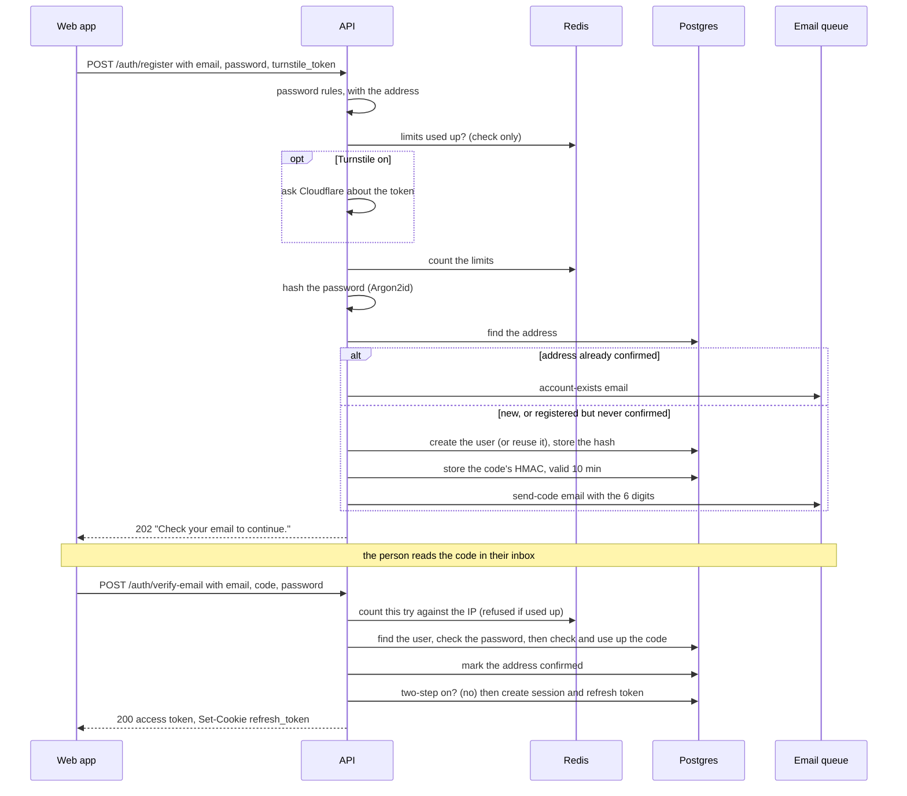

**1. `POST /auth/register`** (public). Body: `email`, `password`,
`turnstile_token` (only when Turnstile is on).
[register.handler.ts](../../src/modules/auth/application/commands/register/register.handler.ts)

1. The address is trimmed and lower-cased.
2. The password is checked against the
   [rules](./passwords-and-codes.md#the-password-rules), with the address only.
   Broken: `422 AUTH_PASSWORD_REJECTED`, `data.rules` lists the rule ids.
   This comes first so a password the form must change does not cost the
   person a Turnstile challenge.
3. The limits are checked without counting: new accounts per IP (5 an hour,
   20 with Turnstile on), sign-up emails per address (1 a minute), code
   emails per address (5 an hour). Used up:
   `429 RATE_LIMIT_EXCEEDED` with `data.reason` `network` or `emails` and a
   `Retry-After` header.
4. Turnstile, when on: no token `400 AUTH_CAPTCHA_REQUIRED`, a bad token
   `400 AUTH_CAPTCHA_FAILED`, Cloudflare unreachable
   `503 AUTH_CAPTCHA_UNAVAILABLE`.
5. The limits are counted (checked once more: two requests racing past the
   first check are still caught).
6. The password is hashed, every time, so the answer takes as long whether or
   not the address is taken.
7. Then, depending on the address:
   - **already confirmed**: no account is made; its owner is emailed "You
     already have an account" (`account-exists`), with links to sign in and
     to reset the password;
   - **registered but never confirmed**: the new password replaces the old
     one, and a fresh code is emailed. Whoever can read the inbox is the
     owner;
   - **new**: an unconfirmed user is created, the hash stored, and a code
     emailed (`send-code`, purpose `email-verify`).
8. Answer: `202`, `data: null`. The same answer
   in every case, so sign-up cannot be used to find out who has an account.

**2. `POST /auth/verify-email`** (public). Body: `email`, `code` (exactly six
digits, else `422`), `password` (the one from the last sign-up, else `422`).
[verify-email.handler.ts](../../src/modules/auth/application/commands/verify-email/verify-email.handler.ts)

1. Wrong codes from this IP: 20 an hour across all addresses. The try is
   counted before anything is checked, and taken back if it was right, so a
   burst of requests sent at once is limited like a slow one. Used up:
   `429 RATE_LIMIT_EXCEEDED`, `data.reason: "network"`.
2. The user is looked up by address and the password checked (an unknown
   address still runs a hash). A wrong password stops here, with the
   same answer as a wrong code, and without using up one of the code's tries.
   It is there because signing up again replaces the password of an
   unconfirmed account: see [accounts.md](./accounts.md#confirming-the-address).
3. The code is checked. Each check counts one of the code's 5 attempts, in the
   same database statement.
   - unknown address, wrong password, wrong code, or no code waiting:
     `400 AUTH_CODE_INVALID` (one error for all, so this route cannot find
     accounts either);
   - older than 10 minutes, or the 5th wrong try: `400 AUTH_CODE_EXPIRED`.
     The person asks for a new code.
   Either failure counts one against the IP's 20.
4. Right code: the code is used up, the address marked confirmed, and the
   cached user dropped.
5. Signed in through the [sign-in gate](./sessions-and-tokens.md#sessions):
   `200`, the access token in the body and
   the refresh cookie set.

**Resending the code: `POST /auth/resend-verification`** (public). Body:
`email`.
[resend-verification.handler.ts](../../src/modules/auth/application/commands/resend-verification/resend-verification.handler.ts)

1. Limits, checked and counted: code emails per IP (10 an hour), per address
   (1 a minute, 5 an hour). Used up: `429` with `data.reason` `network` or
   `emails`. No Turnstile on this route.
2. No account: nothing is sent. Unconfirmed: a new code, which makes the
   earlier one stop working. Confirmed: the `account-exists` email.
3. Answer: `202` "If that address has an account, an email is on its way."

**What can go wrong for the person**

- The code never arrives: see [emails.md](./emails.md#when-redis-or-smtp-is-down).
- They wait more than 10 minutes, or type it wrong 5 times: they ask for a
  new one. Only the newest code works.
- They reload the confirm page: the web app no longer has the password from
  the sign-up form, so it asks for it alongside the code.
- They signed up twice with different passwords: only the newest code works,
  with the password from that last sign-up.
- They never confirm: the account is deleted after
  `UNVERIFIED_ACCOUNT_RETENTION_DAYS` (7), which frees the address
  ([accounts.md](./accounts.md)).
- They try to sign in before confirming: `403 AUTH_EMAIL_NOT_VERIFIED`
  (only after the right password), so the web app can offer to resend.

## Sign in

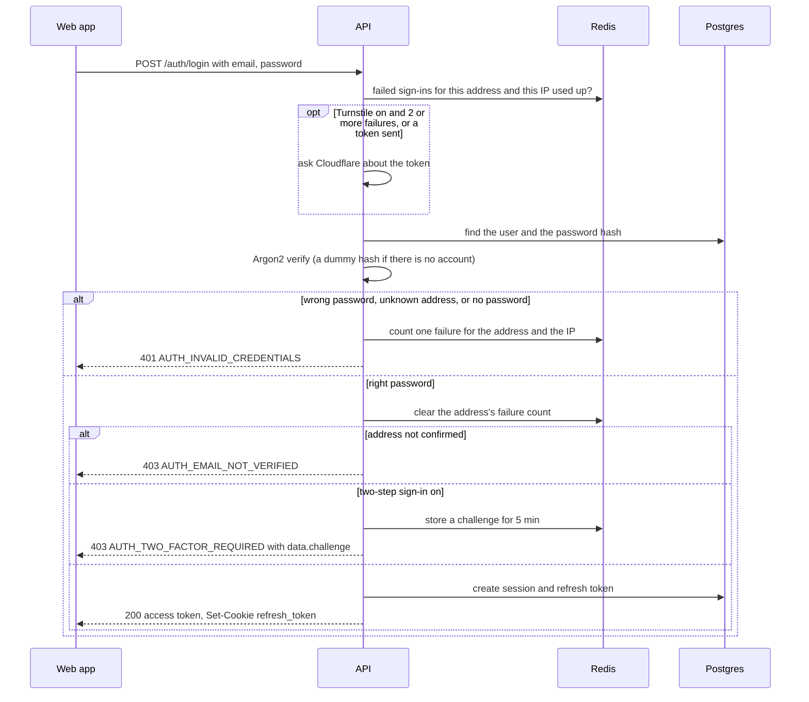

**`POST /auth/login`** (public). Body: `email`, `password`, `turnstile_token`
(when asked for). Send it with credentials so the browser stores the cookie.
[login.handler.ts](../../src/modules/auth/application/commands/login/login.handler.ts)

1. The limits are checked without counting: failed sign-ins per address
   (5 per 15 minutes, 20 with Turnstile on) and per IP (10 per 15 minutes).
   Used up: `429 RATE_LIMIT_EXCEEDED`, `data.reason` `sign_ins` (the address)
   or `network` (the IP). The 6th attempt after 5 failures is the first
   refused.
2. Turnstile, when on, is required once the address or the IP has 2 or more
   failures (so from the 3rd attempt), and whenever a token is sent anyway:
   `400 AUTH_CAPTCHA_REQUIRED`, `400 AUTH_CAPTCHA_FAILED` or
   `503 AUTH_CAPTCHA_UNAVAILABLE`.
3. The password is checked. A wrong password, an unknown address and an
   account with no password (made with Google) are the same answer,
   `401 AUTH_INVALID_CREDENTIALS` "Incorrect email or password.", and take
   the same time (an unknown address is checked against a dummy hash). A
   failure counts one against the address and one against the IP. With
   Turnstile on, once either count reaches 2 the error also carries
   `data.captcha_required: true`, so the page shows the widget before the
   next try.
4. Right password: the address's failure count is cleared (the IP's is not).
5. Address not confirmed: `403 AUTH_EMAIL_NOT_VERIFIED`. Said only now,
   after the right password, so it gives nothing away; the web app offers
   `resend-verification`.
6. The hash is upgraded if it was made with older Argon2 settings.
7. The sign-in gate: with two-step sign-in on,
   `403 AUTH_TWO_FACTOR_REQUIRED` with `data.challenge`, which is the next
   step, not a failure ([below](#sign-in-with-two-step-verification)).
   Otherwise a session starts: `200`,
   `{ access_token, token_type, expires_in }`, and the refresh cookie.

The forms around it: a "Forgot password?" link
([below](#forgot-and-reset-the-password)), and "Continue with Google" when
`GET /auth/options` lists `google` ([below](#sign-in-with-google)).
`GET /auth/options` also gives the Turnstile site key, or `null` when
Turnstile is off.

## Sign in with two-step verification

For an account with two-step sign-in on, every first step (password,
confirming the address, resetting the password, Google) ends with a
challenge instead of a session. Turning it on and off is in
[two-step-sign-in.md](./two-step-sign-in.md).

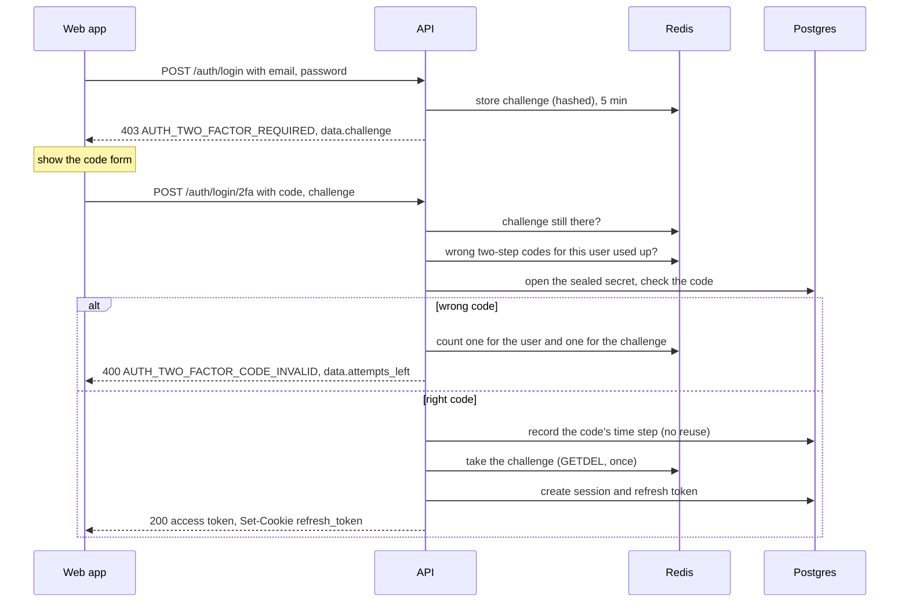

**`POST /auth/login/2fa`** (public). Body: `code` (six digits from the app,
or a recovery code like `K7Q2M-X9HDP`), `challenge`. Send with credentials.
[complete-two-factor-sign-in.handler.ts](../../src/modules/auth/application/commands/complete-two-factor-sign-in/complete-two-factor-sign-in.handler.ts)

1. The challenge comes from the body, or, when the body has none, from the
   `two_factor` cookie (after Google, [below](#after-google-with-two-step-sign-in-on)).
   In the cookie case the `Origin` must be in `CORS_ORIGINS`, else
   `403 AUTH_FORBIDDEN`.
2. Unknown, already used, or older than 5 minutes:
   `401 AUTH_TWO_FACTOR_CHALLENGE_EXPIRED`. The person starts the sign-in
   over.
3. Wrong two-step codes for this user: 5 per 15 minutes, across challenges.
   Used up: `429 RATE_LIMIT_EXCEEDED`, `data.reason: "wrong_codes"`.
4. The account was deleted meanwhile: the challenge is taken,
   `403 AUTH_ACCOUNT_DISABLED`.
5. The secret is opened. If it was sealed with an encryption key the server
   no longer has: `503 AUTH_TWO_FACTOR_UNAVAILABLE` (an operator problem:
   [two-step-sign-in.md](./two-step-sign-in.md)).
6. A six-digit code is checked against the app's secret (one 30-second step
   either side is accepted), and must be newer than the last one accepted.
   Anything else is tried as a recovery code. Using a recovery code emails
   the owner (`recovery-code-used`).
7. Wrong code: counted against the user and against the challenge's 5 tries.
   - the user's 5 are used up: the challenge is taken,
     `429 RATE_LIMIT_EXCEEDED`, `data.reason: "wrong_codes"`;
   - the challenge's 5 are used up: `401 AUTH_TWO_FACTOR_CHALLENGE_EXPIRED`;
   - otherwise `400 AUTH_TWO_FACTOR_CODE_INVALID` with `data.attempts_left`
     (whichever runs out first).
8. Right code: the challenge is taken with `GETDEL` (two requests racing with
   the same right code cannot both get a session), the user's wrong-code
   count is cleared, a session starts, and the `two_factor` cookie is
   cleared if it was used. `200`, token and cookie.

A password reset changes the password first and then stops at this same
challenge: resetting cannot get around the second step.

## Refresh

The access token lasts 15 minutes. Before it runs out, and on every page
load, the web app trades the refresh cookie for a new access token. The
rules are in [sessions-and-tokens.md](./sessions-and-tokens.md#refreshing-and-rotation).

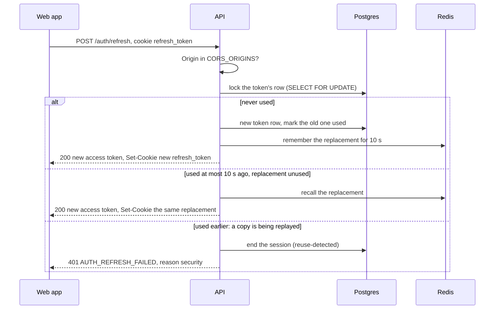

**`POST /auth/refresh`** (public; the cookie is the credential). No body.
Must be sent with credentials.
[refresh.handler.ts](../../src/modules/auth/application/commands/refresh/refresh.handler.ts)

1. `Origin` not in `CORS_ORIGINS`: `403 AUTH_FORBIDDEN`, and the cookie is
   left alone. No `Origin` at all (a non-browser client) is allowed.
2. No cookie, or an unknown token: `401 AUTH_REFRESH_FAILED` with no reason.
3. The token's row is locked, so a second refresh with the same token waits.
4. The session ended: `401 AUTH_REFRESH_FAILED` with `data.reason`:
   `expired`, `signed_out`, `signed_out_everywhere`, `password_changed`,
   `security` or `account_deleted`.
5. Never used: rotated. `200`, a new access token, and a new cookie with the session's original end date.
6. Used within the last 10 seconds and its replacement not yet used: the
   same replacement is handed back (two tabs, below).
7. Used before that: the session ends, the reuse is logged, counted, alerted
   and sent to Sentry, and the answer is `401 AUTH_REFRESH_FAILED` with
   `data.reason: "security"`.

On every `401` the response also clears the cookie.

### Two tabs at once

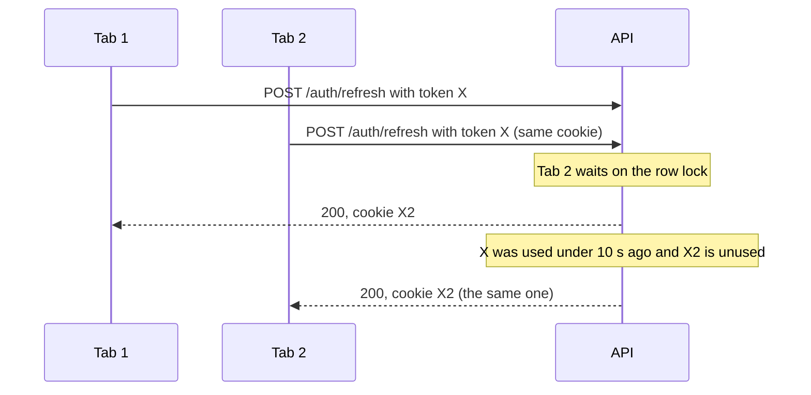

Both tabs end with the same cookie, and the session lives on. If Tab 2's
request had come more than 10 seconds later with X, or after X2 had already
been used, it would be treated as theft.

## Sign out

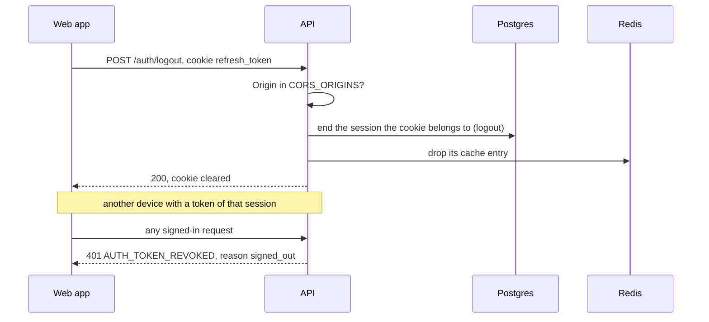

**`POST /auth/logout`** (public; the cookie is the credential). No body.
Send with credentials so the clearing `Set-Cookie` applies.
[logout.handler.ts](../../src/modules/auth/application/commands/logout/logout.handler.ts)

1. `Origin` not in `CORS_ORIGINS`: `403 AUTH_FORBIDDEN`.
2. The session the cookie belongs to is ended (reason `logout`) and its cache
   entry dropped, so its access tokens stop working on their next request.
3. Always `200`, and the cookie is cleared. No cookie, or a cookie for a session that already ended, changes
   nothing and still answers `200`.
4. The web app forgets the access token it holds in memory.

**`POST /auth/logout-all`** (signed in). No body. Send with credentials.

1. Every session of the user is ended (reason `logout-all`), this one
   included, and their cache entries dropped.
2. `200`, "Signed out on every device", and this browser's cookie is
   cleared.
3. Every other device gets `401 AUTH_TOKEN_REVOKED` with
   `data.reason: "signed_out_everywhere"` on its next request, or
   `401 AUTH_REFRESH_FAILED` with the same reason on its next refresh.

## Forgot and reset the password

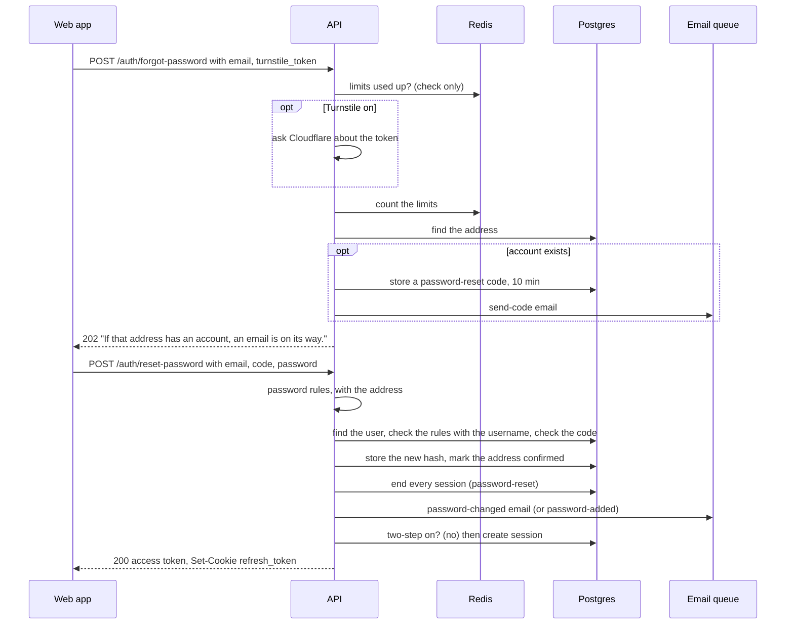

**1. `POST /auth/forgot-password`** (public). Body: `email`,
`turnstile_token` (when Turnstile is on).
[forgot-password.handler.ts](../../src/modules/auth/application/commands/forgot-password/forgot-password.handler.ts)

1. Limits checked without counting: code emails per IP (10 an hour), per
   address (1 a minute, 5 an hour). Used up: `429`, `data.reason` `network`
   or `emails`. Counted for every address, account or not.
2. Turnstile, when on, always: `400 AUTH_CAPTCHA_REQUIRED`,
   `400 AUTH_CAPTCHA_FAILED`, `503 AUTH_CAPTCHA_UNAVAILABLE`. Checked after
   the limits, so a refusal does not spend the person's solved challenge.
3. The limits are counted.
4. No account: nothing is sent. Otherwise a `password-reset` code is emailed.
   For an account with no password yet (made with Google), the email is
   worded "Choose a password" instead of "Reset".
5. Always `202` with the same message.

**2. `POST /auth/reset-password`** (public). Body: `email`, `code`,
`password` (the new one). Send with credentials: it signs in.
[reset-password.handler.ts](../../src/modules/auth/application/commands/reset-password/reset-password.handler.ts)

1. Wrong codes from this IP: 20 an hour. Used up: `429`,
   `data.reason: "network"`.
2. The new password against the rules, with the address only:
   `422 AUTH_PASSWORD_REJECTED`. Before the lookup, so the refusal cannot
   depend on whether the account exists.
3. Unknown address: `400 AUTH_CODE_INVALID` (and one wrong code counted).
4. The rules again, with the username too: `422 AUTH_PASSWORD_REJECTED`.
   Before the code, so a refused password does not use the code up.
5. The code: `400 AUTH_CODE_INVALID` or `400 AUTH_CODE_EXPIRED`, counting a
   wrong code against the IP.
6. The new hash is stored and the address marked confirmed (the code reached
   it).
7. **Every session ends** (reason `password-reset`), on every device,
   including this one's old session. Whoever else was signed in, possibly
   the reason for the reset, is out.
8. The owner is emailed `password-changed`, or `password-added` if the
   account had no password before.
9. The sign-in gate: one new session for this device, `200`,
   token and cookie; or
   `403 AUTH_TWO_FACTOR_REQUIRED` with a challenge. The password is already
   changed at that point.

## Change the password

For a signed-in person who knows their current password.

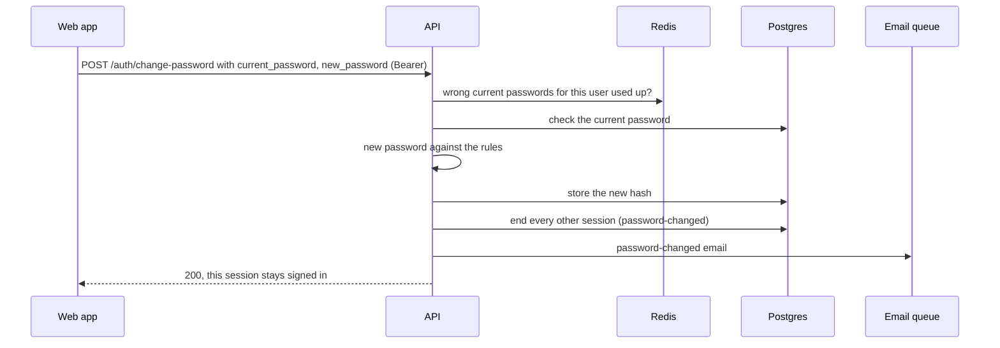

**`POST /auth/change-password`** (signed in). Body: `current_password`,
`new_password`.
[change-password.handler.ts](../../src/modules/auth/application/commands/change-password/change-password.handler.ts)

1. Wrong current passwords for this user: 5 per 15 minutes. Used up: `429`,
   `data.reason: "wrong_password"`.
2. Wrong current password, or an account with no password:
   `400 AUTH_CURRENT_PASSWORD_INVALID`, counting one. It is a `400`, not a
   `401`, on purpose: clients treat any `401` as "signed out".
   Accounts without a password use [set a first password](#set-a-first-password)
   instead.
3. The new password against the rules, with the address and the username:
   `422 AUTH_PASSWORD_REJECTED`.
4. The new hash is stored, **every other session ends** (reason
   `password-changed`), the count is cleared, and the owner is emailed
   `password-changed`.
5. `200`, `data: null`. This
   session stays signed in; its cookie is unchanged.

## Set a first password

For an account made with Google, which has no password. Being signed in is
not enough on its own (a session left open on a shared computer would let
anyone add a permanent way in), so a code goes to the inbox first.

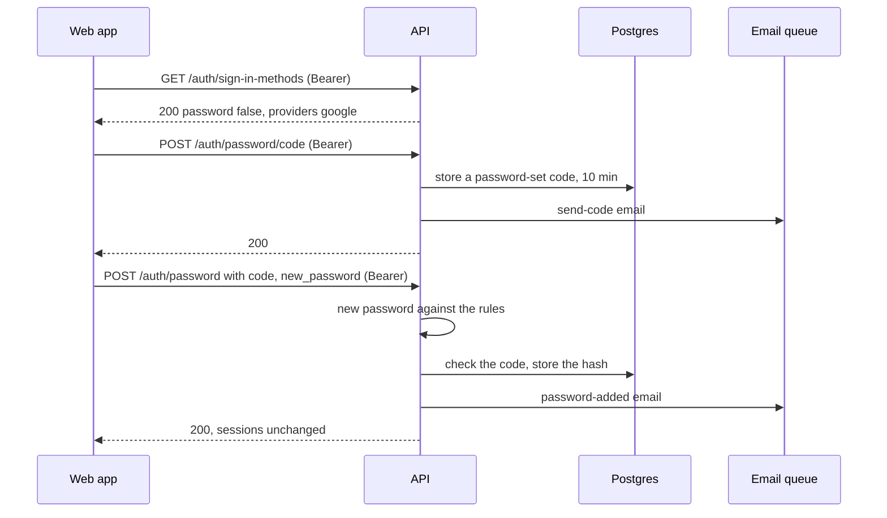

1. **`GET /auth/sign-in-methods`** (signed in): `{ password: false,
   providers: ["google"] }` tells the settings page to offer "Set a
   password" rather than "Change password".
2. **`POST /auth/password/code`** (signed in, no body).
   [set-password.handler.ts](../../src/modules/auth/application/commands/set-password/set-password.handler.ts)
   - The account has a password already: `409 AUTH_PASSWORD_ALREADY_SET`.
   - Code emails to the address: 1 a minute, 5 an hour. Used up: `429`,
     `data.reason: "emails"`.
   - A `password-set` code is emailed. `200`, `data: null`.
3. **`POST /auth/password`** (signed in). Body: `code`, `new_password`.
   - Wrong codes from this IP: 20 an hour (`429`, `network`).
   - Has a password already: `409 AUTH_PASSWORD_ALREADY_SET`.
   - The rules, with address and username: `422 AUTH_PASSWORD_REJECTED`.
     Checked before the code, so a refused password does not use it up.
   - The code: `400 AUTH_CODE_INVALID` or `400 AUTH_CODE_EXPIRED`.
   - The hash is stored, the owner emailed `password-added`. `200`,
     `data: null`. Sessions are untouched, and Google keeps working.

"Forgot password" on the sign-in page reaches the same result for someone
who is not signed in: the reset email is worded "Choose a password".

## Sign in with Google

On only when `GOOGLE_CLIENT_ID` and `GOOGLE_CLIENT_SECRET` are both set
(`GET /auth/options` then lists `google`). It is a sequence of browser
navigations, not API calls: the web app sends the whole page to the API,
which sends it to Google and back. How it is configured, and every rule, is
in [google-sign-in.md](./google-sign-in.md).

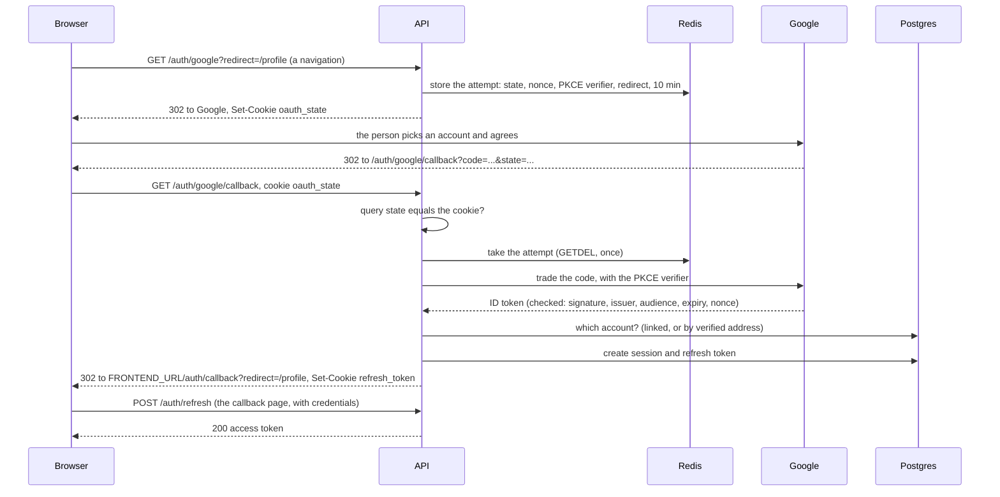

**1. `GET /auth/google?redirect=/path`** (public; a full-page navigation).
[start-oauth.handler.ts](../../src/modules/auth/application/commands/start-oauth/start-oauth.handler.ts)

1. An unknown or unconfigured provider: `404` (`NOT_FOUND_ERROR`, as JSON).
2. `redirect` is kept only if it is a path on the web app: it must start
   with one `/`, contain no `\` or control characters, and be at most 2048
   characters. Anything else becomes `/`.
3. A `state`, a `nonce` and a PKCE verifier are made and stored in Redis
   with the redirect for 10 minutes (`auth:oauth:<state>`). Redis or Google's
   discovery document unreachable: `500`.
4. `302` to Google (scope `openid email profile`, `prompt=select_account`),
   with an `oauth_state` cookie holding the same `state`.

**2. `GET /auth/google/callback`** (public; Google sends the browser here).
[finish-oauth.handler.ts](../../src/modules/auth/application/commands/finish-oauth/finish-oauth.handler.ts)

Every outcome is a `302` to `FRONTEND_URL/auth/callback?...`, never a JSON
error, and the `oauth_state` cookie is cleared.

1. The `state` in the URL must equal the cookie, and the attempt must still
   be in Redis (taken once). Otherwise `?error=failed`. This stops someone
   sending a victim a return link with the attacker's own code.
2. Google returned `error=access_denied` (the person said no):
   `?error=cancelled`. Any other Google error: `?error=failed`.
3. The code is traded for an ID token, server to server, with the PKCE
   verifier; the token's signature, issuer, audience, expiry and nonce are
   checked. Any failure: `?error=failed`.
4. Which account, below. Google has not verified the address:
   `?error=email_unverified`. Linked to a deleted account:
   `?error=account_deleted`.
5. The sign-in gate: a session and the refresh cookie, then
   `?redirect=/path`; or, with two-step sign-in on, the `two_factor` cookie
   and `?two_factor=1&redirect=/path`.
6. When a never-confirmed account's password was removed while linking,
   `&notice=password_removed` is added, so the web app can tell the person.
7. Unexpected errors (database, Redis): `?error=failed`, logged at error
   level. The reason for every failure is logged at warn level: "google
   sign-in did not complete (failed): …".

**3. The web app's `/auth/callback` page** reads the query. With `redirect`
alone it calls `POST /auth/refresh` (with credentials) to get an access token,
exactly as a page reload does, then goes to the path after checking it again.
With `error`, it shows what went wrong and offers to try again.

### Which account

The person is recognised by Google's id for them (`sub`), never by their
address alone, which can change at Google.

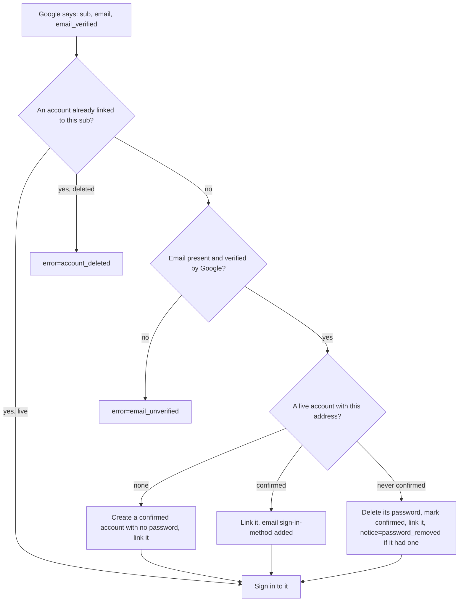

| Situation | What happens | Email |
|---|---|---|
| **Returning**: already linked | Signed in to that account | none |
| **First time, no account** | A new account: confirmed, display name from Google, no password | none |
| **Linking a confirmed account** (signed up with a password earlier) | Linked; the password keeps working too | `sign-in-method-added` ("Google sign-in was added…"), the one they need if it was not them |
| **Linking a never-confirmed account** | Its password is **deleted**, the address marked confirmed, then linked | none; the web app shows `notice=password_removed` |

Why delete the password in the last case: whoever set it never proved they
read the inbox, and Google just did. Otherwise someone could register a
victim's address first, wait for the victim to use Google, then sign in with
the password they chose.

### After Google, with two-step sign-in on

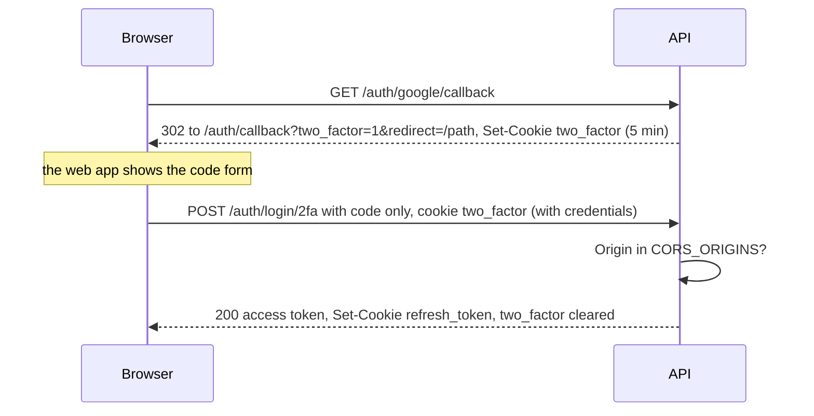

The challenge travels in the `two_factor` cookie (httpOnly, path
`/api/v1/auth/login/2fa`), never in the URL, where it would end up in
browser history and logs. The web app posts the code with no `challenge` in
the body, so the API reads the cookie. Errors are those of
[sign in with two-step verification](#sign-in-with-two-step-verification),
plus `403 AUTH_FORBIDDEN` for an `Origin` not in `CORS_ORIGINS`.

## Delete the account

Deleting needs proof it is the owner, not only a signed-in session (or anyone
at an unlocked computer could do it). Which proof depends on the account.

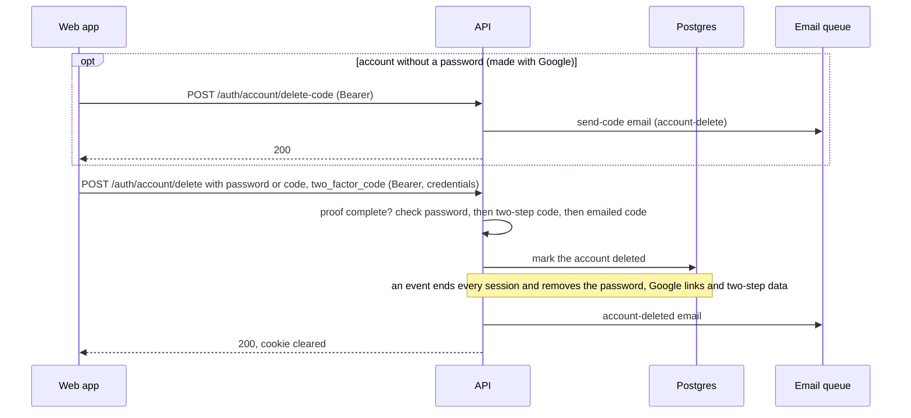

**1. `POST /auth/account/delete-code`** (signed in, no body), only for an
account with no password.
[delete-own-account.handler.ts](../../src/modules/auth/application/commands/delete-own-account/delete-own-account.handler.ts)

- The account has a password: `409 AUTH_USE_PASSWORD` (confirm with the
  password instead).
- Code emails to the address: 1 a minute, 5 an hour (`429`, `emails`).
- An `account-delete` code is emailed. `200`, `data: null`.

**2. `POST /auth/account/delete`** (signed in). Body: `password` (accounts
with one), or `code` (accounts without), plus `two_factor_code` when
two-step sign-in is on. Send with credentials so the cookie is cleared.

1. Proof missing: `400 AUTH_CONFIRMATION_REQUIRED` with `data.needs`, a list
   of `password`, `code` and `two_factor_code`. A web app can send an empty
   body first to learn what this account needs.
2. The password, if the account has one. Wrong current passwords per user:
   5 per 15 minutes (`429`, `wrong_password`). Wrong:
   `400 AUTH_CURRENT_PASSWORD_INVALID`.
3. The two-step code, if it is on (an app code or a recovery code; no
   "recovery code used" email here, the account-deleted one follows). Wrong
   two-step codes per user: 5 per 15 minutes. Wrong:
   `400 AUTH_TWO_FACTOR_CODE_INVALID` with `data.attempts_left`, or `429`
   `wrong_codes` when none are left. Unreadable secret:
   `503 AUTH_TWO_FACTOR_UNAVAILABLE`.
4. The emailed code, for an account without a password. Wrong codes per IP:
   20 an hour (`429`, `network`). Wrong or expired: `400 AUTH_CODE_INVALID`
   or `400 AUTH_CODE_EXPIRED`.
5. The users module marks the account deleted. A second deletion racing this
   one: `404 USER_NOT_FOUND`.
6. Straight after, an event handler ends every session (reason
   `account-deleted`) and removes the password, the Google links, the
   two-step secret and the recovery codes. Until it has run, the guard
   already refuses the account.
7. The owner is emailed `account-deleted`, which says when their personal
   details are erased (`DELETED_ACCOUNT_RETENTION_DAYS`, default 30).
8. `200`, and the cookie is cleared. Every
   other device gets `403 AUTH_ACCOUNT_DISABLED` on its next request.

What is kept and erased, and when: [accounts.md](./accounts.md).

## Related

- [sessions-and-tokens.md](./sessions-and-tokens.md): the token and session rules behind these flows
- [passwords-and-codes.md](./passwords-and-codes.md): the password rules and the emailed codes
- [emails.md](./emails.md): every email these flows send
- [rate-limits.md](./rate-limits.md): every limit named here
- [api-reference.md](./api-reference.md): every route and error, as reference
