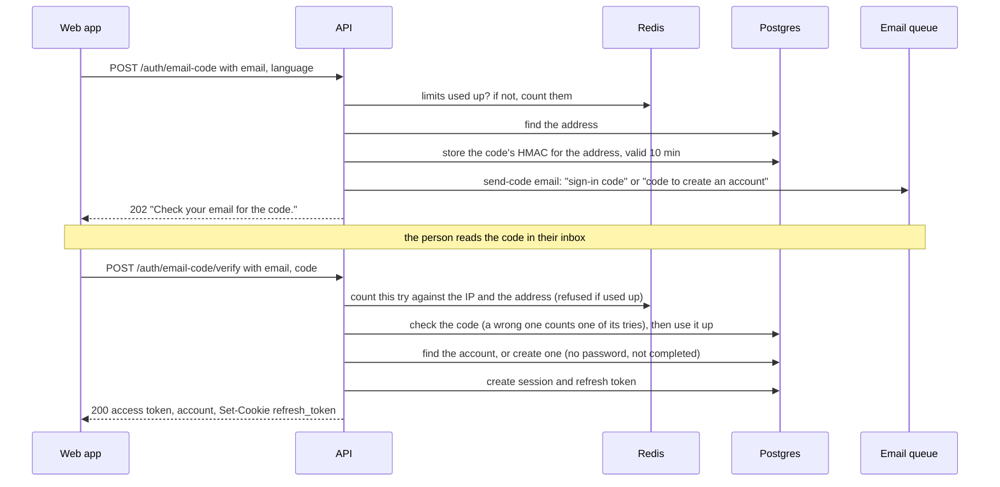
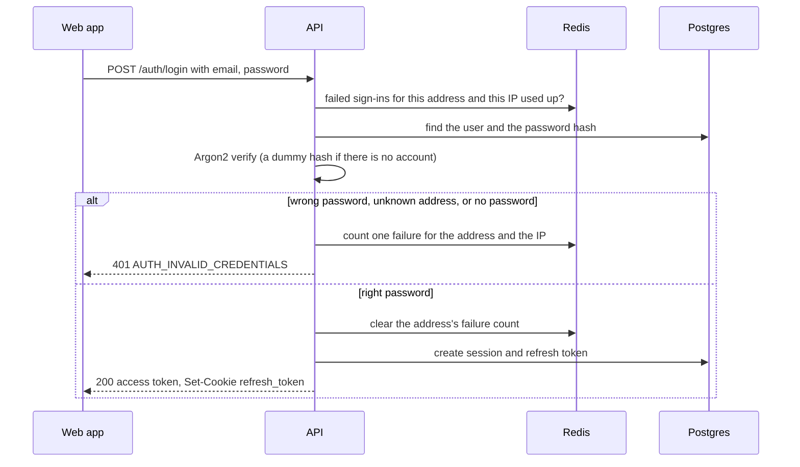
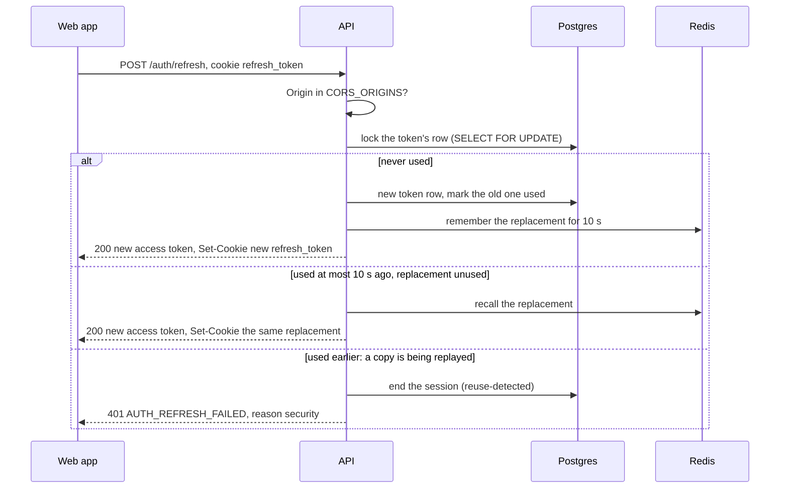
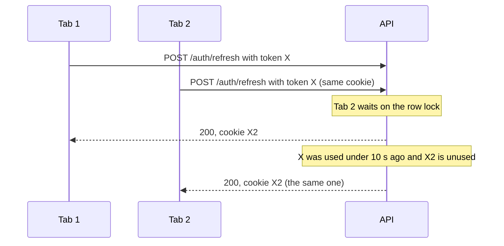
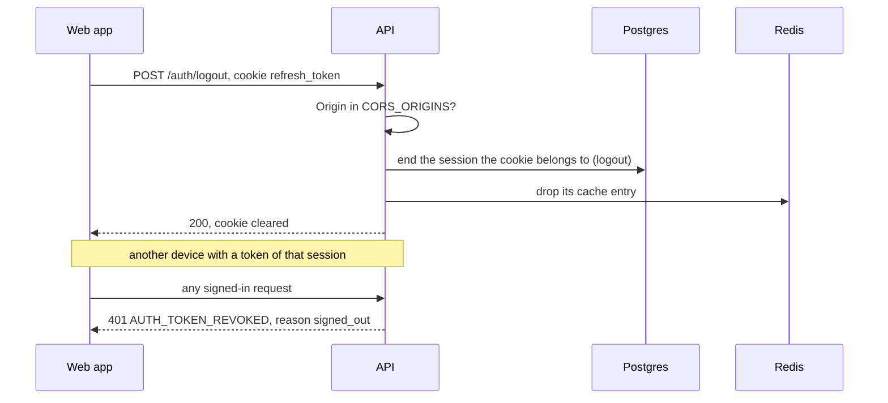
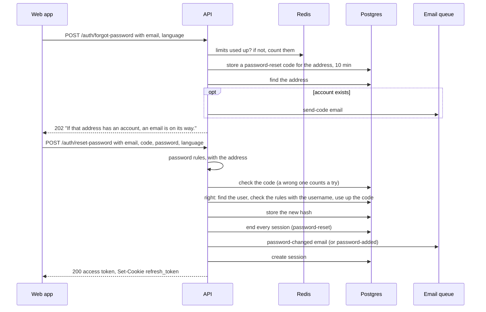
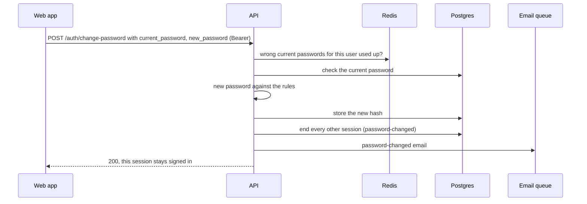
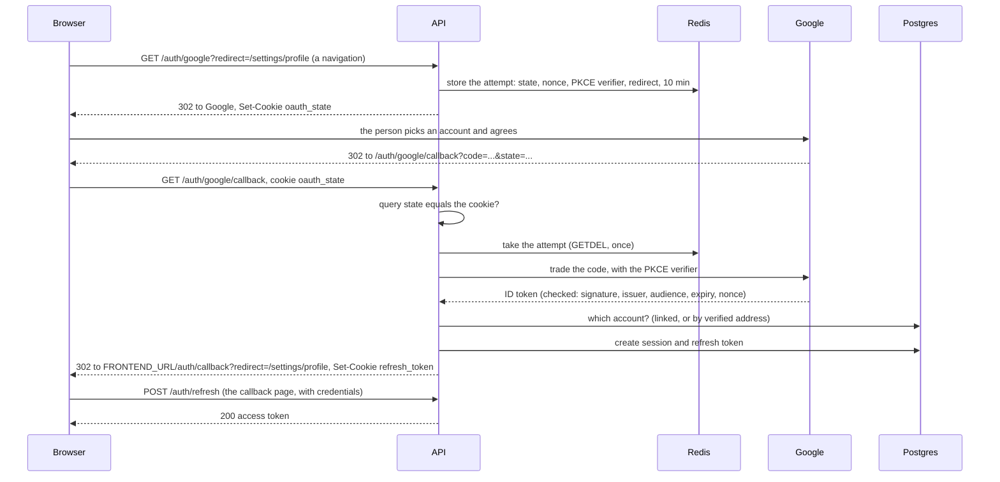
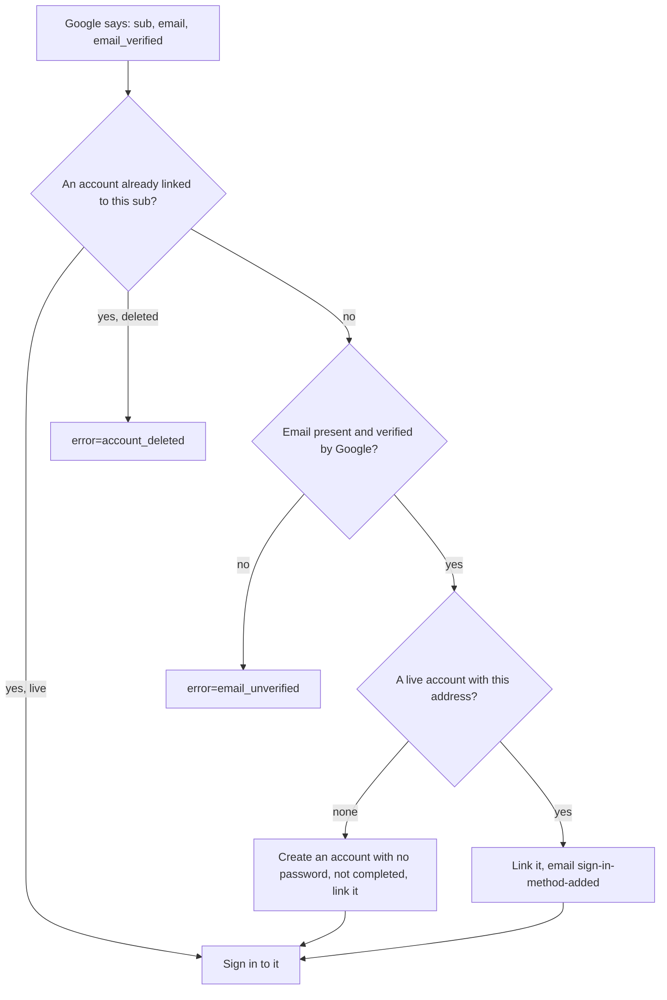
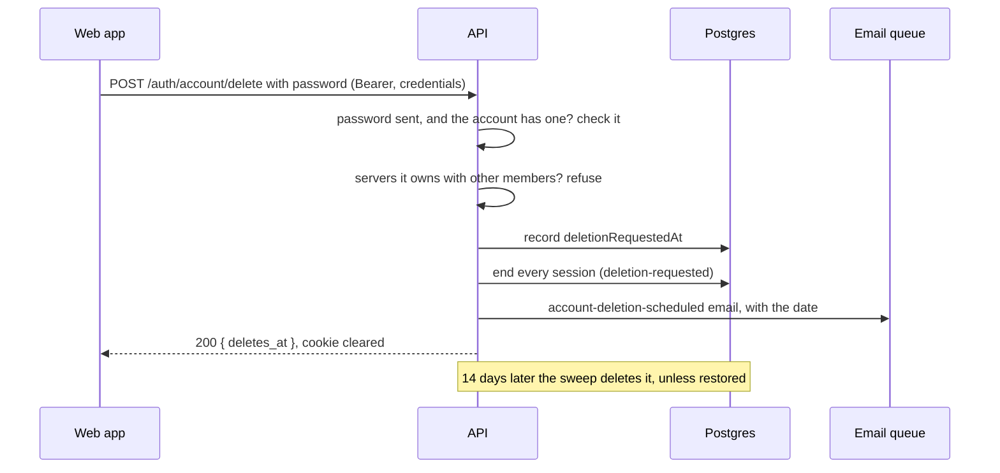

# Every flow, step by step

What happens, in order, when someone signs up or signs in with a code, signs
in with a password, refreshes, signs out, resets or changes a password, signs
in with Google, or deletes their account. Each flow has a diagram, then numbered steps naming the route, what
is checked, and what can go wrong.

Read this if you are building the frontend, writing a test, or want to know
exactly what a route does before changing it. The words used here are
explained in [concepts.md](./concepts.md). Every route's full request and
response shapes are in [api-reference.md](./api-reference.md).

- [How to read this page](#how-to-read-this-page)
- [Sign up or sign in with a code](#sign-up-or-sign-in-with-a-code)
- [Sign in](#sign-in)
- [Refresh](#refresh)
- [Sign out](#sign-out)
- [Forgot and reset the password](#forgot-and-reset-the-password)
- [Change the password](#change-the-password)
- [Sign in with Google](#sign-in-with-google)
- [Delete the account](#delete-the-account)
- [Restore the account](#restore-the-account)

## How to read this page

- **Routes** are written without the prefix. `POST /auth/login` means
  `POST /api/v1/auth/login` (`API_PREFIX` is `api` by default).
- **Bodies are snake_case** on the wire (`new_password`, `current_password`).
  An unknown field, or a field that fails validation, is
  `422 VALIDATION_ERROR` (code `422000`) on every route.
- **Errors** are written as `status TYPE`, for example
  `401 AUTH_INVALID_CREDENTIALS`. The type is `meta.type` in the error
  envelope; extra details are in `data` (for example `data.reason`).
- **Every route** can also answer `429` from the global throttler (type
  `THROTTLE_ERROR`, counted per user when signed in and per IP otherwise), on
  top of the auth limits listed per flow ([rate-limits.md](./rate-limits.md)).
- **"Signed in"** means the route needs `Authorization: Bearer <access_token>`.
  Without a usable one it answers `401 AUTH_TOKEN_MISSING`,
  `AUTH_TOKEN_EXPIRED`, `AUTH_TOKEN_INVALID` or `AUTH_TOKEN_REVOKED`, or
  `403 AUTH_ACCOUNT_DISABLED` for a deleted account
  ([the check on every request](./sessions-and-tokens.md#the-check-on-every-request)).
- **Emails** are queued, not sent during the request
  ([emails.md](./emails.md)). In development they land in Mailpit,
  `http://localhost:8025`.

## Sign up or sign in with a code

Creating an account and signing in with a code are one flow (D-59, D-60):
one request emails a code, the other checks it and signs in. A right code
signs in to the address's account, or makes one if it has none.

**1. `POST /auth/email-code`** (public). Body: `email`, optional `language`
(`vi` or `en`, default `en`). Asking again is the same call.
[send-email-code.handler.ts](../../src/modules/auth/application/commands/send-email-code/send-email-code.handler.ts)

1. The address is trimmed and lower-cased.
2. The limits: code emails per IP (30 in 5 minutes), per address (1 a minute,
   5 an hour, shared with reset codes). Used up: `429 RATE_LIMIT_EXCEEDED`
   with `data.reason` `network`, `recent_email` (the minute) or `emails`
   (the hour) and a `Retry-After` header.
   Otherwise each is counted. Requests racing past the check are caught by the
   count, and the refused ones give their hits back: six sent at once send one
   email and use one of the five an hour. There is no separate limit on new accounts: each one
   needs a code from these.
3. A `sign-in` code is stored for the address, replacing any earlier one, and
   emailed (`send-code`). Every address gets one. Only the wording differs:
   "your sign-in code" if the address has an account, "your code to create an
   account" if not, in the request's `language` (D-132).
4. Answer: `202`, `data: null`. The same answer and the same work for every
   address, so this route cannot be used to find out who has an account
   (D-121).

**2. `POST /auth/email-code/verify`** (public). Body: `email`, `code`
(exactly six digits, else `422`). Send it with credentials so the browser
stores the cookie.
[verify-email-code.handler.ts](../../src/modules/auth/application/commands/verify-email-code/verify-email-code.handler.ts)

1. Wrong codes from this IP (30 in 5 minutes, across addresses) and for this
   address (10 an hour, across its codes, D-134). The try is counted before
   anything is checked, and taken back if it was right, so a burst of
   requests sent at once is limited like a slow one. Used up:
   `429 RATE_LIMIT_EXCEEDED`, `data.reason` `network` or `codes`.
2. The code is checked. A wrong guess uses one of the code's 5 tries, counted
   in the same database statement; a right one uses none. A code with 5 wrong
   tries is dead, even for the right guess.
   - wrong code, or no code sent: `400 AUTH_CODE_INVALID`;
   - older than 10 minutes, or the 5th wrong try: `400 AUTH_CODE_EXPIRED`.
     The person asks for a new code.
   Either failure counts one against the IP and the address.
3. Right code: it is used up, by an update that matches its hash too, so an
   older code can never use up a newer one. Another request used it first:
   `400 AUTH_CODE_INVALID`. One code makes one session.
4. The address's account, or a new one: no password, no username,
   `completedAt` empty ("not completed"). Two sign-ups racing for one address
   meet at the database's unique index; the loser signs in to the winner's
   account.
5. Signed in through the [sign-in gate](./sessions-and-tokens.md#sessions):
   `200`, the access token in the body with
   `account: { created, completed }`, and the refresh cookie set.

`completed: false` tells the web app to open the "complete your account"
step (D-61): `POST /auth/complete-account` with a display name, username,
password, time zone, language and the Terms ticked. Until it is done, every
signed-in route except that one, `GET /users/me` and the username check
answers `403 ACCOUNT_INCOMPLETE`. Once done, the same access token passes
everywhere ([accounts.md](./accounts.md#completing-the-account),
[api-reference.md](./api-reference.md#complete-your-account)).

**What can go wrong for the person**

- The code never arrives: see [emails.md](./emails.md#when-redis-or-smtp-is-down).
- They wait more than 10 minutes, or type it wrong 5 times: they ask for a
  new one. Only the newest code works.
- They asked for two codes: only the newest works.
- They guessed wrong 10 times in an hour across several codes:
  `429`, `data.reason: "codes"`, until the hour has passed.

## Sign in

**`POST /auth/login`** (public). Body: `email`, `password`. Send it with
credentials so the browser stores the cookie.
[login.handler.ts](../../src/modules/auth/application/commands/login/login.handler.ts)

1. The limits are checked without counting: failed sign-ins per address
   (5 per 15 minutes) and per IP (30 per 5 minutes).
   Used up: `429 RATE_LIMIT_EXCEEDED`, `data.reason` `sign_ins` (the address)
   or `network` (the IP). The 6th attempt after 5 failures is the first
   refused.
2. The password is checked. A wrong password, an unknown address and an
   account with no password (made by a code or with Google, and not
   completed) are the same answer,
   `401 AUTH_INVALID_CREDENTIALS` "Incorrect email or password.", and take
   the same time (an unknown address is checked against a dummy hash). A
   failure counts one against the address and one against the IP.
3. Right password: the address's failure count is cleared (the IP's is not).
4. The hash is upgraded if it was made with older Argon2 settings. The new
   hash replaces the stored one only if that is still the hash just checked
   (`replaceHash`).
5. The stored hash must still be the one checked (or its upgrade). A reset
   that changed the password meanwhile answers
   `401 AUTH_INVALID_CREDENTIALS`, not counted as a failure: a sign-in with
   the old password racing a reset must not keep a session the reset ended,
   or put the old password back.
6. The sign-in gate starts a session: `200`,
   `{ access_token, token_type, expires_in }`, and the refresh cookie.

The forms around it: "Sign in with a code"
([above](#sign-up-or-sign-in-with-a-code)), a "Forgot password?" link
([below](#forgot-and-reset-the-password)), and "Continue with Google" when
`GET /auth/options` lists `google` ([below](#sign-in-with-google)).

## Refresh

The access token lasts 15 minutes. Before it runs out, and on every page
load, the web app trades the refresh cookie for a new access token. The
rules are in [sessions-and-tokens.md](./sessions-and-tokens.md#refreshing-and-rotation).

**`POST /auth/refresh`** (public; the cookie is the credential). No body.
Must be sent with credentials.
[refresh.handler.ts](../../src/modules/auth/application/commands/refresh/refresh.handler.ts)

1. `Origin` not in `CORS_ORIGINS`: `403 AUTH_FORBIDDEN`, and the cookie is
   left alone. No `Origin` at all (a non-browser client) is allowed.
2. No cookie, or an unknown token: `401 AUTH_REFRESH_FAILED` with no reason.
3. The token's row is locked, so a second refresh with the same token waits.
4. The session ended: `401 AUTH_REFRESH_FAILED` with `data.reason`:
   `expired`, `signed_out`, `signed_out_everywhere`, `revoked`,
   `password_changed`, `security` or `account_deleted`. With
   `account_deleted` for an account still waiting to be deleted, also
   `data.deletes_at`.
5. Never used: rotated. `200`, a new access token, and a new cookie with the session's original end date.
   The session records the time, the request's IP and its user agent (cut to
   512 characters): what the list of devices shows (D-138).
6. Used within the last 10 seconds and its replacement not yet used: the
   same replacement is handed back (two tabs, below).
7. Used before that: the session ends, the reuse is logged, counted, alerted
   and sent to Sentry, and the answer is `401 AUTH_REFRESH_FAILED` with
   `data.reason: "security"`.

On every `401` the response also clears the cookie.

### Two tabs at once

Both tabs end with the same cookie, and the session lives on. If Tab 2's
request had come more than 10 seconds later with X, or after X2 had already
been used, it would be treated as theft.

## Sign out

**`POST /auth/logout`** (public; the cookie is the credential). No body.
Send with credentials so the clearing `Set-Cookie` applies.
[logout.handler.ts](../../src/modules/auth/application/commands/logout/logout.handler.ts)

1. `Origin` not in `CORS_ORIGINS`: `403 AUTH_FORBIDDEN`.
2. The session the cookie belongs to is ended (reason `logout`) and its cache
   entry dropped, so its access tokens stop working on their next request.
3. Always `200`, and the cookie is cleared. No cookie, or a cookie for a session that already ended, changes
   nothing and still answers `200`.
4. The web app forgets the access token it holds in memory.

### Sign out other devices

The settings page lists the signed-in devices and can end them (D-75). These
routes never clear the cookie: this device stays signed in.
[sessions.controller.ts](../../src/modules/auth/presentation/http/sessions.controller.ts)

**`GET /auth/sessions`** (signed in). The live sessions, this device first
(`current: true`), then the most recently active. Browser, system, device
kind and a masked IP (`14.231.x.x`) are read from what the last refresh
recorded (D-138).

**`DELETE /auth/sessions/{id}`** (signed in). No body.

1. If the session is the user's, it is ended (reason `revoked`) unless it
   already was, and its cache entry dropped.
2. Always `200`, "Signed out that device": also for a session that already
   ended, is someone else's, or does not exist (NFR-SEC-05).
3. That device gets `401 AUTH_TOKEN_REVOKED` with `data.reason: "revoked"`
   on its next request, or `401 AUTH_REFRESH_FAILED` with the same reason on
   its next refresh.

**`DELETE /auth/sessions`** (signed in). No body. "Sign out the other devices".

1. Every session of the user except this one is ended (reason `logout-all`),
   and their cache entries dropped.
2. `200`, "Signed out the other devices", `data.revoked`: how many ended.
   This session and its cookie are untouched.
3. Every other device gets `401 AUTH_TOKEN_REVOKED` with
   `data.reason: "signed_out_everywhere"` on its next request, or
   `401 AUTH_REFRESH_FAILED` with the same reason on its next refresh.

## Forgot and reset the password

Also how an account without a password (not completed, or made with Google)
chooses its first one.

**1. `POST /auth/forgot-password`** (public). Body: `email`, optional
`language`.
[forgot-password.handler.ts](../../src/modules/auth/application/commands/forgot-password/forgot-password.handler.ts)

1. Limits checked and counted: code emails per IP (30 in 5 minutes), per
   address (1 a minute, 5 an hour, shared with sign-in codes). Used up:
   `429`, `data.reason` `network`, `recent_email` or `emails`. Counted for every address,
   account or not.
2. No account: a `password-reset` code is still stored, and sent to nobody.
   Guesses at it are counted and wear it out after five exactly as for a real
   one, so "the fifth guess says expired" cannot tell which addresses have
   accounts (D-121).
3. An account: a `password-reset` code is emailed. For an account with no
   password yet, the email is worded "Choose a password" instead of "Reset".
   If the email cannot be queued, that is logged and the answer is still
   `202`, as for an address with no account.
4. Always `202` with the same message.

**2. `POST /auth/reset-password`** (public). Body: `email`, `code`,
`password` (the new one), optional `language`. Send with credentials: it
signs in.
[reset-password.handler.ts](../../src/modules/auth/application/commands/reset-password/reset-password.handler.ts)

1. Wrong codes from this IP (30 in 5 minutes) and for this address (10 an hour,
   D-134). Used up: `429`, `data.reason` `network` or `codes`.
2. The new password against the rules that need only the address:
   `422 AUTH_PASSWORD_REJECTED`. The answer is the same with or without an
   account, and a refused password does not use a try.
3. The code: `400 AUTH_CODE_INVALID` or `400 AUTH_CODE_EXPIRED`, counting a
   wrong code against the IP and the address. Every address that asked has a
   code, so this is answered the same everywhere. A right guess at the unsent
   code of an address without an account is answered as wrong.
4. Only with the right code, the account is looked up and the rule "the
   password is not the username" checked (D-66): `422 AUTH_PASSWORD_REJECTED`.
   Checked earlier, that answer would tell a guesser which username has this
   address. The code is not used up, and the right code checked again does
   not use a try, so the person can choose another password with it.
5. The code is used up. Another request used it first: `400 AUTH_CODE_INVALID`.
6. The new hash is stored.
7. **Every session ends** (reason `password-reset`), on every device,
   including this one's old session. Whoever else was signed in, possibly
   the reason for the reset, is out.
8. The cached sessions and user are dropped, and the owner is emailed
   `password-changed`, or `password-added` if the account had no password
   before. The password has already changed, so a failure here is logged
   (`afterCommit`) and the reset still signs in.
9. The sign-in gate: one new session for this device, `200`,
   token and cookie.

## Change the password

For a signed-in person who knows their current password.

**`POST /auth/change-password`** (signed in). Body: `current_password`,
`new_password`.
[change-password.handler.ts](../../src/modules/auth/application/commands/change-password/change-password.handler.ts)

1. Wrong current passwords for this user: 5 per 15 minutes. Used up: `429`,
   `data.reason: "wrong_password"`.
2. Wrong current password, or an account with no password:
   `400 AUTH_CURRENT_PASSWORD_INVALID`, counting one. It is a `400`, not a
   `401`, on purpose: clients treat any `401` as "signed out".
   Accounts without a password choose one with
   [forgot password](#forgot-and-reset-the-password) instead.
3. The new password against the rules, with the address and the username:
   `422 AUTH_PASSWORD_REJECTED`.
4. The new hash is stored, **every other session ends** (reason
   `password-changed`), the count is cleared, and the owner is emailed
   `password-changed`.
5. `200`, `data: null`. This
   session stays signed in; its cookie is unchanged.

## Sign in with Google

On only when `GOOGLE_CLIENT_ID` and `GOOGLE_CLIENT_SECRET` are both set
(`GET /auth/options` then lists `google`). It is a sequence of browser
navigations, not API calls: the web app sends the whole page to the API,
which sends it to Google and back. How it is configured, and every rule, is
in [google-sign-in.md](./google-sign-in.md).

**1. `GET /auth/google?redirect=/path`** (public; a full-page navigation).
[start-oauth.handler.ts](../../src/modules/auth/application/commands/start-oauth/start-oauth.handler.ts)

1. An unknown or unconfigured provider: `404` (`NOT_FOUND_ERROR`, as JSON).
2. `redirect` is kept only if it is a path on the web app: it must start
   with one `/`, contain no `\` or control characters, and be at most 2048
   characters. Anything else becomes `/`.
3. A `state`, a `nonce` and a PKCE verifier are made and stored in Redis
   with the redirect for 10 minutes (`auth:oauth:<state>`). Redis or Google's
   discovery document unreachable: `500`.
4. `302` to Google (scope `openid email profile`, `prompt=select_account`),
   with an `oauth_state` cookie holding the same `state`.

**2. `GET /auth/google/callback`** (public; Google sends the browser here).
[finish-oauth.handler.ts](../../src/modules/auth/application/commands/finish-oauth/finish-oauth.handler.ts)

Every outcome is a `302` to `FRONTEND_URL/auth/callback?...`, never a JSON
error, and the `oauth_state` cookie is cleared.

1. The `state` in the URL must equal the cookie, and the attempt must still
   be in Redis (taken once). Otherwise `?error=failed`. This stops someone
   sending a victim a return link with the attacker's own code.
2. Google returned `error=access_denied` (the person said no):
   `?error=cancelled`. Any other Google error: `?error=failed`.
3. The code is traded for an ID token, server to server, with the PKCE
   verifier; the token's signature, issuer, audience, expiry and nonce are
   checked. Any failure: `?error=failed`.
4. Which account, below. Google has not verified the address:
   `?error=email_unverified`. Linked to a deleted account:
   `?error=account_deleted`.
5. The sign-in gate: a session and the refresh cookie, then
   `?redirect=/path`.
6. Unexpected errors (database, Redis): `?error=failed`, logged at error
   level. The reason for every failure is logged at warn level: "google
   sign-in did not complete (failed): …".

**3. The web app's `/auth/callback` page** reads the query. With `redirect`
alone it calls `POST /auth/refresh` (with credentials) to get an access token,
exactly as a page reload does, then goes to the path after checking it again.
With `error`, it shows what went wrong and offers to try again.

### Which account

The person is recognised by Google's id for them (`sub`), never by their
address alone, which can change at Google.

| Situation | What happens | Email |
|---|---|---|
| **Returning**: already linked | Signed in to that account | none |
| **First time, no account** | A new account: display name from Google, no password, not completed | none |
| **Linking an existing account** (made with a code earlier) | Linked; its password, if it has one, keeps working too | `sign-in-method-added` ("Google sign-in was added…"), the one they need if it was not them. In the account's language, English if it has none yet (D-132) |

Every account's address is confirmed: by a right code, or by Google (D-133).
So linking never has to undo anything someone else set up on the address.

## Delete the account

Deleting needs proof it is the owner, not only a signed-in session (or anyone
at an unlocked computer could do it). The proof is the password. Nothing is
deleted at once: the account waits 14 days, still live, so that signing in
again can restore it (D-141).

**`POST /auth/account/delete`** (signed in). Body: `password`, and an
optional `language` for the email. Send with credentials so the cookie is
cleared.
[delete-own-account.handler.ts](../../src/modules/auth/application/commands/delete-own-account/delete-own-account.handler.ts)

1. No password sent, or the account has none:
   `400 AUTH_CONFIRMATION_REQUIRED` with `data.needs: ["password"]`. A
   completed account without a password chooses one with
   [forgot password](#forgot-and-reset-the-password) first.
2. Wrong current passwords per user: 5 per 15 minutes (`429`,
   `wrong_password`). Wrong: `400 AUTH_CURRENT_PASSWORD_INVALID`.
3. The account owns servers with other members:
   `409 OWNERSHIP_TRANSFER_REQUIRED` with `data.servers` (D-76). None until
   servers exist (M1).
4. The time of the request is recorded on the account. A second request
   racing this one: `403 AUTH_ACCOUNT_DISABLED`.
5. Every session ends (reason `deletion-requested`), and the cache entries go.
6. The owner is emailed `account-deletion-scheduled`, in the request's
   `language`: the date it goes, in the account's time zone, and a sign-in
   button to restore it.
7. `200` with `data.deletes_at`, and the cookie is cleared. Every other
   device gets `401 AUTH_TOKEN_REVOKED` (reason `account_deleted`) on its next
   request, and its refresh says `deletes_at` too.

## Restore the account

Within the 14 days, signing in by password, code or Google reaches the same
account. Every signed-in route then answers `403 ACCOUNT_PENDING_DELETION`
except `GET /users/me` (whose `deletes_at` tells the web app to show the
restore dialog) and the restore itself.

**`POST /auth/account/restore`** (signed in, no body).
[restore-account.handler.ts](../../src/modules/auth/application/commands/restore-account/restore-account.handler.ts)

1. The request is taken back, by a conditional write: only an account still
   waiting.
2. The cached user goes, so the next request passes.
3. `200`. Not waiting any more (another tab restored it): `200` too. Deleted by
   the sweep first: `403 AUTH_ACCOUNT_DISABLED`.

The devices the request signed out stay signed out; their refresh now says
`revoked`. Once the 14 days are over, the 15-minute sweep deletes the account
and erases its personal data at once. What is kept and erased, and when:
[../account-deletion.md](../account-deletion.md).

## Related

- [sessions-and-tokens.md](./sessions-and-tokens.md): the token and session rules behind these flows
- [passwords-and-codes.md](./passwords-and-codes.md): the password rules and the emailed codes
- [emails.md](./emails.md): every email these flows send
- [rate-limits.md](./rate-limits.md): every limit named here
- [api-reference.md](./api-reference.md): every route and error, as reference
