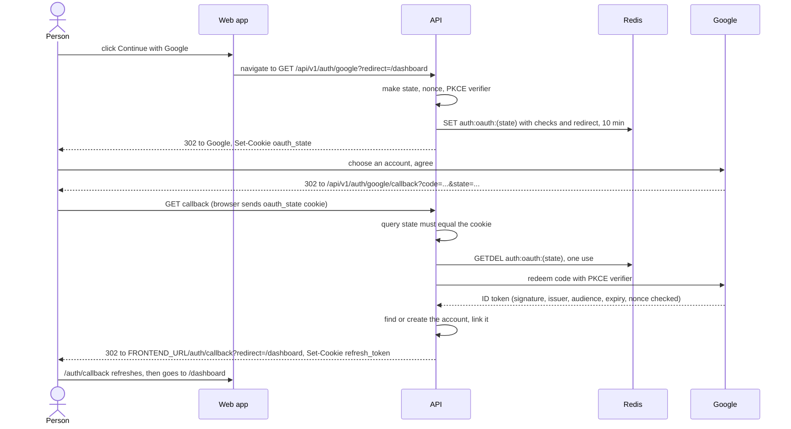

# Signing in with Google

"Continue with Google" lets people sign up and sign in with their Google
account instead of an emailed code or a password. This page explains how it works inside the API,
which account a Google sign-in lands in, what the web app is told when it does
not work, and how to add another provider.

To get the Google keys and turn it on, follow
[../setup/google-sign-in.md](../setup/google-sign-in.md) (click by click in the
Google Cloud console). This page is for understanding and changing the
behaviour.

- [Turning it on](#turning-it-on)
- [The words: OAuth, OpenID Connect, PKCE, state, nonce](#the-words-oauth-openid-connect-pkce-state-nonce)
- [The flow](#the-flow)
- [Which account a Google sign-in lands in](#which-account-a-google-sign-in-lands-in)
- [What the web app is told](#what-the-web-app-is-told)
- [The safety checks, one by one](#the-safety-checks-one-by-one)
- [Accounts made with Google](#accounts-made-with-google)
- [When Redis or Google is down](#when-redis-or-google-is-down)
- [Logs, metrics and tests](#logs-metrics-and-tests)
- [Adding another provider](#adding-another-provider)
- [Where it lives in the code](#where-it-lives-in-the-code)

## Turning it on

Two settings in the API's env file:

| Variable | Value |
|---|---|
| `GOOGLE_CLIENT_ID` | the OAuth client's ID, ending in `.apps.googleusercontent.com` |
| `GOOGLE_CLIENT_SECRET` | its secret |

Both set: on. Both empty: off, and the button does not appear. One without the
other: the app refuses to start, naming the missing one.

In Google's console, register this **redirect URI** (Google calls it
"Authorized redirect URI") exactly, scheme and port included:

| Where | Redirect URI |
|---|---|
| Development | `http://localhost:8888/api/v1/auth/google/callback` |
| Production | `https://api.example.com/api/v1/auth/google/callback` |

The API builds it as `<BASE_URL>/<API_PREFIX>/v1/auth/google/callback`, so it
follows `BASE_URL`. If they differ by a single character, Google shows
`Error 400: redirect_uri_mismatch` and never sends the person back.

The web app does not need a setting of its own: it asks `GET /api/v1/auth/options`,
whose answer lists `"providers": ["google"]` when Google is on, and shows the
button only then.

## The words: OAuth, OpenID Connect, PKCE, state, nonce

- **OAuth 2.0** is the standard way for one site to send a person to another
  (Google), have them agree there, and get back a short-lived **authorization
  code** that the first site's server exchanges for tokens.
- **OpenID Connect (OIDC)** is OAuth plus an **ID token**: a signed statement
  from Google saying who the person is (`sub`, a stable id for the person),
  their email, and whether Google has verified that email. Signing in needs
  exactly that.
- **PKCE** ("pixy", Proof Key for Code Exchange): before leaving, the API makes
  a random secret (the *verifier*) and sends Google only its SHA-256 hash (the
  *challenge*). To redeem the code it must show the verifier. Someone who
  intercepts the code cannot redeem it.
- **state**: a random value the API sends to Google and expects back unchanged.
  It ties the return to the sign-in this browser started.
- **nonce**: a random value Google copies into the ID token. It ties the ID
  token to this sign-in attempt, so an old ID token cannot be replayed.

The starter uses the library [`openid-client`](https://github.com/panva/openid-client)
for the protocol work, through one generic adapter,
[openid-connect-provider.adapter.ts](../../src/modules/auth/infrastructure/adapters/openid-connect-provider.adapter.ts).
Google is that adapter with Google's issuer URL, `https://accounts.google.com`.
[concepts.md](concepts.md) explains these words more gently.

## The flow

Signing in with Google is a **browser navigation**, not an API call: the page
leaves the web app, visits Google, and comes back.



### Start: `GET /api/v1/auth/google`

1. The web app links to `<API>/auth/google?redirect=/where/to/go`. `redirect` is
   optional and must be a path on the web app (see
   [the checks](#the-safety-checks-one-by-one)); anything else becomes `/`.
2. The API makes `state`, `nonce` and a PKCE verifier, and builds Google's
   address with scope `openid email profile`, `code_challenge_method=S256` and
   `prompt=select_account` (Google always asks which account, rather than
   silently using the one the browser is signed in to).
3. It keeps the attempt (provider, the three checks and the redirect path) in
   Redis under `auth:oauth:<state>` for **10 minutes**.
4. It sets a cookie `oauth_state` holding the state: httpOnly, `Secure` as the
   refresh cookie is, path `/api/v1/auth/google/callback` (sent nowhere else),
   10-minute lifetime. Its SameSite is `Lax` even when the refresh cookie is
   `Strict`, because the return is a navigation from Google's site and a
   `Strict` cookie would not come back with it (`None` when
   `AUTH_COOKIE_SAMESITE=none`).
5. It answers `302` to Google.

### Return: `GET /api/v1/auth/google/callback`

1. The `state` in the query must equal the `oauth_state` cookie, else the
   sign-in fails.
2. The attempt is taken out of Redis with `GETDEL`: a missing, expired or
   already used attempt fails. So a return link works once, even if two arrive
   together.
3. If Google answered with `error=access_denied` (the person pressed Cancel),
   the result is `cancelled`; any other `error` is `failed`.
4. The code is redeemed with the PKCE verifier. `openid-client` checks the ID
   token's issuer, audience (our client ID), expiry and nonce, and the starter
   also turns on its signature check against Google's published keys
   (`enableNonRepudiationChecks`).
5. From the ID token the API keeps four things: `sub`, `email`,
   `email_verified` and `name`. It never stores Google's tokens.
6. It decides the account ([next section](#which-account-a-google-sign-in-lands-in)),
   then passes through the same sign-in gate as a password, which starts a
   session.
7. It clears `oauth_state` and redirects to the web app's
   `FRONTEND_URL/auth/callback` with the outcome in the query.

On success the refresh cookie is set on that redirect. The web app's
`/auth/callback` page then calls `POST /auth/refresh` to get an access token,
like any page load of a signed-in person. See
[sessions-and-tokens.md](sessions-and-tokens.md).
## Which account a Google sign-in lands in

The rules, in order ([finish-oauth.handler.ts](../../src/modules/auth/application/commands/finish-oauth/finish-oauth.handler.ts)):

| Situation | What happens | Email sent |
|---|---|---|
| This Google person (`sub`) is already linked to an account | Sign in to that account | none |
| ...but that account is deleted | Refused: `?error=account_deleted` | none |
| Not linked, and Google did not say the email is verified (or sent none) | Refused: `?error=email_unverified` | none |
| Not linked, no live account has the address | A new account: **no password**, not completed, display name from Google (trimmed, cut to 32 characters). Linked. It goes through "complete your account" like any other (D-61, D-130) | none |
| Not linked, an account has the address | Linked to it, then signed in. Its password, if it has one, keeps working | "Google sign-in was added to your {app} account" |

Notes on the table:

- **Links are keyed on `sub`, never on the email.** A person who changes their
  Gmail address keeps their account. The `OAuthAccount` table stores
  `(provider, providerAccountId = sub)` and nothing else from Google.
- **Only a verified address can link or create.** Otherwise anyone could make a
  Google-type account claiming someone else's address and take over their
  account here.
- **Every account's address is confirmed** (D-133): an account is only made
  after a right emailed code, or by a provider that verified the address. So
  no password set by someone who never proved they read the inbox can be
  waiting on an account Google links.
- **Linking an existing account emails its owner.** If it was not them, that
  email is how they find out. It links to `/forgot-password`. Nobody asked for
  it from a page, so it is in the account's language (`UserSettings.language`,
  chosen when it was completed), English if it has none yet (D-132).
- **Deleted accounts.** Deleting an account removes its Google link, so the same
  Google person signing in again later starts afresh with a new account (the
  deleted account's address is no longer live). `account_deleted` appears only
  if a link still points to a deleted account, which happens only if the
  deletion's clean-up has not run yet. See [accounts.md](accounts.md).
- **Races.** Two returns for the same person at once, or a sign-up with the same
  address at the same moment, both end in one account: the second one signs in
  to whichever won.

## What the web app is told

Every outcome is a `302` to `FRONTEND_URL/auth/callback` with a query:

| Outcome | Query |
|---|---|
| Signed in | `redirect=<path>`. The refresh cookie is set. |
| Did not work | `error=<reason>`, plus `&redirect=<path>` when the attempt was found, so the page can offer to try again and land in the same place |

`error` values:

| Value | Meaning | Usual cause |
|---|---|---|
| `cancelled` | The person declined at Google | They pressed Cancel |
| `failed` | Anything else went wrong | The `oauth_state` cookie was missing or different (more than 10 minutes at Google, a different browser, cookies blocked, the return opened twice); Google returned an error other than `access_denied`; the code could not be redeemed (wrong client secret, a redirect URI that differs from the registered one); or an unexpected error (database, Redis). The API log says which. |
| `email_unverified` | Google did not confirm the address | Rare with Google; common with providers that do not send `email_verified` |
| `account_deleted` | The linked account is deleted | See above |

The React starter's `src/features/auth/pages/OAuthCallback.tsx` handles all
of these.

Only one thing answers with JSON instead of a redirect: an unknown provider
(`GET /auth/github` when only Google is configured) gives
404 `NOT_FOUND` (404000). On the start route, a Redis failure or a failure to
reach Google's discovery document gives 500, as JSON.

## The safety checks, one by one

| Check | Stops |
|---|---|
| `state` in the query must equal the `oauth_state` cookie | **Login CSRF**: an attacker sends the victim a return link carrying the attacker's own code, and the victim ends up signed in to the attacker's account (and types things into it). |
| The attempt is taken from Redis once (`GETDEL`), and expires after 10 minutes | Replaying a return link |
| PKCE verifier | Redeeming a stolen authorization code |
| `nonce` in the ID token | Replaying an ID token issued for another attempt |
| ID token signature, issuer, audience and expiry | Forged or misdirected ID tokens |
| The callback URL given to the library is rebuilt from the registered redirect URI, not from the request | A proxy's internal address leaking into the token request; a mismatch is refused |
| `redirect` must be a path: start with `/`, not `//`, no `\`, no control characters, at most 2048 characters; otherwise `/` | **Open redirect**: `//evil.example` or `/\evil.example`, which browsers read as another site. The web app checks the value again before following it (`safeRedirect` in its `src/features/auth/paths.ts`). |
| Only a provider-verified email creates or links an account | Taking over an account with an unverified address |
| `code` and `state` are redacted from the request log, error envelopes and Sentry | One-time values kept in logs for weeks |

## Accounts made with Google

An account created by Google has no password and is not completed. Like an
account made by a code, it must do "complete your account", which sets a
password, before the other signed-in routes answer (they say
`403 ACCOUNT_INCOMPLETE`; [accounts.md](accounts.md#completing-the-account)).
Until then it differs from other accounts in three ways:

- **Adding a password.** Besides completing the account, "Forgot password"
  (`POST /api/v1/auth/forgot-password`) emails a code with the wording
  "Choose a password", and `POST /api/v1/auth/reset-password` sets the first
  one; the owner is emailed "A password was added". After that, the person can
  sign in both ways. See [passwords-and-codes.md](passwords-and-codes.md).
- **Deleting it** needs the password and a completed account. See
  [../account-deletion.md](../account-deletion.md).
- **Signing in with a password fails** with the ordinary 401
  `AUTH_INVALID_CREDENTIALS` until a password is set: the API does not reveal
  how an account signs in. A code by email always works.

`GET /api/v1/auth/sign-in-methods` tells the settings page what an account has:
`{ "password": false, "providers": ["google"] }`. There is no route to unlink
Google. [accounts.md](accounts.md) covers sign-in methods in the account's life.

## When Redis or Google is down

- **Redis down.** The attempt cannot be saved or read, and there is no database
  fallback: starting answers 500, a return lands on `?error=failed`. Password
  sign-in keeps working.
- **Google unreachable.** The first sign-in after the app starts fetches
  Google's discovery document (10-second timeout). If that fails, the sign-in
  answers 500 and the next one tries again; the app itself starts fine either
  way.

## Logs, metrics and tests

- A failed sign-in logs a warning: `google sign-in did not complete (<reason>): <detail>`.
  The detail says which check failed. An unexpected one logs an error:
  `google sign-in failed: ...`. Callback failures are not sent to Sentry: they
  are redirects, not crashes.
- The request log shows the callback URL with `code` and `state` replaced by
  `[REDACTED]`.
- `auth_events_total` counts `oauth_login_succeeded`, `oauth_login_failed` and
  `oauth_account_linked` (an existing account gaining a Google link). The
  Grafana API dashboard shows them in its "Sign-in and accounts" row.
- `test/integration/oauth-http.integration-spec.ts` runs the whole flow against
  a fake OpenID Connect issuer (`test/integration/fake-oidc-issuer.ts`), so the
  tests never call Google.

## Adding another provider

**Another OpenID Connect provider** (Microsoft Entra ID, GitLab, Okta, Auth0, a
Keycloak realm and others publish a discovery document) is configuration, not
new logic:

1. Add its two variables, for example `GITLAB_CLIENT_ID` and
   `GITLAB_CLIENT_SECRET`, to [validation.ts](../../src/config/validation.ts)
   (as optional strings, and to `PAIRED_KEYS` so one without the other fails at
   boot), to [auth.config.ts](../../src/config/auth.config.ts), and to
   `.env.example`.
2. In [auth.module.ts](../../src/modules/auth/auth.module.ts), in the
   `OAUTH_PROVIDERS` factory, push another adapter when both are set:

   ```ts
   providers.push(
       new OpenIdConnectProvider({
           id: 'gitlab', // in the URL and in the stored link
           displayName: 'GitLab', // in emails
           issuer: 'https://gitlab.com',
           clientId: gitlab.clientId,
           clientSecret: gitlab.clientSecret
       })
   )
   ```

3. Register `<BASE_URL>/api/v1/auth/gitlab/callback` as the redirect URI at the
   provider. The routes `/auth/gitlab` and `/auth/gitlab/callback` already
   exist (they take the provider as a parameter), and `GET /auth/options` lists
   it.
4. In the web app, add the id to `OAUTH_PROVIDERS` in `src/features/auth/lib/oauth.ts`
   and a button in `src/features/auth/components/OAuthButtons.tsx`.

Check two things about the provider first:

- **Does it send `email_verified: true`?** The linking rules need it. A provider
  that leaves it out (some do, or only for some account types) can only sign in
  people already linked, which is nobody: everyone else gets
  `?error=email_unverified`.
- **Is its issuer one fixed URL, and does it return with a GET?** Multi-tenant
  endpoints whose issuer changes per user, and providers that return with a
  `POST` (form post), need adapter changes.

**A provider that is not OpenID Connect** (GitHub is plain OAuth 2.0) needs an
adapter of its own implementing `OAuthProviderPort`
([oauth-provider.port.ts](../../src/modules/auth/application/ports/oauth-provider.port.ts)):
`start(redirectUri)` returns the address to send the browser to and the checks
to keep, and `finish(callbackUrl, redirectUri, checks)` returns
`{ subject, email, emailVerified, name }`. For GitHub that means calling its
API for the user and their verified primary email. The commands, linking rules,
cookies and redirects stay as they are. [in-the-code.md](in-the-code.md) lists
the other extension points.

## Where it lives in the code

| File | What it does |
|---|---|
| [oauth.controller.ts](../../src/modules/auth/presentation/http/oauth.controller.ts) | The two routes and the redirects; registered last, as `GET auth/:provider` matches any `GET auth/<word>` ([in-the-code.md](./in-the-code.md#the-controllers)) |
| [auth-cookies.ts](../../src/modules/auth/presentation/http/auth-cookies.ts) | The `oauth_state` and refresh cookies |
| [start-oauth.handler.ts](../../src/modules/auth/application/commands/start-oauth/start-oauth.handler.ts) | Starting; `safeReturnPath` |
| [finish-oauth.handler.ts](../../src/modules/auth/application/commands/finish-oauth/finish-oauth.handler.ts) | The return checks and the linking rules |
| [openid-connect-provider.adapter.ts](../../src/modules/auth/infrastructure/adapters/openid-connect-provider.adapter.ts) | The `openid-client` adapter: PKCE, state, nonce, ID token checks |
| [redis-oauth-state.adapter.ts](../../src/modules/auth/infrastructure/adapters/redis-oauth-state.adapter.ts) | Attempts in Redis, taken once |
| [prisma-oauth-account.repository.ts](../../src/modules/auth/infrastructure/persistence/prisma-oauth-account.repository.ts) | The `OAuthAccount` table |
| [oauth-settings.ts](../../src/modules/auth/application/oauth-settings.ts) | The redirect URI |
