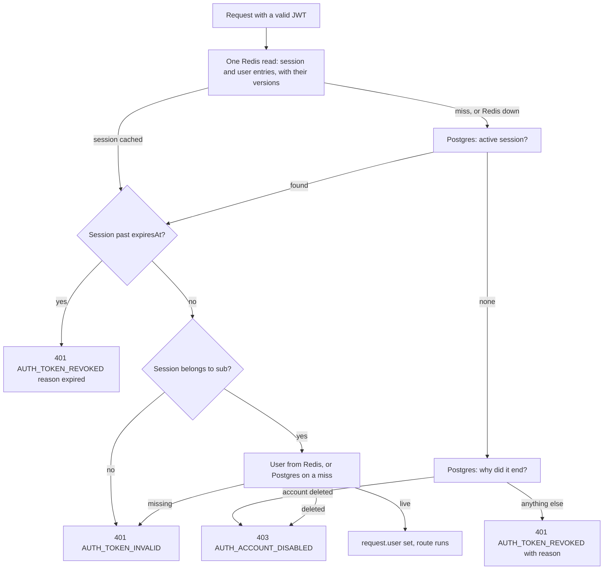

# Sessions and tokens

How a signed-in person stays signed in: the access token, the refresh token
and its cookie, the session behind them, what ends a session, the check that
runs on every request, and how to set up the cookie when the web app and the
API live on different domains.

Read this if you are building the frontend, deploying the API on its own
domain, or debugging "I keep getting signed out". New to the words? Start
with [concepts.md](./concepts.md).

- [The short version](#the-short-version)
- [The access token](#the-access-token)
- [The refresh token](#the-refresh-token)
- [The refresh cookie](#the-refresh-cookie)
- [Sessions](#sessions)
- [Refreshing and rotation](#refreshing-and-rotation)
- [What ends a session](#what-ends-a-session)
- [The check on every request](#the-check-on-every-request)
- [When Redis is down](#when-redis-is-down)
- [Cross-site setups](#cross-site-setups)
- [What the web app must do](#what-the-web-app-must-do)
- [Settings](#settings)
- [Where it is in the code](#where-it-is-in-the-code)

## The short version

| | |
|---|---|
| Access token | A JWT (HS256, signed with `JWT_SECRET`), valid 15 minutes, sent as `Authorization: Bearer …`. Kept in memory by the web app |
| Refresh token | 32 random bytes in an httpOnly cookie `refresh_token`, path `/api/v1/auth`. Swapped for a new one on every use |
| Session | A row in Postgres. Lasts 30 days from sign-in, however often it is refreshed |
| Stolen refresh token | Noticed the moment either copy is used after the other: that session ends |
| Signing out, password change, deletion | Take effect on the very next request, not when the access token expires |
| Every request | Signature checked locally, then one Redis read (Postgres if Redis is down) to confirm the session and the account are still live |
| Web app and API on different domains | Works out of the box on subdomains of one domain (`app.example.com` + `api.example.com`). Anything else: read [cross-site setups](#cross-site-setups) |

## The access token

What a client sends with every request. A [JWT](./concepts.md#jwt) the API
signs and checks itself; nothing else needs to know the key.

| | |
|---|---|
| Format | JWT, header `{"alg":"HS256","typ":"JWT"}`, signed with the UTF-8 bytes of `JWT_SECRET` |
| Lifetime | `JWT_ACCESS_TTL_SECONDS`, default `900` (15 minutes), allowed 60 to 3600. Returned as `expires_in` |
| Where it travels | Response body of every route that signs in; request header `Authorization: Bearer <token>` |
| Made by | [jose-token-service.adapter.ts](../../src/modules/auth/infrastructure/adapters/jose-token-service.adapter.ts), `issueAccessToken` |

The claims:

| Claim | Value |
|---|---|
| `sub` | The user id |
| `sid` | The session id (the `Session` row) |
| `typ` | `"access"`, so no other token this API might sign can pass for one |
| `iss`, `aud` | Both `BASE_URL` with trailing slashes removed. Default `http://localhost:${PORT}` |
| `jti` | A random UUID |
| `iat`, `exp` | Issued at, and issued at + lifetime |

**No roles, no email.** Those are read on every request (below), so taking a
role away or deleting an account takes effect at once instead of when the
token expires.

The response that carries it (from `POST /auth/login`, `email-code/verify`,
`reset-password` and `refresh`; `email-code/verify` adds `account`):

```json
{
  "meta": { "message": "Login successful", "...": "..." },
  "data": { "access_token": "eyJhbGciOiJIUzI1NiIs…", "token_type": "Bearer", "expires_in": 900 }
}
```

### How it is checked

On every route that is not `@Public()`,
[access-token.guard.ts](../../src/modules/auth/presentation/guards/access-token.guard.ts):

1. Reads `Authorization: <scheme> <token>`. The scheme must be `Bearer`
   (any case). Nothing usable: `401 AUTH_TOKEN_MISSING`.
2. Verifies the signature with HS256 only, and that `iss` and `aud` equal
   `BASE_URL`. Expired: `401 AUTH_TOKEN_EXPIRED`. Anything else wrong
   (signature, issuer, audience, malformed): `401 AUTH_TOKEN_INVALID`.
3. Requires `typ: "access"` and string `sub` and `sid`, else
   `401 AUTH_TOKEN_INVALID`.
4. Checks the session and the account are still live:
   [the check on every request](#the-check-on-every-request).

### What makes every access token stop working

Every token in circulation becomes `401 AUTH_TOKEN_INVALID` at once when:

- **`JWT_SECRET` changes**: the signatures no longer match. Sessions are not
  affected: the next refresh hands out a token signed with the new secret.
  (It also kills every emailed code still waiting to be typed:
  [passwords-and-codes.md](./passwords-and-codes.md#how-codes-are-stored).)
- **`BASE_URL` changes**: `iss` and `aud` no longer match.

This is why a client should treat `AUTH_TOKEN_INVALID` like
`AUTH_TOKEN_EXPIRED`: refresh once, retry, and only sign out if the refresh
fails too ([what the web app must do](#what-the-web-app-must-do)).

## The refresh token

The secret that gets a new access token when the old one expires. See
[refresh token](./concepts.md#refresh-token) for the idea.

| | |
|---|---|
| Form | 32 random bytes, base64url (43 characters). Not a JWT: it means nothing without the database |
| Stored as | Its SHA-256 hash, in `RefreshToken.tokenHash` (unique). A copy of the database does not hand out working tokens. A fast hash is right here because 32 random bytes cannot be guessed |
| Lifetime | The session's. Every refresh token of a session ends when the session does |
| On every refresh | Replaced by a new one. The old row is marked used (`usedAt`) and points at its replacement (`replacedById`). It is kept until the session row is deleted, so a stolen copy is still recognised |
| Made by | [jose-token-service.adapter.ts](../../src/modules/auth/infrastructure/adapters/jose-token-service.adapter.ts), `newRefreshToken` |

The client never sees it: it is not in any response body, only in the
`Set-Cookie` header, and the cookie is httpOnly.

## The refresh cookie

In development (plain `http://localhost`):

```
Set-Cookie: refresh_token=Qm9i…; Path=/api/v1/auth; Expires=Wed, 04 Nov 2026 10:00:00 GMT; HttpOnly; SameSite=Lax
```

In production (HTTPS):

```
Set-Cookie: refresh_token=Qm9i…; Path=/api/v1/auth; Expires=Wed, 04 Nov 2026 10:00:00 GMT; HttpOnly; Secure; SameSite=Lax
```

| Attribute | Value | Why | Set by |
|---|---|---|---|
| Name | `refresh_token` | | [auth.config.ts](../../src/config/auth.config.ts) |
| `HttpOnly` | always | Page scripts cannot read it, so a cross-site-scripting bug cannot steal the session | [auth-cookies.ts](../../src/modules/auth/presentation/http/auth-cookies.ts) |
| `Path` | `/<API_PREFIX>/v1/auth`, so `/api/v1/auth` | The browser sends it to the auth routes only, never with ordinary API calls | the controller, from `API_PREFIX` |
| `Expires` | The session's end (`expiresAt`), absolute | A rotated cookie keeps the same end date | the controller |
| `SameSite` | `AUTH_COOKIE_SAMESITE`: `lax` (default), `strict` or `none` | Other sites cannot make the browser send it | [auth.config.ts](../../src/config/auth.config.ts) |
| `Secure` | `AUTH_COOKIE_SECURE` if set; unset means on when `NODE_ENV=production` or SameSite is `none` | HTTPS only. Off in development, where localhost is plain HTTP | [auth.config.ts](../../src/config/auth.config.ts) |
| `Domain` | not set | A host-only cookie: only the API's exact host gets it back, not its sibling subdomains | |

The controller clears the cookie (same attributes, an expired date) on
`logout`, `account/delete`, and on every `401` from `refresh`
(not on its `403 AUTH_FORBIDDEN`, which never looked at the cookie). Signing
out other devices (`DELETE /auth/sessions`, `DELETE /auth/sessions/{id}`)
leaves it alone: this device stays signed in.
`AUTH_COOKIE_SECURE=false` together with `AUTH_COOKIE_SAMESITE=none` is
refused at start-up: browsers drop such a cookie.

**The path is computed from `API_PREFIX`, not from the public URL.** If a
reverse proxy serves the API under an extra prefix (say
`https://example.com/backend/api/v1/...` rewritten to `/api/v1/...`), the
browser sees a different path from the one the cookie names and never sends
it back. Serve the API so the browser-visible path starts with
`/<API_PREFIX>/v1/auth`.

### The short-lived cookie

One more cookie exists only during a sign-in with Google. It is httpOnly,
uses the same `Secure` setting, and uses `SameSite=None` when you chose `none`,
`Lax` otherwise (never `Strict`, which would not come back with a navigation
from Google):

| Cookie | Path | Lives | Holds |
|---|---|---|---|
| `oauth_state` | `/api/v1/auth/<provider>/callback` | 10 minutes | The `state` of the attempt, matched against Google's return ([state and nonce](./concepts.md#state-and-nonce)) |

Details: [google-sign-in.md](./google-sign-in.md).

## Sessions

One row per sign-in, in the `Session` table
([auth.prisma](../../prisma/models/auth.prisma)):

| Column | Meaning |
|---|---|
| `id` | A UUID: the `sid` claim of every access token issued in this session. It survives rotation, so ending the session ends every token issued in it |
| `userId` | Whose session |
| `createdAt` | When it started |
| `lastUsedAt` | Updated on each refresh that rotates the token, together with `userAgent` and `ip` |
| `expiresAt` | Absolute end: `createdAt` + `AUTH_SESSION_TTL_DAYS` (default 30, allowed 1 to 365) |
| `revokedAt`, `revokedReason` | When and why it was ended early (reasons below) |
| `userAgent` | The `User-Agent` header of the last refresh (at sign-in before any), cut to 512 characters ([route-helpers.ts](../../src/modules/auth/presentation/http/route-helpers.ts) `client()`). A request without the header leaves the stored one as it was |
| `ip` | The client's IP of the last refresh (at sign-in before any): the real one, as the app trusts one proxy hop. `unknown` when Express has none |

- **Created** only by [session-issuer.ts](../../src/modules/auth/application/services/session-issuer.ts),
  called by [sign-in-gate.ts](../../src/modules/auth/application/services/sign-in-gate.ts).
  Every way of signing in (password, an emailed code, resetting a
  password, Google) ends there.
- **Absolute lifetime.** Refreshing never moves `expiresAt`. After 30 days
  the person signs in again, however active they were.
- **Removed** a week after it ended (expired or revoked), with its refresh
  tokens, by the hourly clean-up
  ([clean-up-auth.handler.ts](../../src/modules/auth/application/commands/clean-up-auth/clean-up-auth.handler.ts)).
  The week lets a stolen token presented in that time still be recognised as
  reuse.
- **Listed** on the settings page's list of devices (`GET /auth/sessions`,
  D-75): the live ones, this device first. The browser, system and device
  kind are read from `userAgent` when the list is asked for
  ([device.ts](../../src/modules/auth/domain/device.ts)), and `ip` is masked
  to its network (`14.231.x.x`,
  [masked-ip.ts](../../src/modules/auth/domain/masked-ip.ts)) before it
  leaves the server (D-138). Neither is stored a second way, so a better
  table of user agents applies to old sessions too.

## Refreshing and rotation

`POST /api/v1/auth/refresh`, with the cookie and no body. The flow, with a
diagram, is in [flows.md](./flows.md#refresh). Here are the rules.

Before anything: the `Origin` check. A request whose `Origin` header is not
in `CORS_ORIGINS` gets `403 AUTH_FORBIDDEN`, and the cookie is left alone. No
`Origin` header (a non-browser client) is allowed.

Then [prisma-session.repository.ts](../../src/modules/auth/infrastructure/persistence/prisma-session.repository.ts)
(`rotate`) decides, in one transaction with the token's row locked
(`SELECT … FOR UPDATE`). A second refresh with the same token waits on that
lock until the first has committed:

| The presented token | Outcome | Answer |
|---|---|---|
| No cookie | | `401 AUTH_REFRESH_FAILED`, no reason |
| Unknown | `invalid` | `401 AUTH_REFRESH_FAILED`, no reason |
| Past its `expiresAt` | `invalid` | `401 AUTH_REFRESH_FAILED`, `data.reason: "expired"` |
| Its session ended (account deleted, revoked, or expired) | `invalid` | `401 AUTH_REFRESH_FAILED`, `data.reason` says why ([table](#what-ends-a-session)) |
| Never used | `rotated`: a new token is created, the old one marked used and pointed at it, `lastUsedAt`, `ip` and `userAgent` updated | `200`, new access token, new cookie |
| Used at most 10 seconds ago, and its replacement not used yet | `grace` | `200`, the **same** replacement as the first request got |
| Used earlier than that, or its replacement already used | `reused`: the session is revoked (`reuse-detected`) | `401 AUTH_REFRESH_FAILED`, `data.reason: "security"` |

On any `401` from refresh, the response also clears the cookie: a cookie
that no longer works is only in the way. The new cookie keeps the session's
original `Expires`.

There is no auth-specific rate limit on refresh; only the global throttler
applies, per IP since the web app sends refresh without an access token
([rate-limits.md](./rate-limits.md)).

### The grace window

A person with two tabs open has one cookie. When both tabs' access tokens
expire together, both tabs refresh at once with the same cookie, and the
second request would look exactly like a stolen token being replayed.

So a used token presented again **within 10 seconds, while its replacement
has not been used yet**, gets that same replacement back. Both tabs end up
holding one cookie. How the second tab finds the replacement: before the
first refresh commits (while the row is still locked), the new token is put
in Redis for 10 seconds under `auth:replaced:<hash of the old token>`.

- The 10 seconds are hard-coded (`refreshGraceMs: 10_000` in
  [auth.module.ts](../../src/modules/auth/auth.module.ts)), not a setting.
- If Redis lost the replacement (Redis down, or the write failed and was
  logged as "Could not remember a refresh token's replacement"), the second
  tab gets `401` with no reason and signs in again.

### Reuse detection

If a refresh token is copied (a compromised device, a malicious browser
extension, a backup of the browser profile), the owner and the thief hold
the same token. Whoever refreshes second presents a token that is already
used. That can only happen if it was copied, so the **whole session ends**,
for both. The owner signs in again; the thief's copy is worthless.

When it happens ([refresh.handler.ts](../../src/modules/auth/application/commands/refresh/refresh.handler.ts)):

1. The session is revoked with reason `reuse-detected`, and its cache entry
   dropped.
2. `auth_events_total{event="refresh_reuse_detected"}` goes up, which fires
   the `AuthRefreshTokenReuse` alert ([alerts.md](../alerts.md)).
3. A warning is logged: "A refresh token was used twice; session … of user …
   has been ended".
4. Sentry gets an event "Refresh token reuse detected", tagged
   `auth: refresh-reuse`.
5. The caller gets `401 AUTH_REFRESH_FAILED` with `data.reason: "security"`.
   Every other device holding a token of that session finds out on its next
   request (`401 AUTH_TOKEN_REVOKED`, reason `security`).

A false alarm is possible but rare: the browser sent a refresh, the server
rotated the token, but the answer never arrived (the connection dropped, the
tab closed mid-request), and the browser refreshes again with the old cookie
more than 10 seconds later. That is indistinguishable from theft by design.

## What ends a session

| What happened | Sessions ended | Stored `revokedReason` | `data.reason` the device is told |
|---|---|---|---|
| `POST /auth/logout` | The one the cookie belongs to | `logout` | `signed_out` |
| `DELETE /auth/sessions` ("Sign out the other devices", D-75) | All of the user's except the one asking | `logout-all` (the value predates the button keeping this device) | `signed_out_everywhere` |
| `DELETE /auth/sessions/{id}` | That one, if it is the user's | `revoked` | `revoked` |
| `POST /auth/change-password` | All except the one that made the change | `password-changed` | `password_changed` |
| `POST /auth/reset-password` | All that existed; then one new session starts for the device that reset | `password-reset` | `password_changed` |
| A used refresh token comes back | That one | `reuse-detected` | `security` |
| The account is deleted | All | `account-deleted` | `account_deleted` on refresh; `403 AUTH_ACCOUNT_DISABLED` on other routes |
| `expiresAt` passes | That one | (none) | `expired` |

The mapping is in [session-end.ts](../../src/modules/auth/domain/session-end.ts).
A session with `revokedAt` set but no reason reads as `logout`.

**Not ended by**: linking Google, or a role change
(roles are read on every request, so they apply at once without ending
anything).

**How a device finds out.** On its next request:

- any signed-in route answers `401 AUTH_TOKEN_REVOKED` with `data.reason`,
  or `403 AUTH_ACCOUNT_DISABLED` if the account was deleted;
- `POST /auth/refresh` answers `401 AUTH_REFRESH_FAILED` with `data.reason`.

Only the holder of that session's token is told the reason, and the token no
longer works, so it gives nothing away. A web app can turn the reason into a
message ("You were signed out because your password was changed").

## The check on every request

After the signature, [redis-session-cache.adapter.ts](../../src/modules/auth/infrastructure/adapters/redis-session-cache.adapter.ts)
(`resolve`) confirms the session and the user. This is what makes revocation
immediate.



1. **One Redis round trip** (`MGET`) reads `auth:session:<sid>`,
   `auth:user:<user id>` and their version keys (`…:v`). Names in
   [cache-keys.ts](../../src/modules/auth/infrastructure/adapters/cache-keys.ts).
2. **Session.** A hit is used as is. A miss reads Postgres for a session that
   is not revoked and not expired; if there is none, a second query finds out
   why, so the device can be told.
3. **User.** A hit is used as is; a miss reads the user through the users
   module. A deleted account is refused.
4. **`request.user`** is built from the user record: id, session id, email,
   username, name, roles and the profile. That is what
   `@CurrentUser()` returns and what `@Roles()` checks.

**The cache:**

- Entries are written only after a successful Redis read, for at most
  5 minutes (a session entry for less if the session ends sooner). The
  5 minutes are hard-coded.
- Ending a session, deleting an account, changing a profile or a role
  invalidates the entry at once. Invalidation bumps a version counter and
  deletes the entry in one transaction; a write only lands if the version
  is still the one read before the database query. So a request that was
  already reading the database cannot put a stale entry back
  ([versioned-cache.ts](../../src/shared/infrastructure/cache/versioned-cache.ts)).
- Redis only, never an in-memory layer: an in-memory copy would be cleared on
  one instance and kept on the others.
- Hits and misses are counted in `cache_hits_total` and
  `cache_misses_total` with `cache="auth_session"` and `cache="auth_user"`.

The global guards run in this order: the throttler (so anonymous floods are
limited first), then this guard, then the roles guard.

## When Redis is down

Redis speeds up the session check; it is not required for it. Other auth
features do need it:

| Feature | With Redis down |
|---|---|
| The check on every request | Works: every request reads Postgres. Logged at most once a minute: "Session cache unavailable, reading from the database" |
| Cache invalidation | Fails and is logged ("Session cache update failed"). An entry that should have gone lives at most 5 more minutes, once Redis is back |
| Refresh | Works. The grace replacement cannot be stored, so a second tab racing the first gets `401` and signs in again |
| Auth rate limits | Fail closed (D-137): sign-in, codes, reset, change password and account deletion answer `503`, logged once a minute. See [rate-limits.md](./rate-limits.md#when-redis-is-down) |
| Google sign-in | Fails: the attempt lives only in Redis. Back to the web app with `?error=failed` |
| Anything that sends an email | Fails: the email queue lives in Redis ([emails.md](./emails.md#when-redis-or-smtp-is-down)) |

The Redis client does not queue commands while disconnected
(`disableOfflineQueue`), so the session check fails over to Postgres at once
instead of waiting.

## Cross-site setups

This is the most common way to break sign-in in production: everything works
on your machine, you deploy the web app and the API to their own domains,
sign-in appears to work, and then every visitor is signed out when the page
reloads or after 15 minutes. The cause is almost always the refresh cookie
not reaching the API.

The words *site* and *origin* are explained in
[site and origin](./concepts.md#site-and-origin). In short: an origin is
scheme + host + port; a site is scheme + the domain you bought.

### What the browser needs to send the cookie

For the web app's `POST /api/v1/auth/refresh` to carry the cookie, all of
these must hold:

1. **The cookie was stored.** The sign-in request was sent with credentials,
   and the API answered with `Access-Control-Allow-Credentials: true` and the
   web app's exact origin in `Access-Control-Allow-Origin`. That needs the
   web app's origin in `CORS_ORIGINS` and `CORS_CREDENTIALS=true`.
2. **`Secure` matches the scheme.** A `Secure` cookie is only stored and sent
   over HTTPS (browsers make an exception for `localhost`). Production sets
   `Secure` by default, so production must be HTTPS.
3. **`SameSite` allows it.** With `Lax` or `Strict`, the cookie is sent only
   if the web app and the API are the **same site**. On different sites it
   needs `SameSite=None` (which requires `Secure`), and even then some
   browsers refuse it (below).
4. **The path matches.** The request path starts with `/api/v1/auth`.
5. **The refresh request is sent with credentials**, from an origin in
   `CORS_ORIGINS` (otherwise `403 AUTH_FORBIDDEN`).

### Pick your setup

| Setup | Example | Same site? | Works with | Verdict |
|---|---|---|---|---|
| Local development | `http://localhost:3001` and `http://localhost:8888` | Yes (ports do not count) | The defaults | Works out of the box |
| Subdomains of one domain | `https://app.example.com` and `https://api.example.com` | Yes | `AUTH_COOKIE_SAMESITE=lax` (default) | **Recommended.** What the deploy scripts assume |
| One origin, API behind a path | `https://example.com` serving the web app, and the API proxied at `https://example.com/api/v1/...` | Yes, same origin | `lax` | Works. Keep the browser-visible path `/api/v1/...` |
| Two different domains | `https://myapp.com` and `https://myapi.net` | No | `AUTH_COOKIE_SAMESITE=none` (forces `Secure`, needs HTTPS) | Avoid. Safari blocks such cookies by default, and other browsers do in private windows or when the person turns third-party cookies off |
| Two subdomains of a shared host | `https://myapp.vercel.app` and `https://myapi.onrender.com`, or even `myapp.vercel.app` and `myapi.vercel.app` | No: those hosts are registrable domains of their own | Same as two different domains | Avoid. Put both on your own domain instead |

If you are on two different sites today, the fix that works for every
visitor is to give both a name under one domain you own (for example
`app.example.com` pointing at your frontend host and `api.example.com` at
the API). `SameSite=None` is a stopgap.

### Settings for each setup

Local development (`.env.example` already has these):

```
BASE_URL=http://localhost:8888
FRONTEND_URL=http://localhost:3001
CORS_ORIGINS=http://localhost:3001
CORS_CREDENTIALS=true
# AUTH_COOKIE_SAMESITE unset: lax
# AUTH_COOKIE_SECURE unset: off outside production
```

Subdomains of one domain (production, recommended):

```
NODE_ENV=production
BASE_URL=https://api.example.com
FRONTEND_URL=https://app.example.com
CORS_ORIGINS=https://app.example.com
CORS_CREDENTIALS=true
# AUTH_COOKIE_SAMESITE unset: lax
# AUTH_COOKIE_SECURE unset: on in production
```

One origin with the API behind a path:

```
BASE_URL=https://example.com
FRONTEND_URL=https://example.com
CORS_ORIGINS=https://example.com
CORS_CREDENTIALS=true
```

List the origin even here: browsers send an `Origin` header with a
same-origin `POST`, and refresh and logout refuse an `Origin` that is not in
the list.

Two different sites (only if you cannot avoid it):

```
BASE_URL=https://myapi.net
FRONTEND_URL=https://myapp.com
CORS_ORIGINS=https://myapp.com
CORS_CREDENTIALS=true
AUTH_COOKIE_SAMESITE=none
# AUTH_COOKIE_SECURE unset: on (SameSite=None requires it)
```

Rules that apply to every setup:

- `CORS_ORIGINS` holds exact origins: scheme, host, and port if not the
  default; no path, no trailing slash. Several are comma-separated
  (`https://app.example.com,https://admin.example.com`); spaces around the
  commas are trimmed.
- `CORS_CREDENTIALS` must be `true`. Production refuses to start otherwise.
- Do not mix `localhost` and `127.0.0.1`. They are different sites to the
  browser: a web app opened at `http://127.0.0.1:3001` talking to
  `http://localhost:8888` loses the cookie, and its origin is not in
  `CORS_ORIGINS` either.
- `BASE_URL` is the API's public address. It also names the access tokens
  (`iss`, `aud`) and builds the Google redirect URI, so set it to what the
  browser sees, not an internal address.
- Production without HTTPS (a staging server on plain `http://`) loses the
  cookie, because it is `Secure`. Use HTTPS, or for a throwaway test set
  `AUTH_COOKIE_SECURE=false` knowingly.

### Checking it in the browser

Open the developer tools, Network tab, then sign in and reload the page:

1. **The sign-in response** (`POST …/auth/login`): the response headers have
   `Access-Control-Allow-Origin: https://app.example.com` (your exact
   origin), `Access-Control-Allow-Credentials: true`, and a `Set-Cookie:
   refresh_token=…`. Chrome shows a yellow warning icon next to a cookie it
   refused, with the reason on hover.
2. **Application → Cookies → the API's host**: `refresh_token` is listed with
   the path `/api/v1/auth`. (It is listed under the API's host, not the web
   app's: that is expected.)
3. **The refresh request** (`POST …/auth/refresh`, on reload): the request
   headers include `Cookie: refresh_token=…` and an `Origin` that is in
   `CORS_ORIGINS`. The answer is `200`.

### Symptoms and fixes

| Symptom | Cause | Fix |
|---|---|---|
| Sign-in works, then the person is signed out on reload or after 15 minutes | The refresh request carries no cookie | Go through [what the browser needs](#what-the-browser-needs-to-send-the-cookie). Usually two different sites with `SameSite=Lax`, or the web app not sending credentials |
| Same, but only in Safari (or only in private windows) | Two different sites: the browser blocks the cross-site cookie even with `SameSite=None` | Put the web app and the API under one domain |
| `403 AUTH_FORBIDDEN` on refresh or logout | The request's `Origin` is not in `CORS_ORIGINS` | Add the exact origin; check for a typo, `http` versus `https`, a port, or a trailing slash |
| Browser console: "has been blocked by CORS policy … No 'Access-Control-Allow-Origin' header" | The origin is not in `CORS_ORIGINS` | As above |
| Browser console: "… the value of the 'Access-Control-Allow-Credentials' header in the response is '' which must be 'true'" | `CORS_CREDENTIALS` is off | Set `CORS_CREDENTIALS=true` |
| Cookie refused with a note about `Secure` | `Secure` cookie on plain HTTP | Serve over HTTPS |
| Cookie refused with a note about `SameSite=None` | `SameSite=None` without `Secure` | Not possible with the start-up checks; check a proxy is not rewriting `Set-Cookie` |
| The cookie is stored but never sent | A proxy changes the path the browser sees | Keep the browser-visible path `/<API_PREFIX>/v1/auth` |
| Signed out right after the deploy that changed `JWT_SECRET` or `BASE_URL` | Every access token became invalid, and the web app does not refresh on `AUTH_TOKEN_INVALID` | Expected once; better: refresh on `AUTH_TOKEN_INVALID` too |

More symptoms: [operations.md](./operations.md).

## What the web app must do

The React starter already does all of this; another client must too.

1. **Send credentials on every request that sets, reads or clears the
   cookie**: `login`, `email-code/verify`, `reset-password`, `refresh`,
   `logout` and `account/delete`. With `fetch`,
   `credentials: 'include'`; with axios, `withCredentials: true`. A
   cross-origin answer's `Set-Cookie` (including the one that clears the
   cookie) is ignored unless the request was sent with credentials.
2. **Keep the access token in memory**, never in `localStorage` or a
   readable cookie. Send it as `Authorization: Bearer <access_token>`.
3. **On page load**, call `POST /auth/refresh` to get an access token: the
   cookie survives a reload, the in-memory token does not.
4. **Refresh shortly before `expires_in`** runs out, and on a
   `401 AUTH_TOKEN_EXPIRED` or `401 AUTH_TOKEN_INVALID`: refresh once, then
   retry the request once.
5. **Make sure only one refresh is in flight per tab** (queue other requests
   behind it). Two tabs refreshing together are fine (the
   [grace window](#the-grace-window)), but a tab firing many refreshes at
   once wastes the window.
6. **Any other `401` means signed out.** Show `data.reason` in words if
   there is one. `403 AUTH_ACCOUNT_DISABLED` also means signed out: the
   account was deleted.

The full error catalogue: [api-reference.md](./api-reference.md).

## Settings

| Variable | Default | Meaning |
|---|---|---|
| `JWT_SECRET` | none, required | Signs access tokens and keys the emailed-code hashes. At least 32 characters: `openssl rand -hex 32`. Production refuses weak or template values |
| `JWT_ACCESS_TTL_SECONDS` | `900` | Access-token lifetime, 60 to 3600 |
| `AUTH_SESSION_TTL_DAYS` | `30` | Session lifetime, 1 to 365. Absolute |
| `AUTH_COOKIE_SAMESITE` | `lax` | `lax`, `strict` or `none` (any case) |
| `AUTH_COOKIE_SECURE` | unset: on in production or with `none` | `false` is refused together with `none` |
| `CORS_ORIGINS` | `http://localhost:3001` | The web app's exact origins, comma-separated. Also the `Origin` check on refresh and logout |
| `CORS_CREDENTIALS` | `true` | Must be `true`; production refuses `false` |
| `BASE_URL` | `http://localhost:${PORT}` | The API's public address: the tokens' `iss` and `aud`, and the Google redirect URI |
| `API_PREFIX` | `api` | Part of every route and of the cookie paths |

Hard-coded, not settings: the 10-second grace window, the 5-minute cache
entry, the 7 days ended sessions are kept. Every setting:
[environment.md](../environment.md).

## Where it is in the code

| File | What |
|---|---|
| [auth-cookies.ts](../../src/modules/auth/presentation/http/auth-cookies.ts) | Sets, reads and clears the cookies; the `Origin` check |
| [auth.controller.ts](../../src/modules/auth/presentation/http/auth.controller.ts) | Sign-in, `refresh`, `logout`: the routes that use them |
| [sessions.controller.ts](../../src/modules/auth/presentation/http/sessions.controller.ts) | The list of devices: list, sign out one, sign out the others (no cookie) |
| [route-helpers.ts](../../src/modules/auth/presentation/http/route-helpers.ts) | `client()`: the IP and user agent (cut to 512) kept on the session |
| [jose-token-service.adapter.ts](../../src/modules/auth/infrastructure/adapters/jose-token-service.adapter.ts) | Signs and verifies access tokens; makes and hashes refresh tokens |
| [session-issuer.ts](../../src/modules/auth/application/services/session-issuer.ts) | Starts a session |
| [sign-in-gate.ts](../../src/modules/auth/application/services/sign-in-gate.ts) | The one way into a session |
| [refresh.handler.ts](../../src/modules/auth/application/commands/refresh/refresh.handler.ts) | Refresh, grace, reuse |
| [prisma-session.repository.ts](../../src/modules/auth/infrastructure/persistence/prisma-session.repository.ts) | Rotation under a row lock (recording the last use); revocation; the live sessions of a user |
| [logout.handler.ts](../../src/modules/auth/application/commands/logout/logout.handler.ts) | Sign out |
| [revoke-session.handler.ts](../../src/modules/auth/application/commands/revoke-session/revoke-session.handler.ts), [revoke-other-sessions.handler.ts](../../src/modules/auth/application/commands/revoke-other-sessions/revoke-other-sessions.handler.ts) | Sign out one device, sign out the other devices |
| [list-sessions.handler.ts](../../src/modules/auth/application/queries/list-sessions/list-sessions.handler.ts), [device.ts](../../src/modules/auth/domain/device.ts), [masked-ip.ts](../../src/modules/auth/domain/masked-ip.ts) | The list of devices: its order, the user agent read, the IP masked (D-138) |
| [session-end.ts](../../src/modules/auth/domain/session-end.ts) | Stored reason to `data.reason` |
| [access-token.guard.ts](../../src/modules/auth/presentation/guards/access-token.guard.ts) | The global guard |
| [redis-session-cache.adapter.ts](../../src/modules/auth/infrastructure/adapters/redis-session-cache.adapter.ts) | The per-request check and its cache |
| [versioned-cache.ts](../../src/shared/infrastructure/cache/versioned-cache.ts) | Invalidation a slow reader cannot undo |
| [auth.config.ts](../../src/config/auth.config.ts), [cors.config.ts](../../src/config/cors.config.ts) | The settings |
| [auth.prisma](../../prisma/models/auth.prisma) | `Session` and `RefreshToken` |

The tests that pin this down:
[auth.integration-spec.ts](../../test/integration/auth.integration-spec.ts)
(concurrent refreshes, reuse, the grace window, the cache, Redis down) and
[auth-http.integration-spec.ts](../../test/integration/auth-http.integration-spec.ts)
(the cookie's attributes and the `Origin` check over HTTP).

## Related

- [flows.md](./flows.md): sign-in, refresh and sign-out step by step
- [concepts.md](./concepts.md): the words used here
- [security.md](./security.md): why each rule exists
- [operations.md](./operations.md): troubleshooting in production
