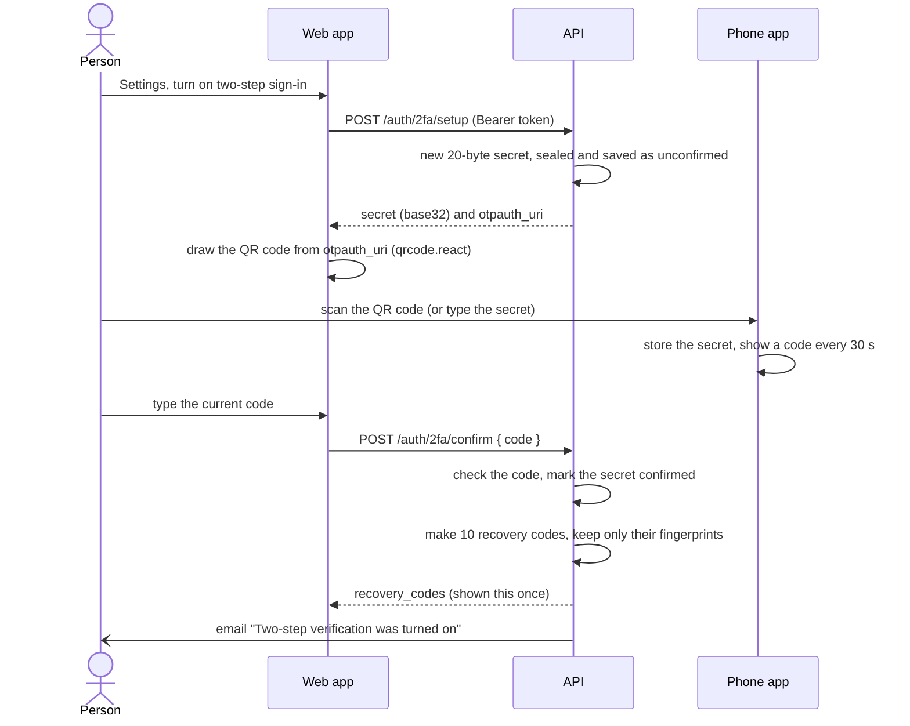
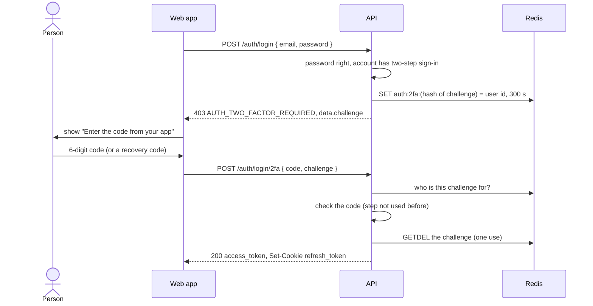

# Two-step sign-in

Two-step sign-in (also called two-factor authentication, 2FA, or "authenticator
app codes") asks for a second proof after the password: a six-digit code from an
app on the person's phone, such as Google Authenticator, Microsoft
Authenticator, 1Password or Aegis. A stolen password alone is then not enough to
get in.

Read this page if you want to know how the QR code, the changing codes and the
recovery codes actually work, if you are building the settings screens or the
"enter your code" screen, or if you run the server and need to change the
encryption key or help a locked-out user. Nothing needs setting up: the feature
is always available, and each user turns it on for their own account.

- [The idea in one paragraph](#the-idea-in-one-paragraph)
- [How the six-digit codes work](#how-the-six-digit-codes-work)
- [Turning it on: the QR code and the first code](#turning-it-on-the-qr-code-and-the-first-code)
- [Signing in with the second step](#signing-in-with-the-second-step)
- [Recovery codes](#recovery-codes)
- [Turning it off, and new recovery codes](#turning-it-off-and-new-recovery-codes)
- [Where each kind of code is accepted](#where-each-kind-of-code-is-accepted)
- [Limits](#limits)
- [How the secret is kept safe at rest](#how-the-secret-is-kept-safe-at-rest)
- [Changing the encryption key](#changing-the-encryption-key)
- [When someone is locked out](#when-someone-is-locked-out)
- [Errors](#errors)
- [Emails and metrics](#emails-and-metrics)
- [Where it lives in the code](#where-it-lives-in-the-code)

## The idea in one paragraph

When a person turns two-step sign-in on, the API makes a random **secret** and
shows it once, as a QR code. The phone app scans it and keeps it. From then on,
the app and the API each hold the same secret, and each can work out, from the
secret and the current time, the same six-digit code. Every 30 seconds the code
changes. Nothing travels between the phone and the server after the scan: the
phone does not need a network connection, and the server never sends a code.
When the person signs in, they type what their app shows, and the API checks it
by doing the same sum. This scheme is a public standard called **TOTP**
(time-based one-time password, [RFC 6238](https://www.rfc-editor.org/rfc/rfc6238)),
which is why any authenticator app works.

## How the six-digit codes work

### 1. A shared secret

At setup the API makes 20 random bytes (160 bits, the size the standard
recommends) and writes them as 32 letters and digits in **base32**, an alphabet
of `A`–`Z` and `2`–`7` that is easy to type: for example
`JBSW Y3DP EHPK 3PXP JBSW Y3DP EHPK 3PXP`. This is the secret. It is shown to
the person once, inside the QR code and as text for typing in by hand, and it
never leaves the server again. The server keeps it encrypted
([below](#how-the-secret-is-kept-safe-at-rest)).

### 2. The current time step

Both sides count time in 30-second **steps** since 1 January 1970 (Unix time):

```
step = floor(unix_seconds / 30)
```

At 12:00:00 UTC on 5 October 2026, Unix time is 1791201600, so the step is
59706720. Every 30 seconds the step goes up by one, and with it the code
changes. That is why the app shows a countdown.

### 3. The code: a keyed hash of the step

The code is an **HMAC** of the step number, keyed with the secret. An HMAC is a
hash that only someone holding the key can compute; change one bit of the key
or the input and the result looks completely different. TOTP uses HMAC-SHA1:

1. Write the step as 8 bytes (big-endian).
2. Compute `HMAC-SHA1(secret, step)`: 20 bytes.
3. **Truncate** to a number: the low 4 bits of the last byte give an offset
   (0–15); take the 4 bytes starting there, drop the top bit, and read them as
   a whole number.
4. Keep the last six decimal digits (`number mod 1 000 000`), padded with zeros
   on the left.

A worked example, the standard's own test vector (secret = the text
`12345678901234567890`, time = 59 seconds after 1970):

| Step | Value |
|---|---|
| Time step | `floor(59 / 30)` = 1 |
| HMAC-SHA1 | `75a48a19d4cbe100644e8ac1397eea747a2d33ab` |
| Offset (last byte `ab`, low 4 bits) | `b` = 11 |
| 4 bytes from offset 11 | `c1397eea` → top bit dropped: `41397eea` = 1 094 287 082 |
| Last six digits | **287082** |

Without the secret, seeing past codes tells an attacker nothing about the next
one: that is the job of the HMAC.

The starter does not do this arithmetic itself. The
[`otpauth`](https://github.com/hectorm/otpauth) library makes the secret,
builds the QR content and computes and compares codes (in constant time), with
SHA-1, 6 digits and 30 seconds: the settings every authenticator app supports
(Google Authenticator ignores any others). The adapter is
[otpauth-totp.adapter.ts](../../src/modules/auth/infrastructure/adapters/otpauth-totp.adapter.ts).

### 4. Why the clock matters

The phone and the server each compute the step from their own clock. If the
phone's clock is two minutes wrong, it is four steps away from the server and
every code it shows is refused. Phones set their time from the network, so this
is rare; when a user says "the codes never work", a wrong phone clock (or a
time-zone set by hand with automatic time off) is the first thing to check. The
server's clock matters just as much: keep NTP on (every normal Linux server has
it).

### 5. Why one step either side is accepted

The API accepts the code for the current step, the step before and the step
after (a **window of ±1**). Two reasons:

- A person reads the code at second 28 of its step, types it, and the request
  arrives at second 33: it now belongs to the previous step, and should still
  work.
- Clocks drift a few seconds. One step either way tolerates up to about 30
  seconds of difference.

So a code is accepted for roughly 90 seconds in all. A wider window would
accept more guesses for no benefit.

### 6. Why a used code cannot be used again

A six-digit code that is valid for 90 seconds could be read over someone's
shoulder, or captured by a fake sign-in page that passes it on, and used again
inside that time. To stop that, the API remembers the step of the last accepted
code (`TwoFactor.lastUsedStep`) and accepts a code only if its step is
**later**. The check and the update are one database statement
(`UPDATE ... WHERE lastUsedStep IS NULL OR lastUsedStep < step`), so two
requests racing with the same code cannot both pass.

The side effect is visible: signing in twice within the same 30 seconds with the
same code fails the second time. Wait for the next code. Setting up two-step
sign-in again starts the count afresh.

## Turning it on: the QR code and the first code

Turning it on takes two calls: one makes a secret, the second proves the phone
has it. Until the second call succeeds, nothing changes at sign-in.



1. **`POST /api/v1/auth/2fa/setup`** (signed in, no body) answers:

   ```json
   {
     "secret": "JBSWY3DPEHPK3PXPJBSWY3DPEHPK3PXP",
     "otpauth_uri": "otpauth://totp/YourAppName:you%40example.com?issuer=YourAppName&secret=JBSWY3DPEHPK3PXPJBSWY3DPEHPK3PXP&algorithm=SHA1&digits=6&period=30"
   }
   ```

   The `otpauth://` URI is the standard format every authenticator app reads.
   It carries the secret and the settings, plus two names the app shows in its
   list: the **issuer**, which is `APP_NAME`, and the **account**, which is the
   person's email (or their user id if the account has none). Set `APP_NAME` to
   your product's name before going live: it is what people will see next to the
   codes.

   The secret is saved **unconfirmed** (`TwoFactor.confirmedAt` is null). Calling
   setup again replaces an unconfirmed secret, so a person who closed the page
   halfway can start over. If two-step sign-in is already on, setup answers
   409 `AUTH_TWO_FACTOR_ALREADY_ON`.

2. **The web app draws the QR code itself.** The React starter's
   `src/features/auth/components/TwoStepSettings.tsx` renders `otpauth_uri` with
   the [`qrcode.react`](https://github.com/zpao/qrcode.react) component
   `QRCodeSVG`, dark on white whatever the theme (some apps cannot read a
   light-on-dark code). It also shows the secret in groups of four for typing in
   by hand, with a copy button. Drawing the QR code in the browser matters: an
   online "QR code generator" would see the secret.

3. **`POST /api/v1/auth/2fa/confirm`** with `{ "code": "123456" }`, a code from
   the app. A recovery code is not accepted here (there are none yet). If the
   code is right:
   - the secret becomes confirmed: from now on, every sign-in asks for a code;
   - 10 recovery codes are made, and returned in this answer only:
     `{ "recovery_codes": ["K7Q2M-X9HDP", ...] }`;
   - the owner is emailed that two-step sign-in was turned on;
   - the person's other sessions are **not** ended (they were already signed in
     with the password; turning protection on is not a sign of trouble).

   A wrong code answers 400 `AUTH_TWO_FACTOR_CODE_INVALID` with
   `data.attempts_left`, and counts against the [limit](#limits).

`GET /api/v1/auth/2fa` tells the settings page the current state:
`{ "enabled": true, "recovery_codes_left": 8 }`. `enabled` is true only once
confirmed; `recovery_codes_left` is 0 when it is off.

## Signing in with the second step

Every way into a session (password, an emailed code, Google) ends in one place,
the `SignInGate` ([sign-in-gate.ts](../../src/modules/auth/application/services/sign-in-gate.ts)).
If the account has a confirmed secret, the gate does not start a session.
Instead it creates a **challenge**: a random, single-use ticket that says "this
person passed the first step for this account, within the last 5 minutes".
No route can start a session around it.



The steps in detail:

1. The first step answers **403 `AUTH_TWO_FACTOR_REQUIRED`** (code `403005`)
   with `data.challenge`. This is a next step, not a failure: the client moves
   to the code screen (`/sign-in/two-step` in the React starter). It can come
   from `POST /auth/login` and from `POST /auth/reset-password`, which signs in
   too; after a reset, the new password is already saved by the time the 403
   arrives. (`POST /auth/verify-email` goes through the same gate, but an
   account still confirming its address cannot have two-step sign-in on yet.)
2. The challenge is 32 random bytes in base64url (43 characters). Redis stores
   it under `auth:2fa:<SHA-256 of the challenge>`, with the user id as the value
   and a 5-minute expiry. Storing a hash means that someone who can read Redis
   cannot send the keys back as challenges.
3. **`POST /api/v1/auth/login/2fa`** with `{ "code": "...", "challenge": "..." }`.
   The code may be six digits from the app or a recovery code.
4. A right code takes the challenge out of Redis with `GETDEL`, so two requests
   racing with the same right code cannot both get a session. The answer is an
   ordinary sign-in: the access token in the body and the refresh cookie.
5. A wrong code costs one of the challenge's **5 tries** and one of the user's
   **5 wrong codes per 15 minutes** (see [Limits](#limits)). The answer is
   400 `AUTH_TWO_FACTOR_CODE_INVALID` with `data.attempts_left`, the smaller of
   the two. When the challenge runs out of tries, or its 5 minutes pass, the
   answer is 401 `AUTH_TWO_FACTOR_CHALLENGE_EXPIRED`: start again from the
   password.

### After Google

When the first step was "Continue with Google", the browser is coming back from
Google through a redirect, so there is no JSON body to put the challenge in. And
the challenge must not go in the URL: URLs end up in browser history and server
logs. So:

1. The API sets an httpOnly cookie `two_factor` holding the challenge, with the
   path `/api/v1/auth/login/2fa` (so the browser sends it nowhere else), a
   5-minute lifetime, `Secure` as the refresh cookie is, and `SameSite=Lax`
   (or `None` when `AUTH_COOKIE_SAMESITE=none`).
2. It redirects to `FRONTEND_URL/auth/callback?two_factor=1&redirect=<path>`.
3. The web app shows the code screen, then calls `POST /auth/login/2fa` with
   only `{ "code": "..." }` and **with credentials** (axios `withCredentials`),
   so the cookie supplies the challenge.
4. Because this request is authenticated by a cookie, the API also checks its
   `Origin` header against `CORS_ORIGINS`, as it does for refresh and sign-out:
   a page on another site gets 403 `AUTH_FORBIDDEN`. The cookie is cleared on
   success.

See [google-sign-in.md](google-sign-in.md) for the rest of the Google flow, and
[flows.md](flows.md) for every flow side by side.

## Recovery codes

Recovery codes are for the day the phone is lost, wiped or replaced. Each one
works once, instead of an app code.

**What they look like.** Ten codes, each 10 characters shown as two groups of
five: `K7Q2M-X9HDP`. The characters come from a 31-character alphabet,
`23456789ABCDEFGHJKMNPQRSTUVWXYZ`: digits and capitals without `0`, `O`, `1`,
`I` and `L`, which people misread when copying from paper. Each character is
picked with Node's `crypto.randomInt` (a cryptographically secure random
source), so a code has 31^10 ≈ 8 × 10^14 possibilities, about 50 bits: far too
many to guess within the [limits](#limits).

**Typing them.** Case, spaces and the dash are ignored: `k7q2m x9hdp`,
`K7Q2MX9HDP` and `K7Q2M-X9HDP` are the same code. Anything that is not 10
characters from the alphabet is simply a wrong code. A six-digit input is always
treated as an app code, never as a recovery code.

**How they are stored.** Never as the codes. Each is stored as a
**fingerprint**: an HMAC-SHA256 of the normalised code, keyed with a key derived
from `AUTH_ENCRYPTION_KEY`, written as `<key id>.<hmac>` (one `RecoveryCode` row
per code). To check a typed code, the API computes its fingerprint and looks for
an unused row with it. A keyed HMAC rather than a plain hash means that a copy
of the database alone is useless: without the key, nobody can even test
guesses against the fingerprints offline. (A slow password hash such as Argon2
is not needed here: the codes are random, not chosen by people, so there is no
dictionary to try.)

**Single use.** Using a code sets its `usedAt` in one conditional update
(`WHERE fingerprint IN (...) AND usedAt IS NULL`), so the same code cannot pass
twice, even in two requests at once. Using one at sign-in emails the owner with
the number left; the email warns when 3 or fewer remain.

**Shown once.** The codes are in the answer to `POST /auth/2fa/confirm` and
`POST /auth/2fa/recovery-codes`, and nowhere else, ever: the server cannot show
them again because it does not have them. The React starter offers to copy or
download them as a text file, and suggests making new ones when 3 or fewer are
left.

## Turning it off, and new recovery codes

Both need a code, not just a signed-in session: someone at an unlocked computer
must not be able to remove the protection, or mint new ways in, with one click.

| Route | Body | Accepts | Effect |
|---|---|---|---|
| `POST /api/v1/auth/2fa/disable` | `{ "code": "..." }` | an app code **or** a recovery code | Deletes the secret and every recovery code. Emails "turned off". Sessions are kept. |
| `POST /api/v1/auth/2fa/recovery-codes` | `{ "code": "..." }` | an app code only | Deletes every earlier recovery code and returns 10 new ones, this once. Emails "new recovery codes were made". |

A recovery code is accepted for turning it off because the person who lost
their phone needs exactly that: sign in with a recovery code, then turn
two-step sign-in off and on again with the new phone. It is not accepted for new
recovery codes, so one leaked recovery code cannot be turned into ten.

Both answer 409 `AUTH_TWO_FACTOR_NOT_ON` if two-step sign-in is not on.

## Where each kind of code is accepted

| Where | App code | Recovery code | Email when a recovery code is used |
|---|---|---|---|
| `POST /auth/login/2fa` (signing in) | yes | yes | yes, "A recovery code was used to sign in", with the number left |
| `POST /auth/2fa/disable` | yes | yes | no (the "turned off" email is sent instead) |
| `POST /auth/account/delete` (`two_factor_code`) | yes | yes | no (the "account deleted" email is sent instead) |
| `POST /auth/2fa/confirm` | yes | no | — |
| `POST /auth/2fa/recovery-codes` | yes | no | — |

The rules live in [second-factor.ts](../../src/modules/auth/application/services/second-factor.ts).

## Limits

Six digits are a million possibilities, so the number of guesses must be small.

| Limit | Size | Counts | Shared by |
|---|---|---|---|
| Tries per challenge | 5, then the challenge is gone | wrong codes at `POST /auth/login/2fa` | that one sign-in attempt |
| `2fa-fail` (per user) | 5 wrong codes per 15 minutes | wrong codes anywhere | signing in, confirm, disable, recovery-codes, account deletion |

Only wrong codes count, and any successful two-step operation clears the
per-user count. When the per-user limit is used up the answer is 429
`RATE_LIMIT_EXCEEDED` with `data.reason: "wrong_codes"` and a `Retry-After`
header, so the page can say how long to wait. Settings pages (confirm, disable,
recovery-codes) answer a wrong code with `attempts_left` from the per-user
limit.

What that buys: with three acceptable codes at any moment (the ±1 window), one
guess has about a 3-in-a-million chance. At 5 guesses per 15 minutes, a script
guessing around the clock has roughly a 1-in-700 chance per day, and every one
of those guesses first needs the account's correct password, which is the
point: the second step protects an account whose password leaked. Changing the
password ends every other session. The `auth_events_total{event="two_factor_failed"}`
metric counts wrong codes at sign-in if you want to watch for this.

Every limit in the module is listed on [rate-limits.md](rate-limits.md).

## How the secret is kept safe at rest

The server must be able to read the TOTP secret (it has to compute codes), so it
cannot store a one-way hash of it, as it does for passwords. It **encrypts** it
instead, with a key that is not in the database: `AUTH_ENCRYPTION_KEY`. A copy
of the database alone (a stolen backup, say) then holds no usable secrets. The
code is [aes-secret-box.adapter.ts](../../src/modules/auth/infrastructure/adapters/aes-secret-box.adapter.ts).

### The key, and three keys made from it

`AUTH_ENCRYPTION_KEY` is at least 32 random bytes written as hex (64 hex
characters). Generate one with:

```bash
openssl rand -hex 32
```

`.env.example` ships an all-zero key for development; production refuses to
start with it. Keep the real one like the database password, in your password
manager as well as in `.env.production`: if it is lost, nobody with two-step
sign-in on can finish signing in ([below](#when-someone-is-locked-out)).

The app never uses this key directly. It derives three separate keys from it
with **HKDF-SHA256** (a standard way to turn one secret into several
independent ones, each named by a label):

| Label | Length | Used for |
|---|---|---|
| `auth:seal` | 32 bytes | the AES-256-GCM key that encrypts TOTP secrets |
| `auth:fingerprint` | 32 bytes | the HMAC key for recovery-code fingerprints |
| `auth:key-id` | 6 bytes | a short public name for the key (8 characters of base64url) |

Separate keys mean neither use can weaken the other. The key id is derived
one-way, so it reveals nothing about the key, but it lets the app tell which key
sealed something.

### Sealing

Each secret is encrypted with **AES-256-GCM** and a fresh random 12-byte
nonce (IV). GCM is "authenticated" encryption: besides the ciphertext it
produces a 16-byte tag, and decryption fails if a single bit of the stored text
was changed. The stored value (`TwoFactor.secretSealed`) is five dot-separated
parts, each base64url:

```
v2.<key id>.<iv>.<tag>.<ciphertext>
```

Opening it:

- The key id picks the key. If no configured key has that id (the key was
  changed without keeping the old one), the answer at the second step is
  503 `AUTH_TWO_FACTOR_UNAVAILABLE`, with an error log telling the operator
  what to do. The request is refused, never let through.
- If the key is known but the tag does not match, the value was altered or
  corrupted in the database: the request fails with a 500, and the account
  needs two-step sign-in turned off ([below](#when-someone-is-locked-out)).
- If it was sealed with the previous key, it is sealed again with the current
  key and saved, the first time it is read.

An older format without a key id (`v1.<iv>.<tag>.<ciphertext>`, and recovery
fingerprints that are a bare `<hmac>`) is still read, by trying each configured
key.

## Changing the encryption key

Do this if the key may have leaked, or on a schedule if your policy asks for
one. Everyone keeps signing in throughout.

1. Generate a new key: `openssl rand -hex 32`.
2. In `.env.production`, move the current key to `AUTH_ENCRYPTION_KEY_PREVIOUS`
   and put the new one in `AUTH_ENCRYPTION_KEY`. Deploy. The previous key is
   only ever used to read; everything new is sealed with the current one. (The
   app refuses to start if the two are the same.)
3. Re-seal every secret now rather than waiting for each person to sign in:

   ```bash
   pnpm auth:rotate-key
   ```

   On the server, in the app's container:

   ```bash
   docker compose --env-file .env.production -f docker-compose.prod.yaml exec app \
     node dist/src/bootstrap/rotate-encryption-key.js
   ```

   It is safe to run again, and while the app serves requests. It prints what
   it did:
   - `✓ N two-step secret(s): M sealed again with the current key.`
   - `✗ ...` for accounts whose secret no configured key can open, with the
     command to fix them. The exit code is 1 when there are any.
   - `! Keep AUTH_ENCRYPTION_KEY_PREVIOUS: ...` while unused recovery codes made
     with the old key exist. Recovery codes cannot be re-sealed (only their
     fingerprints are stored), so they keep needing the old key until they are
     used, or until the person makes new ones (`POST /auth/2fa/recovery-codes`)
     or turns two-step sign-in off and on.
   - `✓ Nothing needs AUTH_ENCRYPTION_KEY_PREVIOUS any more: empty it, and restart the app.`
4. When it says so, empty `AUTH_ENCRYPTION_KEY_PREVIOUS` and deploy again.

The script is [rotate-encryption-key.ts](../../src/bootstrap/rotate-encryption-key.ts).
[operations.md](operations.md) has the production checklist that this fits into.

## When someone is locked out

**A person lost their phone and their recovery codes.** First make sure, by
other means, that it really is them: anyone can claim to be locked out. Then:

```bash
pnpm auth:two-factor:off you@example.com
```

On the server:

```bash
docker compose --env-file .env.production -f docker-compose.prod.yaml exec app \
  node dist/src/bootstrap/two-factor-off.js you@example.com
```

It deletes the account's secret and recovery codes and emails the owner that
two-step sign-in was turned off, exactly as if they had done it (if it was not
their request, they know at once). Their password and sessions are left alone.
They sign in with the password and can turn it on again with the new phone. If
the email cannot be queued (Redis unreachable), the script says so: tell them
yourself.

**The encryption key was lost** (or changed without keeping the old one in
`AUTH_ENCRYPTION_KEY_PREVIOUS`). Everyone with two-step sign-in on gets
503 `AUTH_TWO_FACTOR_UNAVAILABLE` at the second step, whatever code they type:
recovery codes are keyed with the same key, so they fail too. If the old key
still exists anywhere, put it in `AUTH_ENCRYPTION_KEY_PREVIOUS` and the problem
is gone. If it is truly lost:

```bash
pnpm auth:two-factor:off --unreadable          # lists who it would affect, changes nothing
pnpm auth:two-factor:off --unreadable --yes    # turns it off for them, and emails each one
```

The same command handles secrets that fail their integrity check (altered in
the database). The script is [two-factor-off.ts](../../src/bootstrap/two-factor-off.ts).

## Errors

Every error uses the standard envelope; `meta.type` is the value to switch on.
The full catalogue is in [api-reference.md](api-reference.md).

| Status | `meta.type` | Code | When | `data` |
|---|---|---|---|---|
| 403 | `AUTH_TWO_FACTOR_REQUIRED` | 403005 | The first step of a sign-in passed; the code comes next. Not a failure. | `challenge` |
| 400 | `AUTH_TWO_FACTOR_CODE_INVALID` | 400105 | Wrong, already used, or not a code. | `attempts_left` |
| 401 | `AUTH_TWO_FACTOR_CHALLENGE_EXPIRED` | 401009 | The challenge is unknown, older than 5 minutes, out of tries, or already used. Sign in again. | — |
| 409 | `AUTH_TWO_FACTOR_ALREADY_ON` | 409002 | Setup or confirm when it is already on (or a confirm lost a race). | — |
| 409 | `AUTH_TWO_FACTOR_NOT_ON` | 409003 | Confirm before setup ("Set up two-step verification first."), or disable / recovery-codes when it is off. | — |
| 429 | `RATE_LIMIT_EXCEEDED` | 429001 | 5 wrong codes in 15 minutes for this account. | `reason: "wrong_codes"`, plus the `Retry-After` header |
| 503 | `AUTH_TWO_FACTOR_UNAVAILABLE` | 503003 | The secret was sealed with a key this server does not have. | — |
| 403 | `AUTH_ACCOUNT_DISABLED` | 403003 | The account was deleted while the challenge was waiting. | — |
| 403 | `AUTH_FORBIDDEN` | 403004 | `POST /auth/login/2fa` without a `challenge` in the body, from an `Origin` not in `CORS_ORIGINS`. | — |
| 422 | `VALIDATION_ERROR` | 422000 | `code` missing or not 6–32 characters; `challenge` longer than 256. | per-field list |

## Emails and metrics

| Email | Sent when |
|---|---|
| "Two-step verification was turned on for your {app} account" | confirm |
| "Two-step verification was turned off for your {app} account" | disable, and `pnpm auth:two-factor:off` |
| "New recovery codes were made for your {app} account" | `POST /auth/2fa/recovery-codes` |
| "A recovery code was used to sign in to {app}" | a recovery code at `POST /auth/login/2fa` only; says how many are left |

The "turned on/off" email names `SUPPORT_EMAIL` when it is set. Every email is
described on [emails.md](emails.md).

`auth_events_total` counts `two_factor_enabled`, `two_factor_disabled`,
`recovery_codes_replaced` and `two_factor_failed` (wrong codes at sign-in only);
a sign-in finished at the second step counts as `login_succeeded`.

## Where it lives in the code

| File | What it does |
|---|---|
| [otpauth-totp.adapter.ts](../../src/modules/auth/infrastructure/adapters/otpauth-totp.adapter.ts) | New secrets, the `otpauth://` URI, checking a code with a ±1 window |
| [second-factor.ts](../../src/modules/auth/application/services/second-factor.ts) | Accepting an app code or a recovery code, once; re-sealing on read |
| [sign-in-gate.ts](../../src/modules/auth/application/services/sign-in-gate.ts) | Session or challenge; the 5-minute and 5-try constants |
| [set-up-two-factor/](../../src/modules/auth/application/commands/set-up-two-factor/), [confirm-two-factor/](../../src/modules/auth/application/commands/confirm-two-factor/), [disable-two-factor/](../../src/modules/auth/application/commands/disable-two-factor/), [replace-recovery-codes/](../../src/modules/auth/application/commands/replace-recovery-codes/), [queries/get-two-factor-status/](../../src/modules/auth/application/queries/get-two-factor-status/) | Setup, confirm, disable, new recovery codes, status |
| [complete-two-factor-sign-in.handler.ts](../../src/modules/auth/application/commands/complete-two-factor-sign-in/complete-two-factor-sign-in.handler.ts) | `POST /auth/login/2fa` |
| [recovery-codes.ts](../../src/modules/auth/domain/recovery-codes.ts) | Making and normalising recovery codes |
| [aes-secret-box.adapter.ts](../../src/modules/auth/infrastructure/adapters/aes-secret-box.adapter.ts) | Sealing, fingerprints, key ids |
| [redis-two-factor-challenge.adapter.ts](../../src/modules/auth/infrastructure/adapters/redis-two-factor-challenge.adapter.ts) | Challenges in Redis |
| [prisma-two-factor.repository.ts](../../src/modules/auth/infrastructure/persistence/prisma-two-factor.repository.ts) | The `TwoFactor` and `RecoveryCode` tables, the replay guard |

The integration tests that cover it end to end are
`test/integration/two-step-http.integration-spec.ts` and
`test/integration/encryption-key.integration-spec.ts`. For the module as a
whole, see [in-the-code.md](in-the-code.md).
