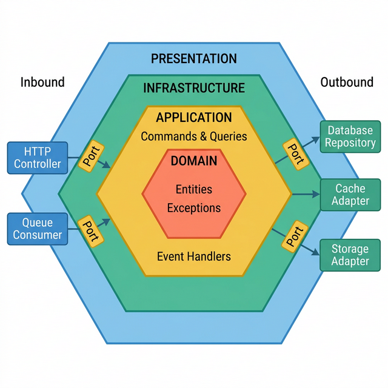
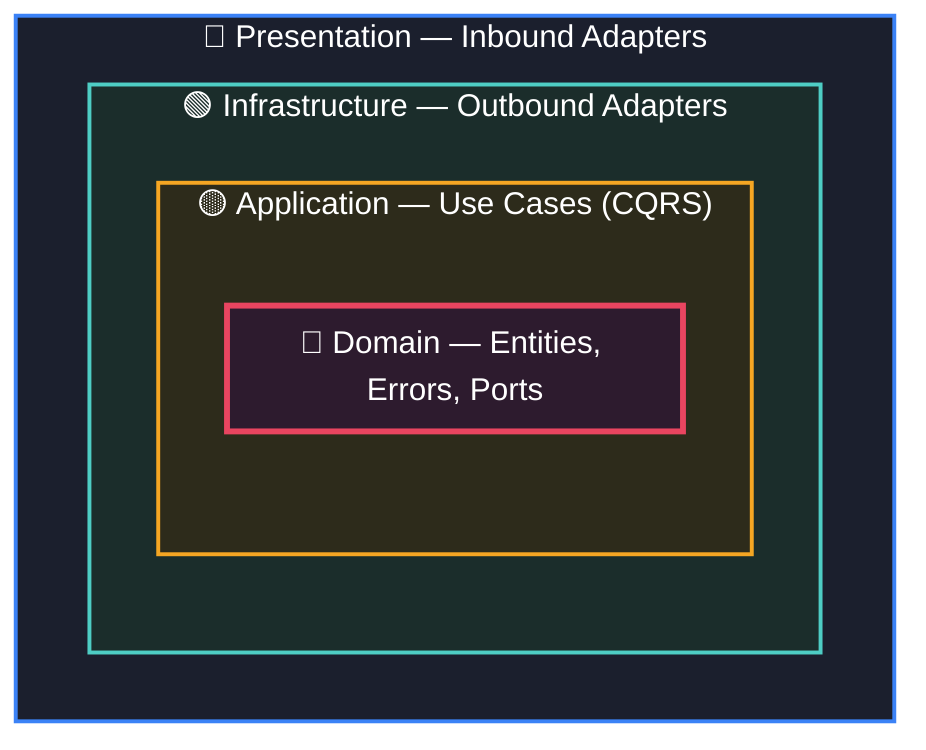
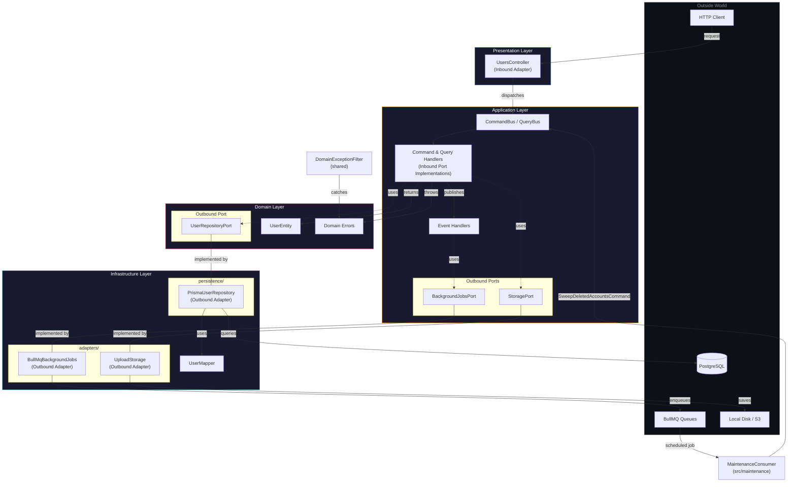
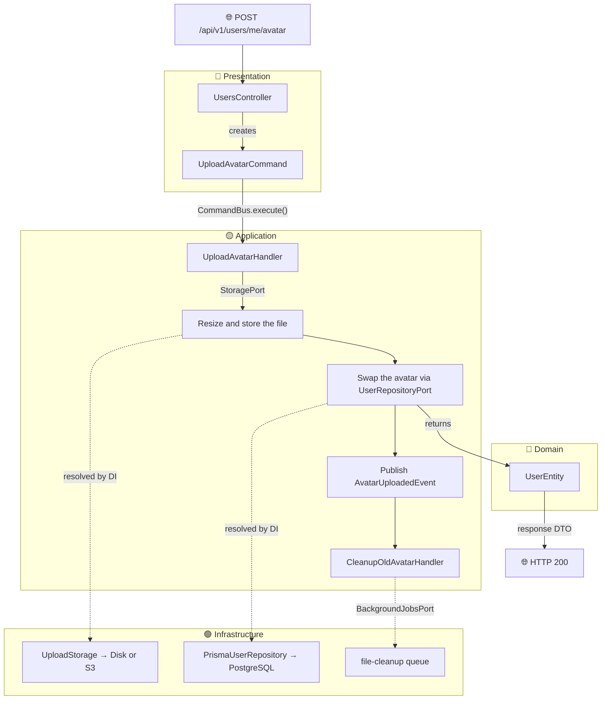
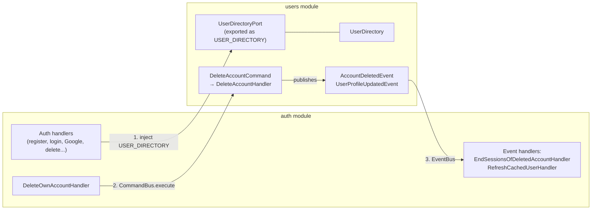

<!-- START doctoc generated TOC please keep comment here to allow auto update -->
<!-- DON'T EDIT THIS SECTION, INSTEAD RE-RUN doctoc TO UPDATE -->
**Table of Contents**  *generated with [DocToc](https://github.com/thlorenz/doctoc)*

- [Hexagonal Architecture: A Beginner's Guide](#hexagonal-architecture-a-beginners-guide)
  - [Table of Contents](#table-of-contents)
  - [What is Hexagonal Architecture?](#what-is-hexagonal-architecture)
  - [The Core Problem it Solves](#the-core-problem-it-solves)
  - [The 4 Layers](#the-4-layers)
    - [1. Domain Layer (The Heart)](#1-domain-layer-the-heart)
    - [2. Application Layer (The Brain)](#2-application-layer-the-brain)
    - [3. Infrastructure Layer (The Hands)](#3-infrastructure-layer-the-hands)
    - [4. Presentation Layer (The Face)](#4-presentation-layer-the-face)
  - [Ports & Adapters (The Key Concept)](#ports--adapters-the-key-concept)
    - [What is a Port?](#what-is-a-port)
      - [Outbound Ports (explicitly defined)](#outbound-ports-explicitly-defined)
      - [Inbound Ports (implicit via CQRS)](#inbound-ports-implicit-via-cqrs)
    - [What is an Adapter?](#what-is-an-adapter)
    - [How They Connect (Dependency Injection)](#how-they-connect-dependency-injection)
  - [The Dependency Rule](#the-dependency-rule)
  - [Architecture Diagram](#architecture-diagram)
    - [Overview (How Our Layers Form the Hexagon)](#overview-how-our-layers-form-the-hexagon)
    - [Detailed Flow (Data Flow Through the Users Module)](#detailed-flow-data-flow-through-the-users-module)
  - [Full Flow Example: Uploading an Avatar](#full-flow-example-uploading-an-avatar)
      - [Step 1: Presentation Layer (The Face)](#step-1-presentation-layer-the-face)
      - [Step 2: Application Layer (The Brain)](#step-2-application-layer-the-brain)
      - [Step 3: Infrastructure Layer (The Hands)](#step-3-infrastructure-layer-the-hands)
      - [Step 4: Event Handlers (Side Effects)](#step-4-event-handlers-side-effects)
      - [Summary:](#summary)
      - [Flow Diagram:](#flow-diagram)
  - [The Second Hexagon: the Auth Module](#the-second-hexagon-the-auth-module)
    - [Its ports and adapters](#its-ports-and-adapters)
    - [Where the two modules meet](#where-the-two-modules-meet)
  - [Our Folder Structure](#our-folder-structure)
  - [FAQ](#faq)

<!-- END doctoc generated TOC please keep comment here to allow auto update -->

# Hexagonal Architecture: A Beginner's Guide

This page is for anyone about to add or change code in `src/modules/`. It
explains how the starter's two modules, `users` and `auth`, are organised,
why, and where a new piece of code belongs. Every example is real code from
the repository, shortened.

## Table of Contents
1. [What is Hexagonal Architecture?](#what-is-hexagonal-architecture)
2. [The Core Problem it Solves](#the-core-problem-it-solves)
3. [The 4 Layers](#the-4-layers)
    - [Domain Layer (The Heart)](#1-domain-layer-the-heart)
    - [Application Layer (The Brain)](#2-application-layer-the-brain)
    - [Infrastructure Layer (The Hands)](#3-infrastructure-layer-the-hands)
    - [Presentation Layer (The Face)](#4-presentation-layer-the-face)
4. [Ports & Adapters (The Key Concept)](#ports--adapters-the-key-concept)
    - [What is a Port?](#what-is-a-port)
    - [What is an Adapter?](#what-is-an-adapter)
    - [How They Connect (Dependency Injection)](#how-they-connect-dependency-injection)
5. [The Dependency Rule](#the-dependency-rule)
6. [Full Flow Example: Uploading an Avatar](#full-flow-example-uploading-an-avatar)
7. [The Second Hexagon: the Auth Module](#the-second-hexagon-the-auth-module)
8. [Our Folder Structure](#our-folder-structure)
9. [FAQ](#faq)

---

## What is Hexagonal Architecture?

**Hexagonal Architecture** (also called "Ports & Adapters") is a way of organizing your code so that **your business logic never depends on external tools**.

Your business logic (e.g., "update a user's profile") doesn't care if the data lives in PostgreSQL, MongoDB, or a JSON file. It doesn't care if avatars are stored on AWS S3, Google Cloud Storage, or a local disk. It doesn't care whether background work runs on BullMQ or another queue.

Hexagonal Architecture enforces this by putting your **business rules at the center** and making all external systems (databases, APIs, file storage, caches, queues) plug in from the outside like USB devices.

## The Core Problem it Solves

In traditional "layered" architecture, your code usually looks like this:

```
Controller → Service → Repository
```

The problem? Your `UsersService` ends up directly importing `PrismaClient`, directly importing the `S3Client`, directly importing the Redis client, and directly calling `BullMQ`. Now your business logic is **glued** to specific technologies:

```typescript
// ❌ Traditional (tightly coupled)
class UsersService {
    constructor(
        private prisma: PrismaClient,        // Glued to Prisma/PostgreSQL
        private s3: S3Client,                 // Glued to AWS S3
        private redis: RedisClientType,       // Glued to Redis
        private cleanupQueue: Queue           // Glued to BullMQ
    ) {}
}
```

What happens when your CTO says "We're migrating from PostgreSQL to MongoDB"? You have to rewrite your **entire** service. The business logic (validation, rules, calculations) is tangled up with database queries. And testing it needs every one of those running.

Hexagonal Architecture solves this by saying: **"Your business logic should talk to abstract interfaces (Ports), not concrete implementations."**

---

## The 4 Layers

Our codebase organizes each module into 4 layers. Think of them as concentric rings, with the most important code in the center.

### 1. Domain Layer (The Heart)

**Location:** `modules/users/domain/`

This is the **innermost ring**. It contains:
- **Entities:** Plain classes that represent your business objects (e.g., `UserEntity`).
- **Errors:** Business rule violations (e.g., `UserNotFoundError`, `UsernameTakenError`).
- **Repository Ports:** Interfaces that describe "what data operations do I need?" without specifying *how*.
- **Rules:** e.g., `username.rules.ts` (what a valid username is).

```typescript
// Domain Entity — no framework, no database (src/modules/users/domain/entities/user.entity.ts)
export class UserEntity {
    readonly id: string

    username: string | null
    email: string | null
    roles: string[]
    displayName: string | null
    avatarUrl: string | null      // a storage key, e.g. avatars/avatar-<id>-<time>-<random>.webp
    bio: string | null
    completedAt: Date | null      // when "complete your account" was done; null until then
    termsAcceptedAt: Date | null  // when the Terms were agreed to, in that step

    readonly createdAt: Date
    updatedAt: Date
    deletedAt: Date | null        // set when the account is deleted (a "soft delete")
    deletedBy: string | null

    constructor(props: { id: string; username?: string | null /* ...every field, optional */ }) {
        // ...defaults: roles ['user'], completedAt null, and so on
    }

    get isDeleted(): boolean {
        return this.deletedAt !== null
    }
}
```

```typescript
// Domain Error — a business rule violation, with no HTTP in it
// (src/modules/users/domain/errors/username.errors.ts)
export class UsernameTakenError extends DomainError {
    readonly kind = 'conflict'             // what went wrong, in domain terms
    readonly errorKey = 'USERNAME_CONFLICT' // which catalogued error it is

    constructor(public readonly username: string) {
        super(`Username already taken: ${username}`)
    }
}
```

`DomainError` ([`src/shared/domain/domain-error.ts`](../src/shared/domain/domain-error.ts))
is the shared base class. The error says *what kind* of failure it is; one
filter at the edge turns the kind into an HTTP status ([FAQ 9](#faq)).

**Golden Rule:** The Domain Layer has **ZERO imports** from NestJS, Prisma, Redis, AWS, or any framework. It is plain TypeScript. You could copy-paste this folder into a React app, a CLI tool, or a Lambda function, and it would work without changes.

### 2. Application Layer (The Brain)

**Location:** `modules/users/application/`

This layer orchestrates the business logic using CQRS (Commands, Queries, Events). It contains:
- **Commands:** "Change something" (e.g., `UpdateProfileCommand`, `UploadAvatarCommand`, `RemoveAvatarCommand`, `DeleteAccountCommand`).
- **Queries:** "Read something" (e.g., `CheckUsernameQuery`).
- **Events:** "Something happened" (e.g., `UserProfileUpdatedEvent`, `AvatarUploadedEvent`, `AvatarRemovedEvent`, `AccountDeletedEvent`).
- **Handlers:** The actual logic for each Command, Query, and Event.
- **Application Ports:** Interfaces for outside capabilities (`StoragePort`, `BackgroundJobsPort`), and the one this module offers other modules (`UserDirectoryPort`).

```typescript
// Application Port — "I need a storage system, but I don't care which one"
// (src/modules/users/application/ports/storage.port.ts)
export interface StoragePort {
    /** Upload an avatar image. Handles processing (resize, format conversion) internally. */
    uploadAvatar(file: Buffer, originalName: string, userId: string): Promise<UploadedFileResult>
    deleteFile(filePath: string): Promise<void>
    /** A URL the client can fetch: a presigned URL for a private S3 bucket. */
    getReadUrl(key: string): Promise<string>
}
export const STORAGE = Symbol('StoragePort')
```

**Golden Rule:** The Application Layer knows about Domain objects (entities, errors) but has **ZERO knowledge** of infrastructure details. It never imports `PrismaClient`, `S3Client`, or a Redis client. It only talks through Port interfaces.

### 3. Infrastructure Layer (The Hands)

**Location:** `modules/users/infrastructure/`

This is where the real-world implementations live. It contains:
- **Adapters:** Concrete classes that implement the Port interfaces.
- **Mappers:** Convert between database models and domain entities.
- **Persistence:** Database-specific repository implementations.

```typescript
// Infrastructure Adapter — implements StoragePort with the shared UploadService
// (src/modules/users/infrastructure/adapters/upload-storage.adapter.ts)
@Injectable()
export class UploadStorage implements StoragePort {
    constructor(private readonly uploadService: UploadService) {}

    async uploadAvatar(fileBuffer: Buffer, originalName: string, userId: string): Promise<UploadedFileResult> {
        // resize with sharp (the avatar's size and format are this module's),
        // then local disk or S3, chosen by STORAGE_TYPE
        const result = await this.uploadService.uploadImage(fileBuffer, { processing: AVATAR_IMAGE /* , folder, name */ })
        return { key: result.key, width: result.width, height: result.height }
    }

    async getReadUrl(key: string): Promise<string> {
        // absolute: a local-storage path gets the API's base URL
        return getFullUrl(await this.uploadService.getSignedReadUrl(key), this.config.get('app.baseUrl'))
    }
    // ...
}
```

```typescript
// Infrastructure Adapter — implements UserRepositoryPort using Prisma/PostgreSQL
// (src/modules/users/infrastructure/persistence/prisma-user.repository.ts)
@Injectable()
export class PrismaUserRepository implements UserRepositoryPort {
    async findById(id: string): Promise<UserEntity | null> {
        const prismaUser = await this.prisma.user.findFirst({ where: { id, deletedAt: null } })
        return prismaUser ? UserMapper.toDomain(prismaUser) : null
    }
    // ...
}
```

**Golden Rule:** The Infrastructure Layer **depends inward** on the Domain and Application layers. It imports the Port interfaces and implements them. The Domain/Application layers never import from Infrastructure.

### 4. Presentation Layer (The Face)

**Location:** `modules/users/presentation/`

This is the outermost entry point. It contains:
- **HTTP Controllers:** Receive HTTP requests, create Commands/Queries, and dispatch them.
- **DTOs:** Request/Response Data Transfer Objects (validation, serialization).
- **Queue Consumers:** BullMQ workers that process background jobs.

There are no per-module exception filters: one shared `DomainExceptionFilter`
handles every module's errors ([FAQ 9](#faq)).

```typescript
// Presentation Controller — receives HTTP, dispatches Commands
// (src/modules/users/presentation/http/users.controller.ts)
@Controller({ path: 'users', version: '1' })
export class UsersController {
    constructor(
        private readonly commandBus: CommandBus,
        private readonly queryBus: QueryBus,
        private readonly configService: ConfigService,
        @Inject(STORAGE) private readonly storage: StoragePort
    ) {}

    @Patch('me')
    @Idempotent('10m')
    async updateProfile(@CurrentUser() user: AuthenticatedUser, @Body() dto: UpdateProfileRequestDto) {
        const result: UserEntity = await this.commandBus.execute(
            new UpdateProfileCommand(user.id, dto.displayName, dto.bio)
        )
        // ...build the response DTO from `result`
    }
}
```

**Golden Rule:** The Presentation Layer only creates and dispatches Commands/Queries, and shapes their results into responses. It never contains business logic. If you swapped the REST controller for a GraphQL resolver, **zero business logic would change**.

---

## Ports & Adapters (The Key Concept)

This is the single most important concept in Hexagonal Architecture. Everything else is built on top of this.

### What is a Port?

A **Port** is a TypeScript `interface` that describes **what** the application needs, without specifying **how** it gets done.

Think of it like an electrical wall outlet. The outlet (port) defines the shape of the plug. It doesn't care if the electricity comes from a coal plant, solar panels, or a nuclear reactor.

Ports come in two flavours:

#### Outbound Ports (explicitly defined)

These describe **what the application needs from the outside world**. They are the interfaces your application calls *out* through. The users module has three:

| Port | What it describes | Location |
|------|-------------------|----------|
| `UserRepositoryPort` | "I need to find, create, update and delete users" | `domain/ports/` |
| `StoragePort` | "I need to store, delete and link to files" | `application/ports/` |
| `BackgroundJobsPort` | "I need work done later, with retries" | `application/ports/` |

Example:
```typescript
// This is an OUTBOUND PORT — a contract for an external capability
// (src/modules/users/application/ports/background-jobs.port.ts)
export interface BackgroundJobsPort {
    /** Delete a stored file nothing references any more. */
    deleteFileLater(storageKey: string): Promise<void>
}
export const BACKGROUND_JOBS = Symbol('BackgroundJobsPort')
```

It has a fourth port that points the other way: `UserDirectoryPort`, what this
module **offers** to other modules. See
[Where the two modules meet](#where-the-two-modules-meet).

#### Inbound Ports (implicit via CQRS)

These describe **what use cases the application exposes** — i.e., entry points *into* the core.

In a traditional hexagonal architecture without CQRS, you would define an explicit inbound port interface:

```typescript
// Traditional inbound port (we do NOT do this)
export interface UserUseCases {
    updateProfile(id: string, data: UpdateProfileDto): Promise<UserEntity>
    checkUsername(username: string): Promise<boolean>
    uploadAvatar(id: string, file: Buffer): Promise<UserEntity>
}
```

**We use CQRS instead**, which makes these explicit interfaces unnecessary:

| Traditional Hex Arch | Our CQRS Approach |
|---|---|
| Inbound Port interface (`UserUseCases`) | Command/Query classes (`UpdateProfileCommand`, `CheckUsernameQuery`) |
| Inbound Port implementation (`UserService`) | Command/Query Handlers (`UpdateProfileHandler`, `CheckUsernameHandler`) |
| Inbound Adapter (`Controller → UserUseCases`) | Inbound Adapter (`Controller → CommandBus/QueryBus`) |

Each Command/Query **defines** a use case entry point with its exact input shape. Each Handler **implements** the use case logic. The `CommandBus`/`QueryBus` acts as the universal dispatcher. This is a well-recognized pattern — CQRS naturally replaces explicit inbound port interfaces by making each use case a self-contained Command + Handler pair. ([cqrs-guide.md](./cqrs-guide.md) covers CQRS itself.)

### What is an Adapter?

An **Adapter** is a concrete class that **implements** a Port interface. It's the actual plug that fits into the wall outlet.

In the users module, there are 4 **outbound** adapters and 2 **inbound** adapters:

**Outbound Adapters** (Infrastructure Layer — the app reaching *out*):

| Adapter | Implements | Technology Used |
|---------|-----------|-----------------|
| `PrismaUserRepository` | `UserRepositoryPort` | Prisma + PostgreSQL |
| `UploadStorage` | `StoragePort` | The shared `UploadService`: sharp, then local disk or S3 |
| `BullMqBackgroundJobs` | `BackgroundJobsPort` | BullMQ (the `file-cleanup` queue) |
| `UserDirectory` | `UserDirectoryPort` (for other modules) | This module's own `UserRepositoryPort` |

**Inbound Adapters** (Presentation Layer — the outside world reaching *in*):

| Adapter | What it does | Technology Used |
|---------|-----------|-----------------|
| `UsersController` | Receives HTTP requests, dispatches Commands/Queries | NestJS HTTP |

The deleted-account sweep is a command of the module's, `SweepDeletedAccountsCommand`,
but what runs it every 15 minutes is not: every module's periodic jobs are
listed in [`src/maintenance/maintenance-tasks.ts`](../src/maintenance/maintenance-tasks.ts),
and `MaintenanceConsumer` there sends their commands. The module only
exports the command, from its `index.ts`.

(`FileCleanupConsumer`, which deletes the files, is not the users module's:
it lives with the storage code in
[`src/shared/infrastructure/storage/file-cleanup.consumer.ts`](../src/shared/infrastructure/storage/file-cleanup.consumer.ts),
and any module can queue work for it.)

Example:
```typescript
// This is an OUTBOUND ADAPTER — the actual BullMQ implementation
// (src/modules/users/infrastructure/adapters/bullmq-background-jobs.adapter.ts)
@Injectable()
export class BullMqBackgroundJobs implements BackgroundJobsPort {
    constructor(@InjectQueue(QUEUES.FILE_CLEANUP) private readonly fileQueue: Queue<{ filePath: string }>) {}

    async deleteFileLater(storageKey: string): Promise<void> {
        // The job id is derived from the key, so queuing the same file twice is one job
        await this.fileQueue.add(FILE_DELETE_JOB, { filePath: storageKey }, { jobId: jobIdFor('file-delete', storageKey) })
    }
}
```

### How They Connect (Dependency Injection)

The magic glue is inside `users.module.ts`. This is where you tell NestJS: "Whenever someone asks for `BACKGROUND_JOBS`, give them the `BullMqBackgroundJobs`."

```typescript
// users.module.ts — the wiring (src/modules/users/users.module.ts)
@Module({
    imports: [CqrsModule, UploadModule, registerQueues(QUEUES.FILE_CLEANUP)],
    controllers: [UsersController],
    providers: [
        // Port → Adapter bindings (Hexagonal Architecture wiring)
        { provide: USER_REPOSITORY, useClass: PrismaUserRepository },
        { provide: STORAGE, useClass: UploadStorage },
        { provide: BACKGROUND_JOBS, useClass: BullMqBackgroundJobs },
        // Published for other modules: what the auth module needs from users.
        { provide: USER_DIRECTORY, useClass: UserDirectory },

        ...CommandHandlers,
        ...QueryHandlers,
        ...EventHandlers
    ],
    exports: [USER_DIRECTORY]
})
export class UsersModule {}
```

Now, when `CleanupOldAvatarHandler` asks for `@Inject(BACKGROUND_JOBS)`, NestJS injects a `BullMqBackgroundJobs`. The handler never knows it's talking to BullMQ. It just sees a `BackgroundJobsPort`.

**Why is this powerful?** If you want to switch from BullMQ to another queue, you write a new class that implements `BackgroundJobsPort`, change ONE line in `users.module.ts`, and the application works without touching a single handler, command, or query. In tests, you inject a plain object with a `jest.fn()` instead ([testing.md](./testing.md#the-port-mocking-pattern)).

---

## The Dependency Rule

The single most important rule in Hexagonal Architecture:

> **Dependencies always point INWARD. Inner layers NEVER import from outer layers.**

```
Presentation → Application → Domain
Infrastructure → Application → Domain
```

- ✅ `UpdateProfileHandler` (Application) imports `UserEntity` (Domain) — OK!
- ✅ `PrismaUserRepository` (Infrastructure) imports `UserRepositoryPort` (Domain) — OK!
- ✅ `UsersController` (Presentation) imports `UpdateProfileCommand` (Application) — OK!
- ❌ `UserEntity` (Domain) imports `PrismaClient` (Infrastructure) — VIOLATION!
- ❌ `UpdateProfileHandler` (Application) imports `PrismaUserRepository` (Infrastructure) — VIOLATION!

Between modules, the same idea holds in one direction: **the auth module
depends on the users module, never the reverse.** Nothing in
`src/modules/users/` imports from `src/modules/auth/`.

## Architecture Diagram

### Overview (How Our Layers Form the Hexagon)



(A general picture. In the users module the outbound adapters are the
database repository, the storage adapter and the background-jobs adapter; the
auth module adds, among others, a Redis cache adapter.)



### Detailed Flow (Data Flow Through the Users Module)

The following diagram shows how all layers, ports, adapters, and the CQRS flow connect in our Users module:



---

## Full Flow Example: Uploading an Avatar

Here is the complete journey of a `POST /api/v1/users/me/avatar` request through all 4 layers.

#### Step 1: Presentation Layer (The Face)
The user sends a `POST /api/v1/users/me/avatar` with an image file (multipart, field `avatar`).
Before the controller runs, the global guards check the access token, the idempotency interceptor checks the `Idempotency-Key` ([idempotency.md](./idempotency.md)), and multer refuses a file over the size limit.
The `UsersController` then creates an `UploadAvatarCommand` and hands it to the `CommandBus`.

```typescript
// Presentation Layer — UsersController
@Post('me/avatar')
@Idempotent('10m')
@UseInterceptors(FileInterceptor('avatar', { storage: memoryStorage(), limits: { fileSize: AVATAR_MAX_BYTES, files: 1 } }))
async uploadAvatar(@CurrentUser() user: AuthenticatedUser, @UploadedFile(AvatarFilePipe /* required, declared type */) file: Express.Multer.File) {
    const result: UploadAvatarResult = await this.commandBus.execute(
        new UploadAvatarCommand(user.id, file.buffer, file.originalname)
    )
    // avatarUrl: StoragePort.getReadUrl(result.upload.key), a presigned URL on S3
}
```

#### Step 2: Application Layer (The Brain)
The `UploadAvatarHandler` receives the command. It calls its injected **Ports** (not concrete implementations).

```typescript
// Application Layer — UploadAvatarHandler
// (src/modules/users/application/commands/upload-avatar/upload-avatar.handler.ts)
async execute(command: UploadAvatarCommand): Promise<UploadAvatarResult> {
    // 1. The STORAGE PORT: resize and store (doesn't know if it's S3 or disk)
    const uploadedFile = await this.storage.uploadAvatar(command.fileBuffer, command.originalName, command.userId)

    // 2. The REPOSITORY PORT: swap the avatar and learn which key it replaced, in one statement
    let replaced
    try {
        replaced = await this.userRepo.replaceAvatar(command.userId, uploadedFile.key)
    } catch (error) {
        await this.storage.deleteFile(uploadedFile.key).catch(() => undefined) // nothing will reference it
        throw error
    }
    if (!replaced) {
        // The account was deleted while the image was being processed
        await this.storage.deleteFile(uploadedFile.key).catch(() => undefined)
        throw new UserNotFoundError(command.userId)
    }

    // 3. Publish domain events (fire-and-forget)
    const { user, previousAvatarKey } = replaced
    if (previousAvatarKey) {
        this.eventBus.publish(new AvatarUploadedEvent(user.id, previousAvatarKey))
    }
    this.eventBus.publish(new UserProfileUpdatedEvent(user.id))

    return { user, upload: uploadedFile }
}
```

Why one statement for the swap: two uploads at once would otherwise both read
the same "previous" avatar, and one new file would never be cleaned up
([race-conditions-and-locks.md](./race-conditions-and-locks.md)).

#### Step 3: Infrastructure Layer (The Hands)
Behind the scenes, NestJS injects the real adapters:
- `this.storage` → `UploadStorage` → the shared `UploadService`: sharp resizes the image to WebP, then `LocalStorageService` or `S3StorageService` stores it, chosen by `STORAGE_TYPE`.
- `this.userRepo` → `PrismaUserRepository` → one `UPDATE ... RETURNING` against PostgreSQL that locks the row.

The handler doesn't know or care about any of this. It just calls the Port interface methods.

#### Step 4: Event Handlers (Side Effects)
- `AvatarUploadedEvent` → `CleanupOldAvatarHandler` (which also handles `AvatarRemovedEvent`, from `DELETE /users/me/avatar`) calls `BackgroundJobsPort.deleteFileLater(oldKey)`, which queues a job on the `file-cleanup` queue; `FileCleanupConsumer` deletes the old file, with retries.
- `UserProfileUpdatedEvent` → `RefreshCachedUserHandler`, in the **auth** module, drops its cached copy of the user, so the next request sees the new avatar. (The users module doesn't know who listens.)

#### Summary:
```
HTTP Request
  → UsersController (Presentation)
    → CommandBus
      → UploadAvatarHandler (Application)
        → StoragePort → [UploadStorage resizes and stores] (Infrastructure)
        → UserRepositoryPort → [PrismaUserRepository swaps the avatar] (Infrastructure)
        → EventBus
          → CleanupOldAvatarHandler (Application) → BackgroundJobsPort → file-cleanup queue
          → RefreshCachedUserHandler (auth module) → drops the cached user
  ← HTTP Response (the new avatar URL)
```

#### Flow Diagram:



---

## The Second Hexagon: the Auth Module

`src/modules/auth/` is the starter's second module, and it follows the same
four layers. It signs people in and keeps them signed in: passwords, emailed
codes, sessions and refresh tokens, Google sign-in, account deletion. What it
does is described in [auth/README.md](./auth/README.md); this section is only
about its shape.

| Layer | What is there |
|---|---|
| `domain/` | `errors/` (every auth `DomainError`, by topic), the repository ports in `ports/`, the password policy. No entities: the user is the users module's |
| `application/` | 17 command handlers (register, verify, login, refresh, logout, reset and change password, Google, account deletion...), 2 query handlers, 2 event handlers, small services shared by handlers (`SessionIssuer`, `CodeIssuer`, `SignInGate`), the rate-limit rules, and the ports for outside services in `application/ports/` |
| `infrastructure/` | one adapter per port (below): `adapters/` and `persistence/`, as in users; and `email/`, the emails `AuthJobsConsumer` sends (`AuthEmails` and their templates) |
| `presentation/` | Five controllers for the /auth routes (HTTP), `AccessTokenGuard` (the global guard that checks every request's token), `AuthJobsConsumer` (sends the emails) |

### Its ports and adapters

Wired in [`auth.module.ts`](../src/modules/auth/auth.module.ts), the same way as
the users module:

| Port | What it describes | Adapter | Technology |
|---|---|---|---|
| `PasswordHasherPort` | hash and check passwords | `Argon2PasswordHasher` | `@node-rs/argon2` |
| `TokenServicePort` | issue and verify access tokens, make refresh tokens, hash codes | `JoseTokenService` | `jose` (HS256 JWTs) |
| `CredentialRepositoryPort`, `SessionRepositoryPort`, `VerificationCodeRepositoryPort`, `OAuthAccountRepositoryPort` | the auth tables | `Prisma*Repository` | Prisma + PostgreSQL |
| `PrincipalPort`, `SessionCachePort` | "is this session live, and who is it?" on every request; dropping cached entries | `RedisSessionCache` (one class, both ports) | Redis, with Postgres behind it |
| `OAuthProviderPort` | sign in with another provider | `OpenIdConnectProvider` | `openid-client` (Google) |
| `OAuthStatePort` | an in-progress Google sign-in, taken once | `RedisOAuthState` | Redis (`GETDEL`) |
| `AuthMailerPort` | queue the auth emails | `BullMqAuthMailer` | BullMQ (`auth` queue) |
| `AuthEventsPort` | count what happened | `PrometheusAuthEvents` | Prometheus (`auth_events_total`) |
| `RateLimitPort` | fixed-window limits | the shared `RateLimiter` | Redis |

The auth handler tests replace these with in-memory fakes
([`auth-test-world.shared-spec.ts`](../src/modules/auth/application/commands/auth-test-world.shared-spec.ts)), which is the payoff of the ports: the
whole sign-in logic is tested without Postgres, Redis or Google.
More detail: [auth/in-the-code.md](./auth/in-the-code.md).

### Where the two modules meet

The user record belongs to the users module; the auth module needs to read
and create users, and to delete them. The modules meet at three seams, all
pointing from auth to users:



1. **`UserDirectoryPort`** ([`user-directory.port.ts`](../src/modules/users/application/ports/user-directory.port.ts)).
   The users module publishes the few operations auth needs: find a user by
   email or id, create an account, complete it ("complete your account":
   name, username, Terms, first settings and the password hash in one
   transaction), and read the
   account's language for emails nobody asked for. It speaks in a small `DirectoryUser` record, not the
   `UserEntity`, so auth never depends on the entity's shape. `UsersModule`
   binds it to `UserDirectory` and exports only that token
   (`exports: [USER_DIRECTORY]`); `AuthModule` imports `UsersModule` and
   injects it with `@Inject(USER_DIRECTORY)`. Auth never reads the `User`
   table itself. The reverse has one exception: `complete` writes auth's
   `Credential` row in its transaction, so a completion that loses (another
   tab first, the username taken) changes no password.
2. **Dispatching users' `DeleteAccountCommand`.** `POST /api/v1/auth/account/delete`
   is an auth route, because deleting needs proof (the password or an emailed
   code). Once
   [`DeleteOwnAccountHandler`](../src/modules/auth/application/commands/delete-own-account/delete-own-account.handler.ts)
   has checked it, it does not delete the row itself. It sends the users
   module's command through the bus:

   ```typescript
   await this.commandBus.execute(new DeleteAccountCommand(userId, userId))
   ```

   The users module's handler does the soft delete and publishes
   `AccountDeletedEvent`. Auth never calls the users handler directly
   ([FAQ 12](#faq)).
3. **Listening to users' events.** Auth's
   [`events/handlers/`](../src/modules/auth/application/events/handlers/)
   reacts to `AccountDeletedEvent` (end every session, delete the password and
   Google links) and to `UserProfileUpdatedEvent` (drop the
   cached user). The users module publishes them without knowing auth
   exists.

The result: you could delete `src/modules/auth/` and the users module would
still compile. The other way round, auth needs users' published port,
command and events, and nothing else from it. When you add a module, give it
the same kind of seams: a published port for what others may ask, commands
for what others may make it do, events for what it announces.

---

## Our Folder Structure

Here is the complete folder structure of the `users` module:

```
modules/users/
├── domain/                          # 🔴 The Heart (pure business rules)
│   ├── entities/
│   │   └── user.entity.ts           # Pure domain entity
│   ├── errors/                      # DomainError subclasses, by topic
│   │   ├── user.errors.ts
│   │   └── username.errors.ts
│   ├── ports/
│   │   └── user.repository.port.ts  # Outbound port for persistence
│   ├── avatar.rules.ts              # 8 MB, JPG / PNG / WEBP (no GIF)
│   ├── email.rules.ts
│   ├── profile-text.rules.ts        # display name and bio: NFC, code points, visible characters (D-139)
│   ├── timezone.rules.ts            # IANA zone names (used by "complete your account")
│   ├── username.rules.ts
│   └── index.ts                     # Barrel export
│
├── application/                     # 🟡 The Brain (orchestration + use cases)
│   ├── commands/
│   │   ├── update-profile/
│   │   ├── upload-avatar/
│   │   ├── remove-avatar/           # DELETE /users/me/avatar
│   │   ├── delete-account/          # dispatched by the auth module after proof
│   │   └── sweep-deleted-accounts/  # the scheduled erase / unverified clean-up
│   ├── queries/
│   │   ├── check-username/
│   │   └── resolve-avatar-url/
│   ├── events/
│   │   ├── handlers/
│   │   │   ├── cleanup-old-avatar.handler.ts
│   │   │   └── cleanup-account-avatar.handler.ts
│   │   ├── user-profile-updated.event.ts
│   │   ├── avatar-uploaded.event.ts
│   │   ├── avatar-removed.event.ts
│   │   └── account-deleted.event.ts
│   ├── ports/
│   │   ├── storage.port.ts          # Outbound: file storage
│   │   ├── background-jobs.port.ts  # Outbound: queued work
│   │   └── user-directory.port.ts   # Published for other modules (the auth module uses it)
│   └── index.ts
│
├── infrastructure/                  # 🟢 The Hands (real-world implementations)
│   ├── adapters/
│   │   ├── upload-storage.adapter.ts        # Implements StoragePort
│   │   ├── bullmq-background-jobs.adapter.ts # Implements BackgroundJobsPort
│   │   └── user-directory.adapter.ts        # Implements UserDirectoryPort
│   ├── mappers/
│   │   └── user.mapper.ts           # Prisma model ↔ Domain entity
│   ├── persistence/
│   │   └── prisma-user.repository.ts # Implements UserRepositoryPort
│   └── index.ts
│
├── presentation/                    # 🔵 The Face (HTTP, queues)
│   ├── http/
│   │   ├── users.controller.ts
│   │   ├── avatar-file.pipe.ts      # the avatar's declared type (415 UPLOAD_INVALID_TYPE)
│   │   └── dto/                     # one class per file: *.request.dto.ts, *.response.dto.ts;
│   │                                # profile-text.decorators.ts: DisplayNameField, BioField
│   └── index.ts
│
├── index.ts                         # What other modules may import (the auth module does)
│
└── users.module.ts                  # 🔗 Wiring: Ports → Adapters
```

And the auth module, in short:

```
modules/auth/
├── domain/              # errors/, ports/ (the four repositories), password-policy.ts, ...
├── application/
│   ├── commands/        # one folder per use case: register/, login/, delete-own-account/, finish-oauth/, ...
│   ├── queries/         # get-sign-in-methods/, get-auth-options/
│   ├── events/handlers/ # reacting to the users module's events, one handler per file
│   ├── ports/           # the outside services: hasher, tokens, mailer, ... (table above)
│   ├── services/        # SessionIssuer, CodeIssuer, SignInGate, ...
│   └── rate-limits.ts   # every auth limit, and RateLimitPort
├── infrastructure/      # adapters/ (jose-token-service.adapter.ts, ...), persistence/ (prisma-session.repository.ts, ...)
├── presentation/
│   ├── http/            # auth, password, account-deletion, oauth .controller.ts; auth-cookies.ts; dto/
│   ├── guards/          # access-token.guard.ts (registered globally in AppModule)
│   └── consumers/       # auth-jobs.consumer.ts
└── auth.module.ts       # 🔗 Wiring
```

The full layout, with what each file does, is in
[auth/in-the-code.md](./auth/in-the-code.md). How to start a third module is
in [adding-a-module.md](./adding-a-module.md).

---

## FAQ

**1. Why not just use a regular NestJS Service class?**
You absolutely can for simple CRUD modules! Hexagonal Architecture adds boilerplate (ports, adapters, mappers). It only becomes worthwhile when:
- Your module has complex business logic beyond simple database reads/writes.
- You need to swap technologies (e.g., migrating from PostgreSQL to MongoDB).
- You want your business logic to be easily testable without spinning up real databases.
- You have a team of 5+ developers working on the same module — clear boundaries prevent merge conflicts.

**2. Why is the `UserRepositoryPort` in the Domain layer, but `StoragePort` and `BackgroundJobsPort` are in the Application layer?**
The `UserRepositoryPort` lives in the Domain layer because the concept of "persisting a User" is a fundamental domain concern. The `UserEntity` itself needs to be saved and retrieved; this is core to the business.
`StoragePort` and `BackgroundJobsPort` live in the Application layer because storage and queued work are *use-case specific* concerns. The domain doesn't care about file uploads or retries — those are orchestration details that the Application layer manages. (The auth module does the same: its four repository ports are in `domain/ports/`, the others in `application/ports/`.)

**3. Why is `PrismaUserRepository` in `persistence/` while the other adapters are in `adapters/`?**
Both folders contain outbound adapters, but they are separated by concern:
- **`persistence/`** — Contains adapters for data persistence (database repositories). These depend heavily on the `mappers/` folder for converting between Prisma models and domain entities, and if you ever swapped databases, you'd replace the entire `persistence/` folder while `adapters/` stays untouched.
- **`adapters/`** — Contains adapters for other infrastructure (file storage, queued work, the directory published to other modules). These are typically simpler wrappers around a shared service or SDK.

This is purely an organizational choice. Both are semantically outbound adapter implementations. (The auth module splits them the same way; its emails are in a third folder, `email/`.)

**4. What is a Mapper and why do we need one?**
A **Mapper** translates between two different representations of the same data.
Our database (Prisma) returns a Prisma `User` object, shaped by the schema. Our domain uses a `UserEntity` with the fields and defaults the business code expects. The `UserMapper` converts between them:
```typescript
// Prisma model (database world) → Domain entity (business world)
UserMapper.toDomain(prismaUser) → UserEntity
```
Without a mapper, your domain entity would be the Prisma type itself, and every schema change would ripple into the business code.

**5. What are "Inbound" vs "Outbound" adapters?**
- **Inbound Adapters** bring requests INTO the application from the outside world.  
  Examples: `UsersController` (HTTP requests), and in auth, its controllers, `AccessTokenGuard` and `AuthJobsConsumer` (BullMQ jobs).  
  They live in the **Presentation Layer**.
  
- **Outbound Adapters** let the application reach OUT to external systems.  
  Examples: `PrismaUserRepository` (database), `BullMqBackgroundJobs` (queue), `UploadStorage` (file storage), and in auth, `RedisSessionCache` (cache), `OpenIdConnectProvider` (Google).  
  They live in the **Infrastructure Layer**.

**6. What is a `Symbol` and why do we use it for port tokens (e.g., `STORAGE = Symbol('StoragePort')`)?**
In NestJS, when you use `@Inject()`, you need a **token** to identify what you want to inject. For classes, NestJS uses the class itself as the token. But for interfaces (which don't exist at runtime in TypeScript), we need a unique identifier.
A `Symbol` is a JavaScript primitive that is guaranteed to be unique. Using `Symbol('StoragePort')` creates a unique token that NestJS can use to wire up the correct adapter during dependency injection.

**7. Can I have multiple modules each with their own Hexagonal structure?**
Absolutely! That's the entire point, and the starter already has two: `users` and `auth` ([above](#the-second-hexagon-the-auth-module)). If you add a `PaymentsModule`, it would have its own:
- `payments/domain/` (PaymentEntity, PaymentRepositoryPort)
- `payments/application/` (ProcessPaymentCommand, PaymentProviderPort)
- `payments/infrastructure/` (StripePaymentAdapter, PrismaPaymentRepository)
- `payments/presentation/` (PaymentsController)

Each module is self-contained. Where it needs another module, it uses what that module publishes (a port, a command, an event), as auth does with users. [adding-a-module.md](./adding-a-module.md) walks through it.

**8. If I change the database from PostgreSQL to MongoDB, what files do I need to change?**
For the users module, only 2 files:
1. **`prisma-user.repository.ts`** → Replace with a new `MongoUserRepository` that implements the same `UserRepositoryPort` interface.
2. **`users.module.ts`** → Change `{ provide: USER_REPOSITORY, useClass: PrismaUserRepository }` to `{ provide: USER_REPOSITORY, useClass: MongoUserRepository }`.

That's it. Zero changes to your domain, application, or presentation layers. This is the entire promise of Hexagonal Architecture. (The honest caveat: the repositories rely on things the database does for them, such as row locks and conditional updates, so the new adapter has to give the same guarantees, not just the same method signatures. The port's comments say which.)

**9. How does a domain error become an HTTP status code?**
Translating domain concepts into HTTP concepts is the presentation layer's
job. The domain throws a business error and has no idea what a status code is;
something at the edge decides.

That something is `DomainExceptionFilter`
([`src/shared/presentation/filters/domain-exception.filter.ts`](../src/shared/presentation/filters/domain-exception.filter.ts)), and it is
**one filter for every module**, not one per module. Domain errors extend
`DomainError` ([`src/shared/domain/domain-error.ts`](../src/shared/domain/domain-error.ts)) and declare a `kind`:

| `kind` | HTTP |
| --- | --- |
| `invalid` | 400 |
| `unauthenticated` | 401 |
| `forbidden` | 403 |
| `not_found` | 404 |
| `conflict` | 409 |
| `unprocessable` | 422 |
| `rate_limited` | 429 (with `Retry-After`) |
| `unavailable` | 503 |

So `UsernameTakenError` declares `kind = 'conflict'` and becomes a 409 without
anything being registered anywhere. Its `errorKey` picks the code and type in
the response from the shared catalogue. Adding a module adds no filter;
adding an error adds no mapping.

The earlier design was a filter per module, and it had a quieter problem than
duplication: responses produced by those filters were not counted in the
request metrics, so a module's own errors were invisible on the dashboards.

**10. How does Hexagonal Architecture make testing easier?**
Because your Command Handlers only depend on Port interfaces (not real databases), you can mock the ports in tests:
```typescript
// In tests, you inject FAKE implementations
const mockRepo = { replaceAvatar: jest.fn() }
const mockStorage = { uploadAvatar: jest.fn(), deleteFile: jest.fn() }
const mockEventBus = { publish: jest.fn() }

// The handler doesn't know (or care) that these are fakes!
const handler = new UploadAvatarHandler(mockRepo as any, mockStorage as any, mockEventBus as any)
```
No PostgreSQL needed. No Redis needed. No S3 needed. Tests run in milliseconds. See [testing.md](./testing.md#the-port-mocking-pattern).

**11. What is the difference between Hexagonal Architecture and Clean Architecture?**
They are extremely similar and often used interchangeably. Both enforce the same **Dependency Rule** (inner layers never import outer layers). The main differences are naming conventions:
- **Hexagonal Architecture** (Alistair Cockburn, 2005): Uses the terms "Ports" and "Adapters."
- **Clean Architecture** (Robert C. Martin, 2012): Uses the terms "Use Cases", "Entities", "Interface Adapters", and "Frameworks & Drivers."

In practice, if you understand one, you understand the other. Our codebase uses Hexagonal terminology.

**12. Can a Command Handler from one module call another module's Command Handler?**
It can, but it shouldn't do it directly. Instead, it should dispatch a Command through the `CommandBus`. This maintains loose coupling. The starter does exactly this when a user deletes their account: the auth module checks the proof, then dispatches the users module's command:
```typescript
// ✅ Correct: Dispatch through the bus (DeleteOwnAccountHandler, auth module)
await this.commandBus.execute(new DeleteAccountCommand(userId, userId))

// ❌ Wrong: Directly importing and calling another module's handler
const handler = new DeleteAccountHandler(userRepo, eventBus)
await handler.execute(new DeleteAccountCommand(userId, userId))
```
The bus finds the handler the users module registered, with its own
dependencies. Auth only knows the command's shape.

**13. If Hexagonal Architecture is so great, why doesn't everyone use it?**
Because it introduces significant boilerplate for simple applications. If your app is a basic CRUD API with 5 endpoints and no complex business logic, Hexagonal Architecture is overkill. You would be writing 10 files (port, adapter, mapper, command, handler, event, etc.) for what could be done in 2 files (controller + service).
Use Hexagonal Architecture when:
- Your business logic is complex enough that separating concerns provides real value.
- You anticipate technology changes (e.g., database migrations, cloud provider switches).
- You have a large team and need strict boundaries between layers.
- You need excellent testability without infrastructure dependencies.
