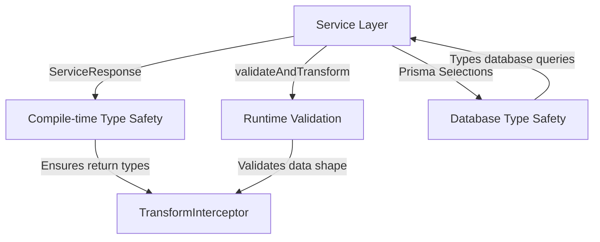

<!-- START doctoc generated TOC please keep comment here to allow auto update -->
<!-- DON'T EDIT THIS SECTION, INSTEAD RE-RUN doctoc TO UPDATE -->
**Table of Contents**  *generated with [DocToc](https://github.com/thlorenz/doctoc)*

- [Type Safety Guide](#type-safety-guide)
  - [Table of Contents](#table-of-contents)
  - [Overview](#overview)
    - [The Problem](#the-problem)
    - [The Solution](#the-solution)
  - [Type-Safe Service Responses](#type-safe-service-responses)
    - [What It Does](#what-it-does)
    - [How It Works](#how-it-works)
      - [1. ServiceResponse Type](#1-serviceresponse-type)
      - [2. createResponse Helper](#2-createresponse-helper)
    - [Example Usage](#example-usage)
    - [Integration with Pagination](#integration-with-pagination)
  - [Runtime Validation](#runtime-validation)
    - [The Problem with `serialize()`](#the-problem-with-serialize)
    - [The Solution: `validateAndTransform()`](#the-solution-validateandtransform)
    - [How It Works](#how-it-works-1)
      - [Step 1: Add Validation Decorators to DTOs](#step-1-add-validation-decorators-to-dtos)
      - [Step 2: Use `validateAndTransform()` in Services](#step-2-use-validateandtransform-in-services)
    - [What Happens When Validation Fails?](#what-happens-when-validation-fails)
    - [When to Use Each Option](#when-to-use-each-option)
  - [Prisma Typed Selections](#prisma-typed-selections)
    - [The Problem](#the-problem-1)
    - [The Solution: Typed Selections](#the-solution-typed-selections)
    - [How It Works](#how-it-works-2)
      - [1. `satisfies Prisma.UserSelect`](#1-satisfies-prismauserselect)
      - [2. `Prisma.UserGetPayload`](#2-prismausergetpayload)
    - [Example: Before vs After](#example-before-vs-after)
    - [Why This Pattern?](#why-this-pattern)
    - [Creating New Selections](#creating-new-selections)
  - [Strict TypeScript Configuration](#strict-typescript-configuration)
    - [Enabled Strict Checks](#enabled-strict-checks)
    - [What Each Check Does](#what-each-check-does)
      - [`strictNullChecks: true`](#strictnullchecks-true)
      - [`noImplicitAny: true`](#noimplicitany-true)
  - [Migration Guide](#migration-guide)
    - [Migrating Existing Services](#migrating-existing-services)
      - [Step 1: Add Return Type](#step-1-add-return-type)
      - [Step 2: Add Validation Decorators to DTO](#step-2-add-validation-decorators-to-dto)
      - [Step 3: Replace `serialize` with `validateAndTransform`](#step-3-replace-serialize-with-validateandtransform)
      - [Step 4: Use `createResponse`](#step-4-use-createresponse)
    - [Migrating Repository Methods](#migrating-repository-methods)
      - [Step 1: Create Typed Selection](#step-1-create-typed-selection)
      - [Step 2: Update Repository Method](#step-2-update-repository-method)
      - [Step 3: Use in Service](#step-3-use-in-service)
  - [Best Practices](#best-practices)
    - [1. Always Define Return Types](#1-always-define-return-types)
    - [2. Create Reusable Selections](#2-create-reusable-selections)
    - [3. Use Strict Validation for Critical Data](#3-use-strict-validation-for-critical-data)
    - [4. Handle Null Checks](#4-handle-null-checks)
  - [FAQ](#faq)
    - [Q: Why not just use Zod?](#q-why-not-just-use-zod)
    - [Q: What's the performance impact of runtime validation?](#q-whats-the-performance-impact-of-runtime-validation)
    - [Q: Do I need to validate every single field?](#q-do-i-need-to-validate-every-single-field)
    - [Q: Can I use Prisma selections for relations?](#q-can-i-use-prisma-selections-for-relations)
  - [Summary](#summary)

<!-- END doctoc generated TOC please keep comment here to allow auto update -->

# Type Safety Guide

This document explains all type safety improvements implemented in the NestJS starter, including type-safe service responses, runtime validation, and Prisma typed selections.

---

## Table of Contents

1. [Overview](#overview)
2. [Type-Safe Service Responses](#type-safe-service-responses)
3. [Runtime Validation](#runtime-validation)
4. [Prisma Typed Selections](#prisma-typed-selections)
5. [Strict TypeScript Configuration](#strict-typescript-configuration)
6. [Migration Guide](#migration-guide)

---

## Overview

### The Problem

Without proper type safety, several issues can occur:

```typescript
// ❌ Problem 1: Service returns 'any'
async getUser(id: string) {
    const user = await this.repo.findById(id)
    return { data: user }  // What type is this? TypeScript doesn't know
}

// ❌ Problem 2: No runtime validation
const response = serialize(UserDto, {
    username: null,  // Should be string, but no error!
    email: undefined // Should be string, but silently passes!
})

// ❌ Problem 3: Prisma returns 'any' with select
const user = await prisma.user.findUnique({
    where: { id },
    select: { username: true, email: true }
})
// TypeScript thinks user is { username: boolean, email: boolean } 😱
```

### The Solution

We implemented **3 layers of type safety**:



---

## Type-Safe Service Responses

### What It Does

Ensures that service methods return **predictable, typed responses** that the `TransformInterceptor` can process.

### How It Works

#### 1. ServiceResponse Type

Located: `src/shared/types/service-response.type.ts`

```typescript
export interface ServiceResponse<T = unknown> {
    message: string   // Human-readable message
    data: T           // Type-safe payload
}
```

**Why?** Before, services returned plain objects with inconsistent structure. Now, TypeScript **enforces** the shape.

There is no code or type: a success needs neither, as the route and the HTTP
status already say what happened. Errors have both
([BACKEND_RESPONSE_HANDLING.md](./BACKEND_RESPONSE_HANDLING.md#error-codes-and-types)).

#### 2. createResponse Helper

```typescript
export function createResponse<T>(message: string, data: T): ServiceResponse<T> {
    return brand({ message, data })
}
```

**Why?** Type-safe builder ensures all fields are present and `data` matches the expected type `T`.

### Example Usage

**Before (unsafe):**
```typescript
async updateProfile(id: string, dto: UpdateDto) {
    const user = await this.repo.update(id, dto)
    
    // ❌ No type safety, inconsistent structure
    return {
        msg: 'Updated',
        data: { username: user.username }
    }
}
```

**After (type-safe):**
```typescript
async updateProfile(
    id: string, 
    dto: UpdateDto
): Promise<ServiceResponse<UpdateProfileResponseDto>> {
    const user = await this.repo.update(id, dto)
    
    // ✅ TypeScript knows exact return type
    return createResponse(
        MESSAGES.USER.PROFILE_UPDATED,
        validateAndTransform(UpdateProfileResponseDto, {
            username: user.username,
            displayName: user.displayName,
            // ... TypeScript enforces this matches UpdateProfileResponseDto
        })
    )
}
```

### Integration with Pagination

**Built on existing `pagination.util.ts`** - no duplication!

```typescript
import { createPaginatedServiceResponse, PaginatedServiceResponse } from '@/shared/types'

async getUsers(
    query: PaginationQueryDto
): Promise<PaginatedServiceResponse<UserDto>> {
    const [items, total] = await this.repo.findAndCount(query)
    
    return createPaginatedServiceResponse(
        'Users fetched successfully',
        items,
        query.page,
        query.limit,
        total
    )
    // Returns: ServiceResponse<{ items: UserDto[], meta: PaginationMeta }>
}
```

---

## Runtime Validation

### The Problem with `serialize()`

**Before:** `serialize()` only transforms, **does NOT validate**:

```typescript
const response = serialize(UserDto, {
    username: null,        // ❌ Should be string
    email: 'not-an-email', // ❌ Should be valid email
})
// No error! Malformed data sent to client 😱
```

### The Solution: `validateAndTransform()`

Located: `src/shared/utils/serializer.util.ts`

```typescript
export function validateAndTransform<T extends object, V>(
    cls: ClassConstructor<T>,
    plain: V,
    options?: ValidateAndTransformOptions
): T {
    // 1. Transform plain object to class instance
    const instance = plainToInstance(cls, plain, {
        excludeExtraneousValues: true,
        enableImplicitConversion: true
    })

    // 2. Validate using class-validator decorators
    const errors = validateSync(instance, {
        skipMissingProperties: true,   // Allow optional fields
        skipNullProperties: true,
        skipUndefinedProperties: true
    })

    // 3. Log warnings or throw if validation fails
    if (errors.length > 0) {
        const errorMessage = formatValidationErrors(errors)
        
        if (options?.throwOnError) {
            throw new Error(errorMessage)  // Crash on critical data
        }
        
        logger.warn(errorMessage)  // Log warning, allow graceful degradation
    }

    return instance
}
```

### How It Works

#### Step 1: Add Validation Decorators to DTOs

```typescript
import { Exclude, Expose } from 'class-transformer'
import { IsString, IsEmail, IsOptional, MaxLength } from 'class-validator'

@Exclude()
export class UpdateProfileResponseDto {
    @Expose()
    @IsOptional()          // ← Runtime check: can be missing or null
    @IsString()            // ← Runtime check: must be string
    @MaxLength(50)         // ← Runtime check: max 50 chars
    username: string | null

    @Expose()
    @IsOptional()
    @IsString()
    @MaxLength(100)        // ← Runtime check: max 100 chars
    displayName: string | null

    // ... avatarUrl, bio (see update-profile.response.dto.ts)
}
```

#### Step 2: Use `validateAndTransform()` in Services

```typescript
async updateProfile(id: string, dto: UpdateDto) {
    const user = await this.repo.update(id, dto)
    
    // ✅ Validates at runtime before sending to client
    const responseData = validateAndTransform(UpdateProfileResponseDto, {
        username: user.username,       // Checked: must be string, max 50 chars
        displayName: user.displayName  // Checked: must be string, max 100 chars
    })
    
    return createResponse(/*...*/, responseData)
}
```

### What Happens When Validation Fails?

**Default behavior (throwOnError: false):**
```typescript
// If a bug upstream let a 60-character username through:
validateAndTransform(UpdateProfileResponseDto, {
    username: 'x'.repeat(60)  // ❌ Violates @MaxLength(50) (null would pass: the field is @IsOptional)
})

// Logs warning:
// ⚠️ "Response DTO validation failed for UpdateProfileResponseDto: 
//     username: username must be shorter than or equal to 50 characters"

// Still returns the object (graceful degradation)
```

**Strict mode (throwOnError: true):**
```typescript
validateAndTransform(PaymentDto, data, { throwOnError: true })
// If validation fails → throws Error (crashes the request)
// Use for critical endpoints like payments, auth
```

### When to Use Each Option

| Scenario | throwOnError | Why |
|----------|--------------|-----|
| User profiles, public data | `false` (default) | Graceful degradation, log for debugging |
| Payments, financial data | `true` | Never send malformed financial data |
| Admin endpoints | `false` | Allow admins to see data, log issues |

**What the starter itself does:** no route passes `throwOnError: true`
today, the auth routes included (`TokenResponseDto` and
`AuthOptionsResponseDto` use the default). Their data is not read from a user
or an outside system: it is a token the API has just signed, or settings it
holds, so a validation failure there is a bug the integration tests catch
rather than bad data at run time. Switch a route to `true` when it returns
data whose shape you do not control and a malformed answer would do harm.

---

## Prisma Typed Selections

> **This is likely new to you!** Prisma selections with `satisfies` + `Prisma.UserGetPayload` is a pattern for type-safe partial queries.

### The Problem

**Without typed selections:**

```typescript
// ❌ What type is user?
const user = await prisma.user.findUnique({
    where: { id },
    select: {
        username: true,
        email: true
    }
})
// TypeScript thinks: { username: boolean, email: boolean } 😱
// Actually returns: { username: string, email: string }
```

Prisma's `select` returns `any` or wrong types because TypeScript can't infer the shape.

### The Solution: Typed Selections

> **In use in servers' `membership.selections.ts`**: `membershipSelect`, what
> every member's view of a server is decided from, its row type derived as below,
> and `toMembership`, which reads that row. The users module maps every row through
> `UserMapper` into a domain entity, so it barely uses `select` at all. The
> pattern below is here for when you add a query that does — a list endpoint
> returning a handful of columns, say — because the first instinct (an inline
> `select`) is the one that loses the types.

Put them next to the repository that uses them, e.g.
`src/modules/users/infrastructure/persistence/user.selections.ts`:

```typescript
// The client is generated into generated/prisma/ (Prisma 7), not node_modules
import { Prisma } from '@/generated/prisma/client'

/**
 * Selection for user preferences
 */
export const userPreferencesSelect = {
    id: true,
    username: true,
    displayName: true,
    avatarUrl: true,
    bio: true,
    completedAt: true
} satisfies Prisma.UserSelect
//   ^^^^^^^^^ TypeScript validates this is a valid User selection

/**
 * Type derived from the selection
 */
export type UserPreferences = Prisma.UserGetPayload<{
    select: typeof userPreferencesSelect
}>
// UserPreferences = {
//     id: string
//     username: string | null
//     displayName: string | null
//     avatarUrl: string | null
//     bio: string | null
//     completedAt: Date | null
// }
```

### How It Works

#### 1. `satisfies Prisma.UserSelect`

```typescript
const userPreferencesSelect = {
    id: true,
    username: true,
    invalidField: true  // ❌ TypeScript error: not a User field!
} satisfies Prisma.UserSelect
```

- **Validates** the selection object at compile-time
- Prevents typos and invalid field names
- Ensures all fields actually exist in the Prisma schema

#### 2. `Prisma.UserGetPayload`

```typescript
export type UserPreferences = Prisma.UserGetPayload<{
    select: typeof userPreferencesSelect
}>
```

- **Derives the exact return type** from the selection
- TypeScript knows which fields are included
- Knows which fields are nullable based on Prisma schema

### Example: Before vs After

**Before (unsafe):**

```typescript
// In repository
async updateWithSelect(id: string, data: any, select: any): Promise<any> {
    return this.prisma.user.update({ where: { id }, data, select })
}

// In service
const user = await this.repo.updateWithSelect(id, dto, {
    id: true,
    username: true,
    displayName: true,
    // ... inline, no reuse, no type safety
})
// user is 'any' - no autocomplete, no type checking
```

**After (type-safe):**

```typescript
// In repository (with generics)
async updateWithSelect<T extends Prisma.UserSelect>(
    id: string,
    data: Prisma.UserUpdateInput,
    select: T
): Promise<Prisma.UserGetPayload<{ select: T }>> {
    return this.prisma.user.update({ where: { id }, data, select })
}

// In service
import { userPreferencesSelect, UserPreferences } from './user.selections'

const user = await this.repo.updateWithSelect(
    id,
    dto,
    userPreferencesSelect  // ← Reusable, validated selection
)
// ✅ user is typed as UserPreferences
// ✅ Autocomplete works
// ✅ TypeScript catches errors
```

### Why This Pattern?

1. **Reusability**: Define selection once, use everywhere
2. **Type Safety**: TypeScript knows exact shape of returned data
3. **Maintainability**: Change selection in one place
4. **Performance**: Only fetch needed fields from database
5. **Documentation**: Selection objects serve as documentation

### Creating New Selections

```typescript
// 1. Define selection with 'satisfies'
export const userPublicInfoSelect = {
    id: true,
    username: true,
    avatarUrl: true
} satisfies Prisma.UserSelect

// 2. Derive type with Prisma.UserGetPayload
export type UserPublicInfo = Prisma.UserGetPayload<{
    select: typeof userPublicInfoSelect
}>

// 3. Use in repository/service
const users = await prisma.user.findMany({
    select: userPublicInfoSelect
})
// users: UserPublicInfo[]
```

---

## Strict TypeScript Configuration

### Enabled Strict Checks

Located: `tsconfig.json`

```json
{
    "compilerOptions": {
        // Core strict mode checks
        "strictNullChecks": true,        // Catch null/undefined bugs
        "noImplicitAny": true,           // No implicit 'any' types
        "strictBindCallApply": true,     // Type-check bind/call/apply
        "strictFunctionTypes": true,     // Stricter function types
        "noImplicitThis": true,          // Catch 'this' issues
        
        // Code quality
        "forceConsistentCasingInFileNames": true,
        "noFallthroughCasesInSwitch": true,
        "noUnusedLocals": true,
        
        // Disabled for DX
        "strictPropertyInitialization": false,  // DI makes this annoying
        "noUnusedParameters": false             // Decorators need unused params
    }
}
```

### What Each Check Does

#### `strictNullChecks: true`

```typescript
// ❌ Before
function getUser(id: string) {
    const user = await repo.findById(id)  // Could be null
    return user.username  // No error, crashes at runtime!
}

// ✅ After
function getUser(id: string) {
    const user = await repo.findById(id)  // user: User | null
    if (!user) {
        throw new Error('User not found')  // Must handle null
    }
    return user.username  // Safe!
}
```

#### `noImplicitAny: true`

```typescript
// ❌ Before
function processData(data) {  // data is implicitly 'any'
    return data.value  // No autocomplete, no safety
}

// ✅ After
function processData(data: UserDto) {  // Explicit type required
    return data.value  // TypeScript validates 'value' exists
}
```

---

## Migration Guide

### Migrating Existing Services

#### Step 1: Add Return Type

```typescript
// Before
async getUser(id: string) {
    // ...
}

// After
async getUser(id: string): Promise<ServiceResponse<UserDto>> {
    // ...
}
```

#### Step 2: Add Validation Decorators to DTO

```typescript
import { IsString, IsOptional } from 'class-validator'

@Exclude()
export class UserDto {
    @Expose()
    @IsString()
    username: string
    
    @Expose()
    @IsOptional()
    @IsString()
    bio?: string
}
```

#### Step 3: Replace `serialize` with `validateAndTransform`

```typescript
// Before
const data = serialize(UserDto, user)

// After
const data = validateAndTransform(UserDto, user)
```

#### Step 4: Use `createResponse`

```typescript
// Before
return { message: '...', data }

// After
return createResponse('Operation successful', data)
```

### Migrating Repository Methods

#### Step 1: Create Typed Selection

```typescript
// In user.selections.ts
export const userBasicSelect = {
    id: true,
    username: true,
    email: true
} satisfies Prisma.UserSelect

export type UserBasic = Prisma.UserGetPayload<{
    select: typeof userBasicSelect
}>
```

#### Step 2: Update Repository Method

```typescript
// Before
async findByIdWithSelect(id: string, select: any): Promise<any> {
    return this.prisma.user.findUnique({ where: { id }, select })
}

// After
async findByIdWithSelect<T extends Prisma.UserSelect>(
    id: string,
    select: T
): Promise<Prisma.UserGetPayload<{ select: T }> | null> {
    return this.prisma.user.findUnique({ where: { id }, select })
}
```

#### Step 3: Use in Service

```typescript
// Before
const user = await this.repo.findByIdWithSelect(id, {
    id: true,
    username: true
})
// user: any

// After
import { userBasicSelect, UserBasic } from './user.selections'

const user = await this.repo.findByIdWithSelect(id, userBasicSelect)
// user: UserBasic | null
```

---

## Best Practices

### 1. Always Define Return Types

```typescript
// ❌ Bad
async getUser(id: string) {
    // ...
}

// ✅ Good
async getUser(id: string): Promise<ServiceResponse<UserDto>> {
    // ...
}
```

### 2. Create Reusable Selections

```typescript
// ❌ Bad - Inline selections
const user1 = await repo.findUnique({
    select: { id: true, username: true }
})
const user2 = await repo.findMany({
    select: { id: true, username: true }  // Duplicated!
})

// ✅ Good - Reusable selection
const users = await repo.findMany({
    select: userBasicSelect
})
```

### 3. Use Strict Validation for Critical Data

```typescript
// For payments and financial data you did not produce yourself
validateAndTransform(PaymentDto, data, { throwOnError: true })

// For user profiles, public data
validateAndTransform(UserDto, data)  // Default: logs warnings
```

### 4. Handle Null Checks

```typescript
// ❌ Bad
const user = await repo.findById(id)
return user.username  // Crashes if user is null!

// ✅ Good
const user = await repo.findById(id)
if (!user) {
    throw new CustomException({ ... })
}
return user.username  // Safe
```

---

## FAQ

### Q: Why not just use Zod?

**A:** Zod is great for new projects, but:
- class-validator is NestJS standard (built-in ValidationPipe)
- Already integrated throughout the codebase
- Migration would be significant effort

Consider Zod for your next project!

### Q: What's the performance impact of runtime validation?

**A:** Minimal for typical usage:
- Validation runs **after** database queries (not in hot path)
- Only validates response DTOs (small objects)
- ~1-2ms per validation for typical DTOs
- Can disable in production if needed

### Q: Do I need to validate every single field?

**A:** Focus on:
- ✅ Critical fields (email, username, IDs)
- ✅ Fields with business rules (max length, format)
- ❌ Don't over-validate internal IDs, timestamps
- ❌ Skip validation for trivial fields

### Q: Can I use Prisma selections for relations?

**A:** Yes!

```typescript
export const userWithPostsSelect = {
    id: true,
    username: true,
    posts: {
        select: {
            id: true,
            title: true,
            createdAt: true
        }
    }
} satisfies Prisma.UserSelect

export type UserWithPosts = Prisma.UserGetPayload<{
    select: typeof userWithPostsSelect
}>
```

---

## Summary

| Feature | Location | Purpose |
|---------|----------|---------|
| `ServiceResponse<T>` | `src/shared/types/service-response.type.ts` | Type-safe service returns |
| `createResponse()` | `src/shared/types/service-response.type.ts` | Type-safe response builder |
| `validateAndTransform()` | `src/shared/utils/serializer.util.ts` | Runtime validation |
| Typed Selections | next to the repository, `src/modules/<module>/infrastructure/persistence/*.selections.ts` (servers' `membership.selections.ts`) | Type-safe Prisma queries |
| Strict Mode | `tsconfig.json` | Compile-time type safety |

**Result:** Fewer bugs, better DX, safer production code! 🎉
